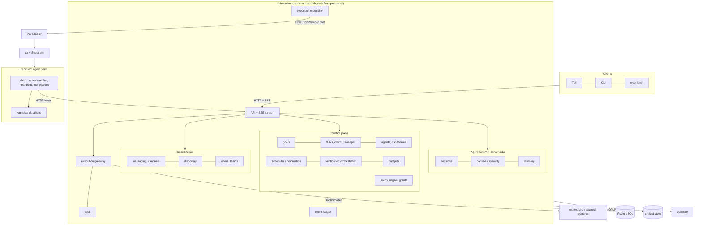
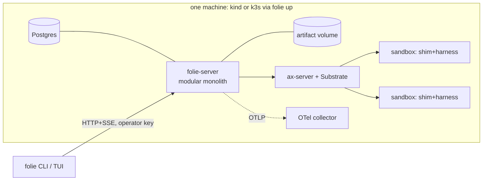

# Folie

A general-purpose, self-organizing autonomous execution environment: humans and AI agents pursue arbitrary objectives together, discover and coordinate work, assemble teams, acquire capabilities, execute, verify outcomes, and keep persistent identities. Coding is one application, not the definition.

**Status 2026-11-04.** This document is the authoritative architectural overview and **the target**. What exists today is a message-driven fleet of persistent agents (the runtime layer): see [`architecture/current-system.md`](architecture/current-system.md), the as-built reference, which also records where the previous design text disagreed with the code. Everything marked *target*, *planned* or *proposed* below is **not built**. Nothing in the repository's code was changed by this evolution.

**Documentation map.**

| Document | Contents |
| --- | --- |
| `DESIGN.md` (this file) | Vision, terminology, principles, current state, target architecture, summaries of every subsystem, requirements and conformance, evaluation, deployment, risks |
| [`architecture/current-system.md`](architecture/current-system.md) | The system as built: invariants, config, HTTP API, replay safety, observability, egress, ax and pi facts, verified discrepancies |
| [`architecture/agents-and-execution.md`](architecture/agents-and-execution.md) | Identity, sessions, memory, context assembly, harness switching, workspace lifecycle, execution boundary |
| [`architecture/work-and-coordination.md`](architecture/work-and-coordination.md) | Goals, tasks, communication/coordination/organization, verification subsystem |
| [`architecture/governance-and-resources.md`](architecture/governance-and-resources.md) | Trust profiles, authority, risk, gateway, kill switch, physical world, budgets, scheduling, threat model |
| [`architecture/integration.md`](architecture/integration.md) | Capabilities, tools, extensions |
| [`architecture/observability-and-clients.md`](architecture/observability-and-clients.md) | OpenTelemetry, metrics, TUI and client architecture |
| [`spec/domain-model.md`](spec/domain-model.md) | Entities, aggregates, state machines, logical schema, transactions, migration |
| [`spec/protocols.md`](spec/protocols.md) | Authentication, messaging, claims, discovery, negotiation, teams, verification, gateway, budgets, recovery |
| [`spec/interfaces.md`](spec/interfaces.md) | Harness, execution provider, tool/verifier/capability providers, policy, stores, extension manifest, HTTP API, tool surface |
| [`decisions/`](decisions/README.md) | ADRs, fate of the 19 existing decisions, the twenty questions, open questions |
| [`spec/requirements.md`](spec/requirements.md) | **The normative specification**: 96 requirements bound to tests, demonstrations, exclusions |

## 1. Vision and non-goals

**Vision.** Infrastructure in which agents and humans collaboratively pursue objectives (mathematical or scientific research, biological or engineering investigation, software development, business workflows, reports and analyses, interaction with external systems through authorized tools, eventually physical machinery through independently safe interfaces) **without a predefined agent hierarchy or fixed roles.** The system provides primitives from which agents organize themselves around the work.

**Central principle: decentralized intelligence and coordination, centralized guarantees and governance.** Agents have real autonomy over reasoning, task discovery, delegation, collaboration and team formation. The runtime keeps deterministic authority over identity, durable state, execution, permissions, resource consumption, task ownership, verification requirements and safety boundaries. Autonomy is not the absence of infrastructure guarantees, and emergence is not assumed to follow from messaging ([§9](#9-coordination-and-self-organization)).

**Non-goals.**

- Not a coding-agent framework, and no repository model in the core.
- Not a fixed manager/worker or CEO hierarchy (it remains *expressible*, as an evaluation baseline).
- Not a universal verifier, a universal goal schema, or a universal planner. The runtime understands structure, never the meaning of a goal.
- Not a distributed system before one machine demands it: no Kubernetes-native rewrite, microservices, service mesh or consensus without a measured need ([§24](#24-deployment-architecture)).
- Not a promise of physical-world safety: physical execution needs an independent safety architecture that sits outside this system and outside any LLM ([§13](#13-security-and-governance)).
- Not a replacement for ax: ax is consumed, never patched (Decision 1).

## 2. Terminology and core domain concepts

The four primary concepts are **Swarm → Goals → Tasks → Agents**, defined independently.

| Term | Definition | Is not |
| --- | --- | --- |
| **Swarm** | A collaborative execution environment: agents, humans, tools, resources and objectives coexist; shared channels, artifacts, policies, integrations. Rows carry `swarm_id`; one swarm (multi-swarm is excluded) | A fixed team |
| **Goal** | A persistent objective: natural-language description, acceptance criteria, constraints and exclusions, budget, deadline, priority, references, verification requirements, approval requirements; versioned by **revisions**; can be paused, resumed, cancelled, superseded, evaluated | A task list; a flag an agent sets |
| **Task** | A unit of work under a goal, dynamically proposed by any permitted principal, with dependencies, a verification **contract**, resource and capability requirements, and a lifecycle; held by at most one owner through a fenced **claim** | A node in a static DAG |
| **Agent** | A persistent participant with an identity independent of process, session, harness, model, workspace and assignment; has config, capabilities, grants, limits, memory and communication endpoints | A process, container, session or model |
| **Principal** | An authenticated acting identity: agent execution, human, system component, extension | A name taken from a request body |
| **Message / delivery / publication** | A *publication* is the sender-side event; a *message* row is one *delivery* to one recipient's durable inbox | A socket write |
| **Channel** | `dm`, `topic`, `goal`, `task` or `team` conversation space with history | Memory |
| **Session** | One bounded unit of reasoning: fresh context, one scope, one settlement | An identity or a memory |
| **Execution** | One provider-level run of the agent shim (an ax Task today) | The agent |
| **Workspace** | Files visible at `/workspace` | Durable memory |
| **Claim / lease / fence** | A hold on a task; its time-limited validity; the monotonic number that makes a stale holder's writes fail | A message |
| **Team** | A scoped, temporary set of agents with a channel, budget slice and context pack | An org-chart node |
| **Capability** | What an agent can meaningfully do, with an evidence level | A permission or a tool |
| **Tool** | A typed interface through which an action happens (local or gateway) | A capability |
| **Permission (grant, policy)** | What a principal is authorized to do | Something a model can assign itself |
| **Execution provider** | Where and how a thing runs (AX today) | A domain concept |
| **Harness** | The agent implementation inside an execution (pi today) | The agent |
| **Artifact** | An immutable, content-addressed output with provenance | A file in a sandbox |
| **Memory** | Scoped, immutable, provenance-bearing entries (agent, task, team, goal, swarm) | A transcript |
| **Verification** | Independent checks against a contract | The producer's report |
| **Ledger** | Append-only event history written in the transaction that changed state | The state store, or telemetry |
| **Communication / coordination / organization** | Exchanging information / aligning actions and avoiding conflict / forming, changing and dissolving structures | Synonyms |

## 3. Architectural principles and invariants

**Principles** (the brief's, kept as design rules):

1. Preserve useful foundations: durable inboxes, persistent names, server-authoritative state, ax, the TUI.
2. Decentralize intelligence, not invariants.
3. Separate identity from execution; memory from conversation; capabilities from permissions; reported outcomes from verified outcomes; communication from coordination from organization.
4. Prefer durable, explicit, observable state transitions.
5. Make concurrency safe (conditional updates, leases, fencing, idempotency).
6. OTel is observability; the database and ledger are the record.
7. Keep infrastructure replaceable (Pi, AX, Postgres, model providers); keep the system composable; avoid premature complexity.

**Invariants.** Breaking one breaks the design. Items 1–5, 7–9 are **in force today**; items marked *target* are not built.

1. **ax is only consumed, never patched.** In the target it is one `ExecutionProvider`.
2. **folie-server is the only process with Postgres credentials.** Sandboxes reach state only through its API.
3. **The only wake is a delivery in an inbox** (goal assignment, delegation, nomination, offer, approval result, control: all deliveries). Priority decides *whether* a suspended agent wakes (`low` does not).
4. **A session is bounded**: fresh context, one scope, one settlement. Memory is the memory service and artifacts, not chat history.
5. **A delivery is acked only by its session's settlement.** A dead session returns it.
6. *(revised)* **A failed session is not retried; a task has an attempt policy.** Lease expiry and environment failures re-open the task for a new claim up to `max_attempts`; agent-reported non-retryable failure and exhausted attempts park it `failed`. Only delivery of a finished report is resent.
7. **Side effects are journaled before they run**, tagged `replay: safe|never`, and sent with deterministic idempotency keys; no exactly-once claim outside Postgres.
8. **Traces are not the record.** Postgres and the ledger are.
9. **Trust is explicit and per profile.** Full trust inside the sandbox is the `dev-full-trust` profile; limits that matter live outside it.
10. *(target)* **Identity comes from the credential, never the request.** Without this, invariants 11–14 are meaningless.
11. *(target)* **Ownership is single and every mutation by an owner is fenced.** A stale holder's writes fail whether or not it obeys a stop message.
12. *(target)* **Completion is a claim until verified.** `submitted`, `completed`, `verified` and `achieved` are four different facts.
13. *(target)* **An agent can never widen its own authority, create agents outside policy, or evade a budget by delegation.** Grants delegate downward only; spawning and delegating are carve-outs.
14. *(target)* **Every state transition appends exactly one ledger event in the same transaction.**
15. *(target)* **Every time-dependent decision uses the database clock.**

## 4. Current-state assessment of Folie

Verified 2026-11-04 by reading `src/` against the previous design text and running the suites: `bun run test` 383 passed and 11 skipped across 27 files, `bun run test:tui` 11 passed, `bunx tsc -p .` clean. No cluster was started; earlier "verified live" claims were not re-run. Detail and evidence: [`architecture/current-system.md`](architecture/current-system.md).

| Class | Items |
| --- | --- |
| **Implemented and tested** (PGlite, in-memory fakes) | Goal queue → pool dispatch → wake → bounded session → report; durable direct and topic mail with idempotent sends; peer delegation; elastic lifecycle (idle suspend, retire, operator ops); mid-session steering at turn boundaries; transcript and artifact events; replay safety (journal, `replay` tags, idempotency keys); OpenTelemetry tracing, metrics, JSON logs, OTLP pass-through gateway; operator TUI view-models and OpenTUI app (in-memory renderer); `folie up` manifest generation; CLI |
| **Implemented, insufficiently tested** | pi against a real provider (only a `401` ever seen; real work unexercised); the controller against real ax and Substrate (tests use `FakeAx`/`FakeEgress`); OTLP gateway against a real collector; `folie up` end to end; concurrent writers (no multi-connection race tests); TUI in a real terminal beyond the in-memory renderer; agent-initiated `topic_publish` live |
| **Implemented but wrong or unsafe** | D1 unauthenticated API with self-asserted identity (any pod can impersonate or delete any agent); D2 unbounded agent creation by messaging new names; D3 `wake_epoch` is a counter, not a fence; D4 `failed` work-item state unreachable; D5 `done` is the agent's say-so; D6 sessions recorded only at report; D8 ax `Workspace` and resource limits unused, no `ListTasks`; D9 single-process loop assumed; D10 no cancellation reaches a running session; D11 spend recorded at session end only |
| **Planned, not implemented** | Everything in §5–§22 except the foundations above: goals and tasks, claims and fencing, verification, capabilities, teams, policy, gateway, budgets, harness contract, execution-provider port, event ledger, SSE, artifact store, memory service, extensions |
| **Proposed, unresolved** | [OQ1–OQ13](decisions/README.md#open-architectural-questions): workload identity, workspace archive of suspended executions, LLM proxy feasibility, vector retrieval, verifier validity, ledger tamper-evidence, loop topology, GenAI conventions, OIDC/multi-swarm, memory poisoning, reputation, budget hot rows, UI extensions |
| **Previously deferred, now required or excluded** | Blob storage (required: artifact store, R-4.4), backlog-aware scaling beyond one goal per agent (superseded by the scheduler), deleting retired agent rows, TUI mouse selection (push updates are required, R-15.6), reconnecting a dropped port-forward, multi-VPC operation, `ax ssh` hop-in, tools-as-CLI |

**Where documentation and code disagreed, the code is the current state** (D1–D12 in the as-built reference; three fixes to the old text: messages are not forge-proof, work items have no priority/context columns, ax `Workspace` is not bound to tasks).

**Existing decisions worth preserving** (all in [`decisions/README.md`](decisions/README.md#what-happened-to-the-existing-decisions)): ax consumed not patched; brokered durable messages; inbox-as-wake; server as sole writer; bounded sessions; replay safety and idempotency keys; trace context on rows; telemetry only through the server; fail-fast covering work not delivery. **Revised:** full trust becomes a profile; one-shot failure becomes session-level; artifact bytes leave `/workspace`; pi becomes one harness.

## 5. Target architecture

A **modular monolith**: one deployable server with enforced internal module boundaries, plus the agent shim in each sandbox. The brief's seven layers are adopted with two changes made after inspecting dependencies: *Agent Runtime* splits into the part that runs **in the sandbox** (shim + harness) and the part that runs **in the server** (session registry, context assembly, memory), because that is the real trust boundary; and *Coordination* is not a separate deployable but modules (`messaging`, `discovery`, `negotiation`, `teams`) over the same transaction scope as the task machinery, since claims and nominations must commit atomically with state.

**Dependency rule** ([interfaces §1](spec/interfaces.md#1-layering-and-the-dependency-rule)): `domain` imports nothing infrastructural (no Pi, AX, OTel, Postgres); `ports` are interfaces over the domain; `app` use cases depend on ports and may use the OTel *API* behind `Observability`; adapters implement ports and import their vendor SDK; composition roots wire everything. A test enforces it. Abstractions exist only where a second implementation is foreseeable now: `Store`, `ExecutionProvider`, `Harness`, `ToolProvider`, `VerifierAdapter`, `ArtifactStore`, `MemoryStore`, `Observability`, `PolicyEngine` (pure).

## 6. Component responsibilities and interfaces

| Component (layer) | Owns | Depends on (ports) | Today |
| --- | --- | --- | --- |
| **API + stream** (client) | routing, authentication, request envelope, SSE over the ledger | `app`, `Store` | `http.ts`, no auth |
| **goals, tasks** (control) | goal/task state machines, claims, leases, fences, sweeper, dependency counters, plan changes | `Store`, ledger, policy, budgets | flat `work_items` |
| **agents, capabilities** (control) | identity, profiles, credentials, grants, capability levels and evidence | `Store` | names + state |
| **scheduler** (control) | nomination and assignment scoring; admission; caps | `Store` | `pool.ts` |
| **verification** (control) | contracts, acceptance job, verify tasks, adapters, aggregation, audits | `Store`, `VerifierAdapter`, `ExecutionProvider` | none |
| **budgets** (control) | tree, carve-out, reserve/commit, enforcement | `Store` | usage recorded |
| **policy** (control) | pure decision function over a snapshot | none | none |
| **messaging, discovery, negotiation, teams** (coordination) | deliveries, channels, control signals, nominations, offers, teams | `Store` | inbox, topics |
| **sessions, context, memory** (runtime, server side) | session registry, context pack, scoped memory | `Store`, `MemoryStore` | session events, reports |
| **shim + harness** (runtime, in sandbox) | session loop, control watcher, heartbeats, hosted tool pipeline, harness | HTTP API, `Harness` | `AgentLoop`, `PiRuntime` |
| **execution reconciler** (execution) | desired/recorded/actual comparison, wake, suspend, retire, loss recovery | `ExecutionProvider` | `Controller` |
| **gateway, vault** (integration) | all effects outside the sandbox; credentials | `ToolProvider`, policy, budgets | none |
| **ledger** (persistence) | append-only history and client feed | `Store` | none |
| **observability** (persistence) | spans, metrics, logs | `Observability` | `telemetry.ts` |

Interfaces: [`spec/interfaces.md`](spec/interfaces.md). Each component's state, invariants and failure behaviour are in the architecture documents, each of which closes with a "Requirements" section naming its requirement ids and a "Tests" section; protocols state failure behaviour per protocol.

## 7. Agent identity, lifecycle, sessions and memory

Full treatment: [`architecture/agents-and-execution.md`](architecture/agents-and-execution.md). Summary:

- **Six records, six lifecycles:** agent (`active|paused|retired`), execution (`provisioning → running ⇄ suspended → terminated`, `failed`, `lost`), workspace (`active → archived → destroyed`), session (`running → settled|abandoned`), task claim, memory entry. Today `agents.state` conflates the first two.
- **Identity** is the name plus the `agents` row; model, harness and limits are config fetched per session. Registration by operator or capacity grant; retirement leaves a tombstone; restoration is an admin event.
- **Sessions** stay disposable and bounded. Created at start (not report), rescope once from triage to task, continuation sessions on the same claim, limits and cancellation, transcript never replayed as memory.
- **Memory** has layers (working context, agent, task, team, goal, swarm, artifacts), immutable entries with provenance, contradiction by link, access control inside the query, and a **context assembler** that builds a token-budgeted, harness-neutral pack. Goal knowledge defaults to goal scope; only `portable` agent entries cross goals.
- **Harness switching** costs nothing between sessions because context is neutral; mid-session switching is unsupported.
- **Durability rule:** anything that must outlive a workspace is `artifact_put` or `memory_write`.

## 8. Goal and task models

Full treatment: [`architecture/work-and-coordination.md`](architecture/work-and-coordination.md); machines and schema: [`spec/domain-model.md`](spec/domain-model.md) §4–§5.

**Goal** `draft → pending_approval → active ⇄ paused → evaluating → achieved | failed`; any non-terminal → `cancelled | superseded`. `achieved` only by goal evaluation. Revisions append, flag stale tasks and never rewrite history.

**Task** `proposed → accepted → available → claimed → running → submitted → completed → verified`, with `blocked`, `failed`, `rejected`, `cancelled`, `superseded` and retry edges; twenty transitions, each with an actor, guard and effect ([domain model §4.2](spec/domain-model.md#42-task)). Authority: **holder** (start, submit, block, fail, release), **runtime** (accept in auto mode, promote, expire, accept results, aggregate verification), **owner/human** (accept, cancel, supersede, revoke, reopen), **verifier** (verdicts). Terminal success is `verified`, or `completed` when the contract declares no verification, shown as unverified.

The graph is **evolving, not a static DAG**: typed edges (`hard|soft|informs`, `needs completed|verified`), atomic `plan.change`, explicit non-cascading supersession, stale-input and stale-revision guards, and an initial `plan` task that is an ordinary task, not a manager. Runaway limits (depth 4, fan-out 8, frontier WIP 32, rate, dedup) and shrinking budgets bound generation.

## 9. Coordination and self-organization

Full treatment: [`architecture/work-and-coordination.md`](architecture/work-and-coordination.md#communication-coordination-organization); protocols: [`spec/protocols.md`](spec/protocols.md) §2–§7.

| Layer | Mechanisms | Authority | Today |
| --- | --- | --- | --- |
| **Communication** | Durable inboxes, direct/topic/goal/task/team channels, priority and expiry, publication separate from delivery, urgent delivery through a control watcher, authenticated provenance | runtime delivers, agents decide content | partial |
| **Coordination** | Task graph; claims, leases, fences; nomination plus pull discovery; offers, bids, handoff; dedup; stall and loop detection; budgets | **runtime decides** by conditional updates; agents propose | none |
| **Organization** | Teams, capacity requests, delegation with budget carve-out, participation, reputation-weighted nomination | runtime enforces bounds; agents choose structure | none |

Messaging does not by itself produce organization; five mechanisms do: a shared queryable work representation, cheap safe commitment and release, cheap discovery, resource accountability, and verified outcomes feeding back into nomination. Every organizing act is bounded and metered, and each mechanism is switchable so its value is **measured against baselines**, not assumed.

Answers to the coordination questions: **discovery is hybrid** (bounded nomination push plus indexed pull) ([ADR 0001](decisions/0001-hybrid-discovery-runtime-claims.md)); **only a delivery wakes an agent**, and urgent mail reaches a running session in about a second via the shim's control watcher; **negotiation is TTL'd messages and every outcome is one conditional update**, under six anti-deadlock rules; **a task has one owner plus participants**; **agents request capacity, they do not create agents** ([ADR 0002](decisions/0002-agents-request-capacity.md)); **teams share a context pack, not a transcript**.

## 10. Harness abstraction

Contract: [`spec/interfaces.md` §4](spec/interfaces.md#4-harness); decision: [ADR 0006](decisions/0006-harness-and-execution-boundaries.md).

`Harness.start(SessionStart, HarnessHost) → RunHandle {result, deliver?, cancel, snapshot?}` with a capability descriptor. **Universal:** start, result, cancel (a harness without it is killed), structured events for tool calls and session boundaries, session-level usage. **Optional with defined degradation:** mid-run delivery (else queued to the next session), turn-level usage (else E1 budget cutoff is session-granular), snapshot, native replay declarations. **Tool dispatch (journal, span, replay policy, fence, redaction) is hosted once in the shim**, so a new harness inherits it. Pi's concepts (`AgentTool`, `steer`, `finishTurn`) live only in the Pi adapter, which maps `deliver` to `steer` and `cancel` to `Agent.abort()`. Out-of-process harnesses use the same contract over JSON-RPC (R-10.5). `echo` is the conformance harness.

## 11. Capability and tool systems

Full treatment: [`architecture/integration.md`](architecture/integration.md). **Capability** (competence, with evidence levels `declared → assessed → verified`), **tool** (typed, versioned interface; `local` or `gateway`), **permission** (grants and policy), **execution provider** (where it runs) are four different things; a capable agent may lack permission, and a permitted tool runs somewhere specific.

Capability claims are not proof: self-declaration admits only low-risk tasks; levels come from probes and from an independence-enforced verification track record (Wilson lower bound, decay, revocation streak). Tools carry typed schemas, versions, risk class, idempotency, replay policy, timeouts, cost model, redaction; the gateway applies auth, policy, budget, journal and audit uniformly. The model-visible tool surface is deliberately small (rare operations go through the `folie` CLI in `bash`).

## 12. Execution-provider abstraction

Contract: [`spec/interfaces.md` §5](spec/interfaces.md#5-execution-provider); boundary table: [agents-and-execution](architecture/agents-and-execution.md#execution-provider-boundary).

`ExecutionProvider { ensure, start, suspend, terminate, inspect, list, setNetworkPolicy, logs? }` plus declared capabilities (suspend, checkpoint, list, resource limits, network model, in-flight cancel). The **AX adapter** is the only code that knows `atespace`, `Task` or `actor`. **Folie owns** what ax lacks: TTLs, timeouts, spend caps, in-flight cancellation (cooperative at the shim, forced by `suspend`/`terminate`), workspace archive and the retire gate, loss detection (desired vs recorded vs `ListTasks` actual), egress profile, per-session config (tasks are immutable), credentials (token generations). A lost execution revokes leases immediately, abandons the session, returns deliveries, restores the workspace from the best source and leaves in-flight effects `unknown` for reconciliation. Distinct lifecycles for logical agent, execution, session, workspace, sandbox and checkpoint are recorded separately.

## 13. Security and governance

Full treatment: [`architecture/governance-and-resources.md`](architecture/governance-and-resources.md); decisions: [ADR 0005](decisions/0005-authenticated-principals.md), [ADR 0007](decisions/0007-gateway-credentials-budgets.md). **A model's output is a request, never an authorization.**

- **Trust profiles.** Today's `dev-full-trust` behavior is explicitly nonconforming: it allows unmediated egress and is only suitable for isolated development. Conforming deployments use `restricted` or `gateway-only` (R-12.8). They provide no external account credential directly to a sandbox, and all external writes use the gateway (R-12.4, R-12.5). An agent cannot grant itself authority: grants are created by humans or delegated downward from a held grant; policy changes are human-only.
- **Authority.** Principals from tokens; grants (positive) and policies (constraints) evaluated by a pure engine: explicit deny > approval > allow; default deny for gateway actions; fail closed. Scoped over agents, goals, tasks, tools, resources, accounts, extensions, executions; temporary and task-bound grants; revocation within ≤ 5 s.
- **Risk classes R0–R7** (read, reversible local, external read, reversible external write, commitment, destructive, production, physical) with autonomy defaults: R0–R1 autonomous; R2–R3 with grant and audit; R4–R6 require approval; R7 prohibited absent an independent safety attestation. Prohibited always: self-grant, credential export, gateway bypass, audit disablement.
- **Execution gateway:** the only path for external reads (except immutable package mirrors), external writes and use of external-account credentials; identity and fence check (again at dispatch), validation, policy, approval, budget reserve, write-ahead journal, scoped short-lived credential, idempotency key, reconciliation of `unknown`, audit, revocation. Conforming direct egress is limited by R-12.4.
- **Human oversight and the kill switch.** Humans are principals who may hold claims; pause, cancel, take over, edit plan, approve, suspend, revoke, freeze. **Stopping folie-server is not a kill switch:** it halts new authorized effects, claims and wakes; it does not terminate running processes, cut full-trust egress, recall dispatched calls or reverse external effects. What acts on a running sandbox is provider `suspend`/`terminate`, egress revocation and credential revocation, each with a stated latency.
- **Physical world:** excluded from this specification; deterministic interlocks, e-stops, operating limits and an independent safety controller stay outside agent reasoning; Folie sends requests to a controller that may refuse; loss of Folie fails safe; an LLM is never the final safety authority.
- Threat model and residual risks: [governance](architecture/governance-and-resources.md#threat-model).

## 14. Verification

Full treatment: [`architecture/work-and-coordination.md`](architecture/work-and-coordination.md#verification-subsystem); decision: [ADR 0003](decisions/0003-completion-states-and-verification.md).

| Claim | State | Established by |
| --- | --- | --- |
| Agent-reported completion | `submitted` | the holder, with a valid fence |
| Runtime-accepted completion | `completed` | deterministic acceptance (fence valid, outputs present and hashed, inputs and revision not stale, no pending approval-gated effect) |
| Verified completion | `verified` | all required contract checks passed with enforced independence |
| Goal-level success | `achieved` | goal evaluation against acceptance criteria (coverage + goal checks + optional human approval) |

The contract is fixed at acceptance. Checks are deterministic adapters (artifact schema/hash, citation resolution, test runs in a **separate verification execution** from an immutable snapshot, proof checkers, external-state reconcilers), independent review tasks (producer and participants excluded; no producer transcript by default; quorum), and human checks. No universal verifier: the contract names the domain's checks; without a deterministic verifier the contract names a substitute (independent re-derivation, evidence audit, human sample) and pure judgment is confidence-capped at 0.7 unless corroborated. Verifiers are audited with canary artifacts and re-verification samples. Confidence and uncertainty are stored and displayed; "all passed" and "all passed, one at 0.7 by judgment" are never collapsed.

## 15. Scheduling and resource management

Full treatment: [governance-and-resources](architecture/governance-and-resources.md#resources); protocol: [protocols §12](spec/protocols.md#12-budgets).

- **Budgets** per dimension (usd, tokens, tool calls, compute, storage, tasks, executions) form a tree. Delegation is a carve-out from the parent's headroom in one statement; spawning and subtasks both require one, so total spend is bounded by the root. Reservations pre-authorize known costs; actual usage commits and may overrun, bounded and recorded; closing returns the unspent. Estimated, measured and external-charge usage are stored separately.
- **Enforcement tiers, always named:** E0 record only (today); E1 cooperative per-turn cutoff (required: tokens, compute, tool calls; overshoot ≤ one turn plus one tool call); E2 gateway-enforced (required: gateway tools and, with the LLM proxy, model spend).
- **Scheduler:** a pure deterministic scoring function (eligibility, capability level, affinity, warmth, load, priority, goal weight and age) used for nomination and assignment; fairness by aging; backpressure is structural (tasks stay `available`, proposals throttled, wakes bounded per pass); idle suspension as today. No preemption, bin packing or global optimizer (excluded).

## 16. Persistence and event model

Full treatment: [`spec/domain-model.md`](spec/domain-model.md); decision: [ADR 0004](decisions/0004-event-ledger-scope.md).

Postgres with folie-server as sole writer, kept. **Relational tables are authoritative for current state; an append-only ledger, written in the same transaction, is authoritative for history and decisions.** Not event sourcing: no read depends on replay. Replay rebuilds projections and verifies counters; a drift job and a one-event-per-transition test guard consistency. High-volume streams (`session_events`, deliveries) stay separate; artifacts are content-addressed in an artifact store (filesystem volume first, S3-compatible later); memory is Postgres with full-text first. Aggregates, ownership and invariants are tabulated in [domain model §3](spec/domain-model.md#3-aggregates-ownership-and-consistency); concurrency uses conditional updates and unique partial indexes (`one_active_owner`, `one_running_session`, `one_live_execution`, `tasks_dedup`) under `READ COMMITTED`; every mutation takes a `request_id`; all time comparisons run in the database. Migrations stay additive; the path from today's tables is [domain model §8](spec/domain-model.md#8-migration-from-the-current-schema).

## 17. OpenTelemetry integration

Full treatment: [`architecture/observability-and-clients.md`](architecture/observability-and-clients.md#opentelemetry). OTel is the observability layer, never the record.

- **Correlation** across swarm, goal, task (with attempt and fence), agent, session, execution, harness, model request (GenAI conventions, dual-written), tool invocation, artifact.
- **Traces are bounded episodes joined by links and stored context**, not one trace per goal: goal submission, task attempt, verification run, wake, evaluation, approval, team formation. The example chain `goal.submit → plan → task.propose → task.claim → agent session → model inference → tool.execute → artifact.create → task.verify → goal.evaluate` is a chain of linked episodes. No span stays open across a suspend or longer than one bounded piece of work.
- **Propagation** across HTTP, gRPC, message/claim/invocation/ledger rows, shim to harness (including out-of-process), gateway to providers, and SSE frames.
- **Metrics** (low cardinality; no task/goal/session ids as labels): goal completion, verified task completion, claim latency, time to verified, agent utilization, message delivery latency, coordination overhead, model and tool cost by basis, retries by reason, failures, verification rejection and false-accept, recovery time by kind, budget utilization and overruns, policy decisions and denied attempts, proposal outcomes, stalls.
- Tail sampling keeps errors, denials, verification failures, losses and conflicts. `folie up` deploys a collector. Evaluation numbers come from the database and ledger, so sampling cannot change a result.

## 18. TUI and client architecture

Full treatment: [observability-and-clients](architecture/observability-and-clients.md#clients-tui-first-api-always). The TUI is an operational interface to the swarm and a client of the same API and SSE stream that the CLI and future web client use. No business logic in the TUI (pure view-models, one OpenTUI file, as today); no harness dependency (neutral session events plus descriptor metadata). Live updates by snapshot + `GET /v1/stream` with `Last-Event-ID` resume and polling fallback. Views: **Fleet**, **Goals**, **Tasks**, **Comms**, **Execution inspector**, **Approvals**, **Policy**, **Teams/capabilities** and **coordination analysis** (R-15.6). Humans submit goals, add context, intervene, approve or reject, message, pause or cancel, edit plans and give feedback; every flow is also a CLI command and an API call.

## 19. Extension architecture

Full treatment: [`architecture/integration.md`](architecture/integration.md#extensions); contract: [interfaces §8](spec/interfaces.md#8-extension-manifest-and-lifecycle). No universal plugin framework. The only stable promises: a **manifest** (`id`, `version`, `folie_api` range, `kinds`, endpoint, `permissions_requested`, config schema, provided tools/capabilities/verifiers), a **JSON-RPC 2.0 invocation protocol**, a **ledger cursor** for event subscribers, **grants as the sole authority** (an extension is principal `ext:<id>` with the grants an admin approved), and **lifecycle and isolation rules** (`registered → approved → enabled ⇄ disabled → removed`; third parties out of process only; timeouts, concurrency caps, circuit breaker; failure makes tools undiscoverable, never blocks a transition). Extension points: tool provider, verifier adapter, capability provider, event subscriber, harness, execution provider; user-side integrations behind firewalls use a **pull transport**; UI extensions are not specified. The tool registry is required from the start (R-10.3) so extension providers are an addition, not a rewrite.

## 20. Failure handling and recovery

| Failure | Detection | Recovery | Spec |
| --- | --- | --- | --- |
| Agent process dies mid-task | lease lapses or execution `lost` | leases revoked, session `abandoned`, deliveries return, task re-opened with higher fence on next claim, attempt recorded | protocols §4, §14 |
| Agent unresponsive holding a claim | no heartbeat or no progress counter movement | lease expiry; stall revoke; stale writes fenced | §4, §16 |
| Two claimants | conditional update | one winner, `409` for the other | §3 |
| Stale holder commits | fence mismatch | rejected; artifacts quarantined; gateway re-checks at dispatch | §4 |
| Execution provider loses a task | reconciler: desired vs recorded vs listed | as above; workspace from checkpoint, archive or empty with `workspace.memory_lost` | §14 |
| Server crash | restart | state is durable; loops are leader-elected and idempotent; gateway marks `dispatched` as `unknown` and reconciles, never re-dispatches | §11 |
| Lost HTTP response | `request_id` | replay returns the stored result | domain model §6 |
| Duplicate side effect | idempotency key | provider honours key, else `unknown` + reconcile, never auto-retry `none` | §11 |
| Verification fails or errors | contract | retry with findings, escalate, `errored` blocks `verified` and alerts | §8 |
| Budget exhausted | usage commit | `control: stop`, goal pause, overrun recorded | §12 |
| Plan invalidated | revision, dependency change | stale flags, control messages, acceptance guards | §9 |
| Verifier collusion or error | canaries, audits | verifier demotion, human check requirement | §8 |
| Telemetry loss | n/a | no effect on state | §17 |
| Transcript gap | known best-effort delivery | never fails a session; ledger and artifacts unaffected | current-system |

## 21. Requirements and conformance

The specification is [`spec/requirements.md`](spec/requirements.md): 96 numbered requirements with normative keywords (`MUST`, `MUST NOT`, `SHOULD`, `MAY`), each bound to a named automated test or a recorded live run. **There is no staging: every `MUST` is required of one system.** The requirements are grouped as follows.

| Group | Requirements | Subject |
| --- | --- | --- |
| Identity and access | R-1.1–1.5 | principals from credentials, token revocation, route authorization, hard prohibitions, registration-only agents |
| Messaging | R-2.1–2.8 | delivery states, publications, wake rules, urgent delivery, cancel semantics, channels, provenance, idempotency |
| Agents, sessions, memory | R-3.1–3.6, R-4.1–4.5 | six separate lifecycles, session at start, scope and limits, per-session config, scoped memory, artifacts, context pack |
| Harness and execution | R-5.1–5.4, R-6.1–6.6 | harness contract, hosted tool pipeline, two harnesses, provider port, reconciliation, loss recovery, leader election |
| Goals and tasks | R-7.1–7.4, R-8.1–8.10 | goal revisions, `achieved` by evaluation, the 20 task transitions, claims, leases, fences, dependencies, atomic replanning, runaway limits |
| Coordination | R-9.1–9.9 | nomination, pull, offers, help, teams, capacity requests, stall detection, no deadlock, switchable mechanisms |
| Capabilities, tools, extensions | R-10.1–10.6 | capability evidence, eligibility, tool definitions, bounded surface, five extension contracts, isolation |
| Verification | R-11.1–11.7 | four completion claims, immutable contract, enforced independence, deterministic and review checks, goal evaluation, confidence, audits |
| Governance | R-12.1–12.9 | policy order and fail-closed, downward delegation, risk classes, gateway, credentials, approvals, reconciliation, trust profiles, kill paths |
| Budgets and scheduling | R-13.1–13.5 | hierarchical budgets, no evasion, enforcement tiers, quotas, deterministic fair scheduling |
| Data and ledger | R-14.1–14.5 | one event per transition, aggregates and concurrency primitives, database clock, additive migration, crash recovery |
| Observability and clients | R-15.1–15.7 | correlation, bounded episodes, propagation, metric set, not-authoritative, TUI as a client, evaluation from the ledger |

**Met when:** every `MUST` has a passing conformance test, every live requirement has a recorded run, and demonstrations E1–E6 ([requirements §2](spec/requirements.md#2-demonstrations)) pass on the recorded configuration.

**Excluded** ([requirements §3](spec/requirements.md#3-excluded-from-this-specification)): physical-world execution and R7 providers; multi-node and distributed consensus beyond leader-elected loops; multiple swarms and OIDC; vector retrieval; UI extensions; bid negotiation (`MAY`); reputation weighting as a default (`MAY`); in-process third-party extensions.

## 22. Implementation constraints

Requirements are unordered; nothing but the stated dependencies constrains the order (for example, R-8 claims presuppose R-1 principals, and R-12.4 gateway presupposes R-8.3 fencing). The constraints below hold at every point in time.

1. **One deployable per concern.** The server is a modular monolith with enforced module boundaries; background loops are leader-elected so more than one replica is safe. New processes appear only for isolation (verification executions, extensions) — never for decomposition's sake.
2. **Additive migration only.** Every schema change is expressed as add–backfill–switch–drop under the advisory lock, with a migration test from a snapshot of the current schema. Every caller is migrated in the same change; no shim or dual-write path outlives the change.
3. **Infrastructure is replaceable, not reachable.** The domain and app layers import no Pi, AX, Postgres or OTel SDK; a test fails on a forbidden import.
4. **ax is consumed, never patched;** existing ax and Substrate behaviours are tracked, not assumed ([D8](architecture/current-system.md#verified-discrepancies), [OQ1](decisions/README.md#open-architectural-questions)).
5. **A `SHOULD` deviation is an ADR.** Any deviation is recorded with its alternative and reason before the code that deviates lands.
6. **The suite never regresses.** Existing behaviour that is not deliberately replaced keeps a passing test; replaced behaviour has its test rewritten, not deleted, unless the behaviour itself is removed by a requirement.
7. **A requirement is verified as it lands.** No requirement is claimed met on the strength of a design; each ships with its named test, and live requirements ship with a recorded run.

## 23. Testing and evaluation

**Test layers.** Unit (state machines, policy, scoring, budgets as pure functions); contract suites per interface (harness, provider, tool, verifier, store) with shared reference fakes; deterministic scenario tests against real Postgres semantics with a fake harness and in-memory provider (races use multiple connections); migration tests from a snapshot of the current schema; trace and metric tests with in-memory exporters; TUI view-model tests plus OpenTUI in-memory renderer tests; opt-in cluster smoke against real ax and Substrate; adversarial tests for the runtime API and later the gateway.

**Twelve scenarios** (deterministic tests first, then live runs; each maps to requirements and to demonstrations E1–E6):

1. A goal needing several independent research tasks.
2. A goal needing dynamically discovered subtasks.
3. A task needing multiple agents to collaborate.
4. An agent failing midway.
5. An agent unresponsive while holding a claim.
6. Two agents claiming the same task.
7. A task whose dependencies change during execution.
8. An agent proposing unnecessary or duplicate work.
9. A malicious or malfunctioning agent attempting unauthorized tool access.
10. A goal exceeding its budget.
11. A human intervening in an active goal.
12. A task reported complete that fails independent verification.

**Systems compared** on the same benchmark goals, model, tools and total budget: **(a)** single agent; **(b)** fixed manager-worker; **(c)** conventionally centrally planned multi-agent (a planner emits a static DAG, a central assigner dispatches); **(d)** the self-organizing model, with mechanisms switchable for ablation (`discovery`, `offers`, `help`, `teams`, `reputation_weighting`). Baselines (b) and (c) are built in earnest on the same runtime (a goal-owner agent that proposes and assigns; a planner task plus `assignment` claims), so differences come from coordination, not infrastructure.

**Measured** (from the database and ledger, not from sampled traces): verified goal success rate; verified task success rate; time to completion; cost per successful goal; coordination overhead (cost and tokens in `plan`, `triage`, `team`, `verify` sessions over total; messages per verified task); duplicate-work rate; conflict frequency (lost claims); agent utilization; recovery time and success after agent failure and after execution failure (fault injection at random times); artifact quality (rubric score by blinded independent reviewers plus deterministic checks where they exist); policy violations and unauthorized action attempts (all must be denied); verification rejection rate and false-accept rate (canaries).

**Pre-registered hypotheses** (fixed before the runs; held-out goals for tuning; N ≥ 10 runs per system per goal): **H1** on parallelizable goals, wall-clock ≤ 0.6× single-agent at ≥ equal verified success and ≤ 1.5× cost. **H2** verified success ≥ manager-worker at ≤ its coordination overhead. **H3** with a random agent killed mid-run, verified success ≥ 90 % of the no-failure rate with no human action. **H4** nomination reduces median claim latency ≥ 30 % versus pull-only at ≤ 2× deliveries. **H5** duplicate-work rate ≤ 5 % of tasks. Self-organization is **not** evaluated by counting messages or agents spawned; a mechanism that does not improve measured outcomes, adaptability or efficiency is removed or left off. A failed hypothesis is reported and limits what the project may claim.

**Validity risks recorded:** LLM-judged quality is circular unless anchored (deterministic ground truth where it exists, blinded human sampling, canaries, [OQ5](decisions/README.md#open-architectural-questions)); benchmark overfitting (held-out goals); run-to-run variance (N and confidence intervals); provider drift (pinned model versions, recorded).

## 24. Deployment architecture

Single machine first, with a credible path out.

- **Today:** `folie up` builds a kind cluster with Substrate, ax, Postgres and folie-server (`replicas: 1`). Target additions: collector, artifact volume, operator credentials file, a Secret for the vault master key.
- **Process model:** one server binary running API, scheduler, reconciler, sweeper, verification orchestrator and gateway as modules. Background loops are **leader-elected by Postgres advisory lock** so more than one API replica is safe (fixes D9). Heavy or isolated work (code-running verifiers, extensions) runs in separate sandboxes or processes.
- **Centralized for correctness** (the last things to distribute): claim and fence arbitration in the single Postgres writer, ledger order, budget roots, policy snapshots and credential issuance, the sweeper and reconciler leader. **Distributable early:** API replicas, harnesses and executions, verification workers, tool providers and extensions, SSE fan-out, artifact storage, nomination scoring. **Path:** shard by `swarm_id`; Postgres HA with one primary; per-goal sweeper partitioning; multi-provider placement. Consensus and service meshes are added only if a single primary is measured to be the bottleneck.
- **Configuration** is environment (as today, [table](architecture/current-system.md#configuration)); new settings follow the same naming and validation pattern. Nothing binds to localhost.

## 25. Risks, open questions, and trade-offs

**Risks** (mitigation noted):

1. **Self-organization may not beat a well-built baseline**. Mitigation: switchable mechanisms, baselines in earnest, pre-registered hypotheses, held-out goals, honest reporting. This is the central risk of the project.
2. **Verification cost and quality**: reviewers cost tokens and share model biases (OQ5). Mitigation: deterministic checks first, canaries, non-LLM check requirement, human sampling.
3. **Contract authoring friction**: agents must write verification contracts. Mitigation: templates and goal-kind defaults, the owner's floor.
4. **Refactor scale**: the schema split, the layering and the harness contract touch every module. Mitigation: additive migrations, one module at a time, the slice test always green (constraint 2).
5. **Substrate/ax constraints**: web-port-only hostname egress, no in-flight cancel, immutable tasks, no workspace archive access (OQ2), private-destination filtering (Substrate #2086). Mitigation: provider capability flags, per-session config, reconciler, shim-level cancel.
6. **Token in sandbox env** (OQ1) and the LLM key until the proxy exists (OQ3). Mitigation: per-execution tokens, revocation in ≤ 5 s, E1 spend cutoff, rotation.
7. **Postgres hot rows** on budget roots and the task table at hundreds of agents (OQ12). Mitigation: leaf-level spend, `SKIP LOCKED` sweeps, indexed partial queries; measure.
8. **Prompt injection steering granted actions**. Mitigation: least privilege, approvals at R4+, `sensitive` flag; not preventable at R0–R3.
9. **Memory poisoning** (OQ10). Mitigation: provenance, contested links, promotion gates, verification of swarm-scope entries.
10. **Pre-1.0 dependencies**: OpenTUI 0.x, pi API, ax pre-stable, GenAI semantic conventions (OQ8). Mitigation: ports and adapters, conformance suites, pinned versions.
11. **Cost of coordination** (nominations, triage sessions, verification) may exceed its value. Mitigation: measured overhead, bounded K × rounds.
12. **Scope**: the specification is large. Mitigation: normative `MUST`/`SHOULD`/`MAY` and the explicit exclusions in [requirements §3](spec/requirements.md#3-excluded-from-this-specification) bound it.

**Trade-offs taken** (alternatives recorded in the ADRs): hybrid discovery over pure push or pull; runtime arbitration over agent consensus; one owner plus participants over co-ownership; request-only capacity over free spawning; a transactional ledger over event sourcing; opaque bearer tokens over unverified workload identity; own harness contract over adopting an external protocol; gateway plus profiles over a deny-all sandbox; scoped immutable memory over transcript summarization; modular monolith over services; episodes linked over one trace per goal; E1 cooperative budget cutoff first over claiming hard enforcement.

**Open architectural questions:** [OQ1–OQ13](decisions/README.md#open-architectural-questions), each with the default this specification assumes and what would change it.

**Honest limits of this specification.** Weights, thresholds and defaults (lease TTL, nomination K, Wilson bound, quotas, budgets) are starting points to be tuned against the evaluation suite, not facts. The `ax` and Substrate behaviours cited are from the vendored proto and the local ax checkout; Substrate behaviours (egress, identity) were not re-tested in this review. The GenAI semantic conventions and OpenTUI are pre-stable. No code was changed or run beyond the existing test suites.
