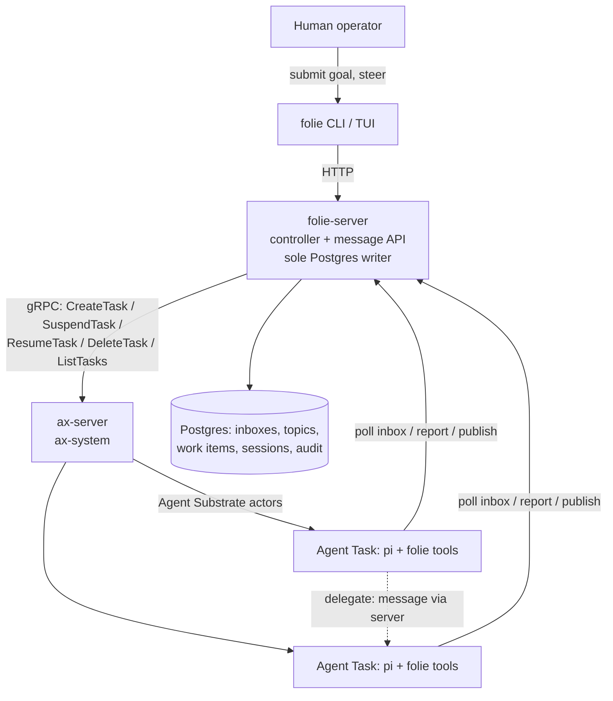

# Folie

A steerable swarm of autonomous coding agents on top of [ax](https://github.com/google/ax).

Status: end-to-end slice works in the cluster (goal → inbox → controller wake → sandboxed agent → report), including the pi runtime reaching a real LLM endpoint from inside the sandbox. Settled through five rounds of structured interrogation on 2026-11-03; every decision in the [Decisions ledger](#decisions-ledger) is final for v1. Ax facts this design relies on are cited in the [appendix](#ax-facts-this-design-relies-on) against the ax checkout at `~/Projects/FOSS/ax`.

## What Folie is

A production work fleet: hundreds of agents (each an ax `Task` running the [pi](https://github.com/badlogic/pi-mono) harness), doing autonomous coding work — arbitrary goals, up to and including implementing a PRD end to end with verification — communicating through durable inboxes and pub/sub topics, and steerable in real time from a CLI and TUI.

The defining property is **emergence by construction**: the only thing that wakes an idle agent is a message arriving in its inbox. Human-submitted goals, controller assignments, and peer-to-peer delegation are all just messages, so any agent can wake any other agent. The TUI lets you watch it happen — fleet grid, live message stream, per-agent inbox and topic inspection.

Non-goals for v1:

- **No changes to ax.** Folie is a pure consumer of ax's gRPC API and primitives.
- **No containment instrumentation.** Full trust (see [Trust posture](#credentials-and-trust-posture)). Folie is not a safety research harness; the audit trail exists for operations and forensics, not for containment.
- **No spend enforcement.** No spend caps exist anywhere in ax or v1 Folie; the upgrade path is an LLM gateway.
- **No multi-cluster.** Laptop first, one VPC next, distributed VPCs later — the design avoids single-host assumptions but implements one cluster.

## Architecture



Everything above ax is Folie. Everything at ax and below is fleet plumbing Folie reuses but never patches.

## The stack, layer by layer

### ax — the fleet layer

ax provides: one sandboxed, resource-limited, digest-pinned container per agent (`Task`); shared prepared environments (`Workspace`: git repos, inline files, MCP servers, skills); a credential record (`Model`); checkpointed suspend/resume; in-cluster addressing of any task via the atenet router; and a paginated `ListTasks` built for millions of tasks. See the [primitive mapping](#mapping-to-ax-primitives) for what Folie builds on each.

### folie-server — controller, message broker, sole DB writer

One TypeScript deployment. Three responsibilities:

1. **Controller loop** — maintains the elastic agent pool against wake pressure and backlog: `CreateTask` to grow, `SuspendTask` to checkpoint idle agents (freeing worker CPU/memory), `ResumeTask` on wake, `DeleteTask` to shrink. Injects the LLM key into each task's `spec.env` at creation.
2. **Message API** — the HTTP surface agents and the TUI call: inbox fetch/ack, message send, topic publish/subscribe, report submission. Every write lands in Postgres. **folie-server is the only process with database credentials**; agents never touch Postgres directly.
3. **TUI/CLI backend** — the same HTTP API serves the operator surface.

Server-side state uses `@earendil-works/pi-durable` (durable conversation/task/document runtime) from day one. v1 server otherwise depends only on `pg` and the generated ax gRPC client — no other pi packages, so upstream churn is opt-in.

The ax gRPC client is generated from `ax.proto` (298 lines, small RPC surface). Ax is pre-stable; regenerating on upstream changes is expected maintenance either way (a Go server would break at compile time instead — same churn, different signal).

### Agent image — pi on the stock ax runner

The agent image extends ax's default `ax-task-runner` image (Python 3.12 base; ax documents this as the shallowest customization level — add tools, keep the entrypoint) with:

- Node.js ≥ 22.19 and a version-pinned `@earendil-works/pi-coding-agent` toolchain,
- the **folie agent program**, a small TypeScript loop built on `@earendil-works/pi-agent-core` (agent runtime with tool calling and state management).

`spec.command` runs the folie agent program; the stock ax runner supervises it as PID 1's child, handles workspace prep, probes, and SIGTERM forwarding. **No runner fork is needed** — the program is a long-lived loop that never exits, which also neutralizes the fact that ax's control plane never reads the command's exit code.

The agent program's loop:

```
on wake (inbox non-empty):
    unread = fetch inbox
    session = pi session, resumed from pi-durable state in /workspace,
              prompt = unread messages + report instruction
    tools   = pi coding tools + folie tools:
                inbox.peek / inbox.read
                message.send(to, body)        # wake another agent
                topic.subscribe / topic.publish
                report.submit(outcome, summary)
    run session; persist conversation to /workspace; submit report
    ack messages; sleep (idle → controller suspends the task)
on failure: report outcome=failed; work item parks in blocked; NO retry
```

Conversation state lives in `/workspace` via `pi-durable`, so it survives ax's suspend/resume (ax snapshots `/workspace` and restores it into a fresh container — a file-level checkpoint, which is exactly what a durable conversation format wants).

### Runtime-agnostic seam

pi is the first runtime, not the only forever-runtime. The seam for others (e.g. Claude Code via ax's own runner): ax `Workspace.spec.mcp.servers` with an HTTP endpoint wires tools into any MCP-speaking agent, and pi itself speaks MCP. The folie message API would be exposed as an MCP server for such runtimes; for pi it is consumed natively by the agent program.

### folie CLI / TUI

TypeScript, built on [OpenTUI](https://github.com/anomalyco/opentui) (`@opentui/core`: Zig-native renderer with flexbox layout, scroll boxes, selects, inputs; the library behind OpenCode). Chosen over `pi-tui` because the operator surface is a dense, mouse-and-keyboard grid plus a scrolling feed, and OpenTUI also offers `@opentui/ssh` for serving the same TUI to remote operators on a VPC. Cost: it requires Bun and ships a native core, so the `folie` CLI is Bun-only (it already is). Views are pure view-models (fleet rows, stream buffer) fed by the HTTP client, with OpenTUI only at the rendering edge, so the renderer stays swappable and the logic stays testable under Node. v1 surface, all of it:

- **Fleet grid** — every agent: state (running / idle / suspended / blocked), current session, inbox depth.
- **Live message stream** — scrolling feed of all messages flowing through the substrate.
- **Inspect** — per-agent inbox, per-topic traffic, session reports.
- **Submit** — create a work item (lands as a message in an agent's inbox or a topic).
- **Steer** — message an agent directly, suspend, resume, delete.

### `folie up` — bootstrap

One command creates the whole world on a laptop: kind cluster, Agent Substrate, ax-server, Postgres, folie-server — pinned versions, Folie in its own `folie` namespace beside ax's `ax-system` and Substrate's `ate-system`, torn down by `folie down`. Substrate and ax are installed by ax's own `hack/setup-e2e-kind.sh`; `folie up` skips it when ax is already healthy (the script wipes ax's database). The same manifests deploy to a real VPC unchanged; only the cluster provider differs. (kubectl/kind are downloaded, sha256-verified, into `~/.folie/bin`.)

## Mapping to ax primitives

| Swarm need                    | ax primitive                                                        | Folie consequence                                                             |
| ----------------------------- | ------------------------------------------------------------------- | ----------------------------------------------------------------------------- |
| One sandboxed agent each      | `Task` (CPU/mem limits, digest-pinned image)                        | Agent == Task; name == actor name                                             |
| Shared prepared environment   | `Workspace` (git, files, MCP, skills)                               | Bound to every agent task; also the MCP seam for non-pi runtimes              |
| Mid-run goal change           | Tasks are immutable                                                 | Goals are **messages**, never task mutations                                  |
| Cheap idle agents             | `SuspendTask` / `ResumeTask` (checkpoint `/workspace`)              | Controller suspends idle agents; pi-durable state rides the snapshot          |
| Kill switch                   | `DeleteTask` per agent                                              | Steering hard-stop                                                            |
| Address / probe any agent     | atenet router, `ate-target-actor: <atespace>/<task>` header         | Controller health checks; emergency `ax ssh` requires `spec.debug: true`      |
| Task TTL / garbage collection | None exists                                                         | Controller owns GC (delete parked/dead agents)                                |
| Completion detection          | Control plane never reads command exit                              | Agent program is a non-exiting loop; completion is a report, not an exit code |
| Spend caps                    | None exists (`ModelSpec` = provider, model, secretKey, parameters)  | None in v1; gateway is the upgrade path                                       |
| LLM credential delivery       | `spec.env` (ax-native; `Model.secretKey` never reaches the sandbox) | Controller injects the key per task at `CreateTask`                           |

## Domain model

- **Swarm** — the whole fleet of agents together with the substrate they communicate through.
- **Agent** — a long-lived worker with a stable identity and exactly one inbox; does its work in sessions.
- **Work item** — a unit of externally submitted intent: an opaque goal, context references, a priority, and a state. The system stores and routes it but never interprets it.
- **Goal** — free-form text directing an agent. Verification, acceptance criteria, PRDs — all of it lives inside goal text, by design.
- **Inbox** — an agent's ordered, durable queue of messages. The only wake source.
- **Message** — an item in an inbox: from a human, the controller, or a peer agent.
- **Topic** — a named broadcast channel; publishing to it delivers a copy into every subscriber's inbox.
- **Wake** — the transition of an idle agent into a session, caused solely by its inbox becoming non-empty.
- **Session** — one run of an agent over its unread messages, with a persistent conversation.
- **Report** — an agent's account of a session's outcome.
- **Steering** — changing swarm behavior: messaging an agent, suspending, resuming, or removing it.

## Message substrate and wake semantics

- **Inbox-non-empty is the only wake.** Human goal submission, controller assignment, peer delegation, and topic delivery all reduce to "there is a message in your inbox." Any agent can wake any other by sending it a message — that is the emergence mechanism, and it is the _only_ mechanism, so it is uniform and observable.
- **Topics are durable, not live.** `publish(topic)` copies the message into every current subscriber's inbox, in one statement, excluding the publisher (so an agent announcing to a topic it follows does not wake itself). Delivery survives suspension and retirement: subscriptions live in Postgres, so a suspended agent wakes with its backlog and a retired one starts a fresh task for it. Nothing is replayed to agents that subscribe later. A topic exists while it has subscribers; publishing to one with none delivers zero copies and leaves no trace (the one gap in the audit log). Anyone can publish (`folie publish`, or an agent's `topic_publish`); an agent can subscribe before it has ever run.
- **The message table is the audit trail.** Every goal issued, every delegation, every report passes through folie-server and is recorded server-side. Agents cannot forge or delete it — they hold no database credentials. (The Hugging Face incident swarm forged its own logs; that failure mode is structurally excluded here.)
- **Failure is one-shot and visible.** A failed session reports `outcome=failed`, the work item parks in `blocked`, and the TUI surfaces it. No retries in v1 — operators decide what to do with failures.

## Agent lifecycle and elasticity

- **Intake.** A goal that names an agent (`folie submit --to lead`) is a message to that agent. A goal that does not stays `queued` with no recipient; each controller pass first dispatches queued goals, oldest first, to a *pool agent* (`agent-<n>`): an idle one if any (running before suspended before retired), else a new one while fewer than `FOLIE_MAX_AGENTS` (default 8) are alive, else it waits. Agents addressed by name are never drafted into the pool. Idle means no unread mail; an agent mid-session always has unread mail, because only its report acks.
- **Wake** (unchanged): mail for an agent without a running task creates the task (egress policy, then resume) or resumes the suspended one.
- **Suspend.** A running agent quiet for `FOLIE_SUSPEND_AFTER_S` (default 60) is suspended. Activity is mail in or a report out (`agents.last_active_at`), not controller state changes.
- **Retire.** A suspended agent quiet for `FOLIE_DELETE_AFTER_S` (default 3600, measured from the same last activity, must exceed the suspend period) has its task deleted and its state set to `retired`. A task found `Failed` while quiet is deleted the same way. Delete is only ever issued for a `Suspended` or `Failed` task, never a running one. New mail for a retired agent starts a fresh task.
- **Identity and memory:** an agent's conversation survives suspend/resume indefinitely (it is in `/workspace`, which ax checkpoints). `DeleteTask` destroys `/workspace` and therefore the agent's memory: retirement is forgetting, not parking. The agent *name*, its audit history in Postgres, and its `<atespace>/<agent>` address are stable across all of it.
- Verified in the cluster with short thresholds: a burst of four unaddressed goals grew the pool 1→4 and all completed; the agents were suspended when quiet, resumed on new mail without being recreated, and retired after the longer horizon. A pre-existing task found `Failed` (cause not investigated) was garbage-collected by the same sweep.

## Data model (Postgres, all writes via folie-server)

- `agents` — name (identity), state (`pending`, `running`, `suspended`, `retired`), wake epoch (advances on each transition into running), last activity.
- `messages` — the audit log: id, sender, recipient (always an agent), body, work item, topic (set when it came from a publish), created, acked. A publish is stored as one row per subscriber.
- `topic_subscriptions` — (topic, agent); there is no separate topic registry.
- `work_items` — id, goal (opaque text), context refs, priority, state (`queued`, `assigned`, `blocked`, `done`, `failed`).
- `sessions` — agent, started/ended, message ids consumed, report ref.
- `reports` — session outcome, summary, artifacts refs.

## Credentials and trust posture

**Full trust, by decision.** Agents run as root inside their sandbox with unrestricted internet egress, unrestricted tools, and no NetworkPolicy. This was chosen with eyes open: it is the configuration that produced the Hugging Face incident, minus the unobservability — here every action that crosses the substrate is logged where agents cannot write.

The free brakes, all of which survive the full-trust choice:

- `DeleteTask` — remove any agent instantly.
- `SuspendTask` — freeze any agent instantly.
- Key rotation — the LLM key is injected per-task at `CreateTask`; rotating it and recreating agents cuts all model access.
- Stopping folie-server — no wakes, no message flow; the swarm goes quiescent on its own.

Credential delivery is the simplest thing that works: the controller holds the LLM key and injects it via `spec.env` (the ax-native flow). Spend enforcement does not exist anywhere in this stack; when cost matters, insert an in-cluster LLM gateway that holds the key and enforces per-agent budgets, and remove the key from `spec.env`.

`spec.config` is plaintext and shown by `ax get task`; it never carries credentials.

## Scale

Designed for hundreds of concurrent agents, no hard cap in schema, protocol, or TUI. A laptop (kind) realistically runs dozens; the same manifests on a VPC run the hundreds. Nothing binds to localhost assumptions: folie-server reaches ax-server and Postgres as addressable services. Distributed multi-VPC operation is a later iteration — the constraint kept in v1 is only that all service addresses are configurable.

## Sandbox egress (a Substrate dependency)

**Found 2026-11-03 by running the slice.** Substrate sandboxes deny egress by default: an actor with no `EgressPolicy` gets `NXDOMAIN` for every hostname and all TCP is blocked (`substrate/docs/egress-traffic.md`). ax creates no egress policy and exposes no way to set one. Before the fix the agent task was `Running`/`Ready` and logged `getaddrinfo ENOTFOUND folie-server.folie.svc` on every poll (visible in the `ax-workers` pod logs).

**Resolution (2026-11-04):** the controller calls Substrate's `CreateActorEgressPolicy` for each agent's actor between ax `CreateTask` and `ResumeTask`, and again before resuming any suspended agent (idempotent, so a crash between steps heals). The policy is the full-trust one: hostname `*` on cleartext HTTP ports `80,8080` and on TLS-passthrough port `443` (`FOLIE_EGRESS_HTTP_PORTS` / `FOLIE_EGRESS_TLS_PORTS`). The two rules use disjoint ports because Substrate rejects ties on the same pattern and port at admission. Verified in-cluster: an agent reaches `folie-server.folie.svc:8080`, and a pi session inside the sandbox got a genuine `401 invalid x-api-key` from `api.anthropic.com`.

What this costs and means:

- Folie now depends on Substrate's API, not only ax's. folie-server holds a projected service-account token (audience `api.ate-system.svc`) and the Substrate trust bundle, as ax-server does, and its namespace carries `ate.dev/api-access=true`.
- `folie up` adds `system:serviceaccount:folie:folie-server` to `ate-api-server`'s `--authz-bootstrap-owners` (a Substrate install setting; ax is untouched). That makes folie-server a *global* Substrate owner, broader than needed. Upgrade path: an atespace-editor access policy for the `folie` atespace.
- Substrate egress is HTTP(S) only: other TCP (ssh, arbitrary ports) is blocked whatever the policy says. "Unrestricted egress" is therefore "all hosts, web ports". Git over ssh, databases and dev servers on other ports do not work from a sandbox.
- Re-running ax's setup script resets the bootstrap owners; the next `folie up` re-applies the grant.
- **Forward risk: in-cluster destinations.** Agents reach `folie-server.folie.svc` today because the `*` rule matches and Substrate does not yet filter private destinations. Substrate [#2086](https://github.com/agent-substrate/substrate/issues/2086) (open) proposes denying private/cluster-internal IPs by default, with an explicit operator exception needed to reach them. When it lands, agent→folie-server traffic breaks unless that exception exists or Substrate gains named in-cluster Service rules (reported as #3243, not checked by me). Re-test after every Substrate bump.
- **Upstream tracking.** ax [#449](https://github.com/google/ax/issues/449) (no egress field on `TaskSpec`; open, maintainers have signalled they want it and are aligning two implementations) is the issue to watch. Folie drops its own policy grant, the Substrate API dependency and the bootstrap-owner patch once ax exposes egress that can name folie-server and web hosts.

Also unresolved: `ax ssh` from this host fails ("error reading server preface"); `ip route get` shows the host routes `10.244.0.0/16` through the LAN gateway rather than kind. Logs via worker pods work, and show agent stdout.

## Decisions ledger

1. **On top of ax, never inside it.** ax is pre-stable with promised breaking changes; a pure API consumer survives them. Even ax's warts (immutable tasks, no TTL, no spend caps) are worked around in Folie rather than patched upstream.
2. **Brokered message substrate, not direct peer sockets.** Direct agent-to-agent serving would require a from-scratch PID 1 (ax's port-80 mux has no extension hook and its `internal/` packages are unimportable), and it would bypass the audit trail. Brokering through folie-server keeps every message durable, replayable, and forge-proof — and at hundreds of agents the hub load is trivial.
3. **pi as first agent runtime, integrated via the pi-agent-core SDK.** Native programmatic integration, not CLI scraping. The runtime seam for other harnesses is MCP over `Workspace.spec.mcp.servers`.
4. **TypeScript across server, agent, and TUI; pi-durable server-side from day one.** One language and one shared contract at the seam the product lives on; the upstream exposure is accepted deliberately (it already exists at the agent layer regardless).
5. **Inbox-non-empty as the sole wake condition.** Uniform emergence: humans, controller, and peers all wake agents the same way, and every wake is a logged message.
6. **Full trust egress and tools.** Chosen over allowlists and tool scoping; brakes are delete/suspend/rotate/quiesce (above). Realised as a Substrate `EgressPolicy` per agent ([Sandbox egress](#sandbox-egress-a-substrate-dependency)); Substrate limits it to web ports.
7. **One-shot failure, visible.** No retry loops in v1; failures park and surface. Retry policy can be added per-work-item later without schema change.
8. **`folie up` owns the entire bootstrap.** The product claim "works on my laptop right now" requires it; this machine currently has no kubectl/kind.
9. **folie-server is the sole Postgres writer.** One trust path, no database credentials in any sandbox.
10. **Opaque work-item schema.** Goal is free text; Folie never interprets content, so nothing about the work is opinionated and PRD-implementation needs no special-casing.

## Ax facts this design relies on

All against the ax checkout at `~/Projects/FOSS/ax`:

- `TaskSpec` = image, command, env, resources, workspace, debug, config — no TTL/timeout/restart policy: `pkg/apis/v1alpha1/ax.proto:69-89`.
- `ModelSpec` = provider, model, secretKey, parameters — no budget/quota field: `ax.proto:196-203`.
- Tasks are immutable once created: ax `DESIGN.md:44`.
- Runner stays up after the command exits; the control plane does not read the exit status: `docs/runner.md:49`.
- Suspend/resume snapshots `/workspace` into a fresh container (new process tree): `docs/runner.md:27`.
- Port 80 serves `/healthz`, `/readyz`, and (with `spec.debug: true`) guest gRPC; the mux has no extension hook: `internal/metadata/server.go:98-108`.
- Tasks are addressed in-cluster via the atenet router with `ate-target-actor: <atespace>/<task>`: `docs/networking.md:3-14`.
- ax-server is a ClusterIP Service at `ax-server.ax-system.svc:8080`: `deploy/ax-server.yaml:154-168`.
- The ax-native credential flow is a key in `spec.env` substituted at apply time; `Model.secretKey` never reaches the sandbox: `examples/claude-code/README.md:104-108`, `docs/sandbox.md:42-46`.
- Extending the default runner image (add tools, keep entrypoint) is documented customization level 1: `docs/runner.md:67-85`. Default image is Python 3.12 + git/curl/ssh: `docs/runner.md:57`.
- `runner.Run` exposes an `OnCommandExit` hook (unused by Folie — the agent program loops): `runner/runner.go:159-166`.

Pi facts: `pi-agent-core` (agent runtime SDK), `pi-durable` (durable conversation/task/document runtime), extensions/packages docs, Node ≥ 22.19, no built-in permission system (containerization is the boundary) — all from the `earendil-works/pi` monorepo README and package docs. (`pi-tui` was considered for the TUI and rejected; see [folie CLI / TUI](#folie-cli--tui).)

## Next steps

1. ~~`folie up`~~ done: kind + Substrate + ax + Postgres + folie-server, idempotent.
2. End-to-end slice: done and exercised in the cluster with the `echo` runtime, and with pi up to a real provider call (bogus key). Pi completing real coding work against a valid key is unexercised. Run `bun run test`.
3. ~~Elastic pool~~ done (above). Conversation is persisted by Folie as `/workspace/.folie/conversation.json`, not yet via `pi-durable`. Not yet: backlog-aware scaling beyond one-goal-per-agent, scale-down hysteresis tuning, deleting retired agent rows.
4. ~~Topics and peer delegation~~ done: `message_send`, `topic_subscribe`/`topic_publish`/`topic_unsubscribe` for pi; `folie topics|subscribe|unsubscribe|publish` for operators. Verified on the cluster's Postgres with the `echo` runtime (agent-initiated publish is covered by tests, not run live). Next: the TUI on OpenTUI (fleet grid, then live stream).
