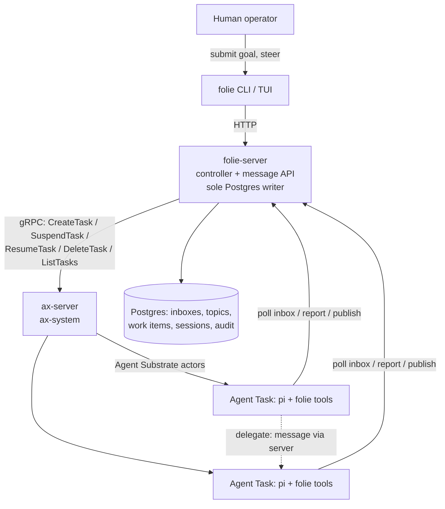

# Folie

A steerable swarm of autonomous agents for arbitrary goals, on top of [ax](https://github.com/google/ax).

Status: end-to-end slice works in the cluster (goal → inbox → controller wake → sandboxed agent → report), including the pi runtime reaching a real LLM endpoint from inside the sandbox. Settled through five rounds of structured interrogation on 2026-11-03; every decision in the [Decisions ledger](#decisions-ledger) is final for v1. On 2026-11-04 bounded sessions, mid-session steering, tool replay safety and OpenTelemetry were added (decisions 11-18), and the [reference design](#reference-design-and-roadmap) set the direction beyond v1. Ax facts this design relies on are cited in the [appendix](#ax-facts-this-design-relies-on) against the ax checkout at `~/Projects/FOSS/ax`.

## What Folie is

A production work fleet: hundreds of agents (each an ax `Task` running the [pi](https://github.com/badlogic/pi-mono) harness) working autonomously on arbitrary goals: mathematics, internet research, model training, biology, software engineering, over days or weeks. Implementing a PRD end to end is one such goal, not the model. Agents communicate through durable inboxes and pub/sub topics, and are steerable in real time from a CLI and TUI.

Folie is meant to replace the meta-harness: the thing you sit inside while agents work. `folie` with no arguments opens the operator TUI (below); the subcommands (`up`, `submit`, `status`, ...) are the scripting surface over the same HTTP API.

The defining property is **emergence by construction**: the only thing that wakes an idle agent is a message arriving in its inbox. Human-submitted goals, controller assignments, and peer-to-peer delegation are all just messages, so any agent can wake any other agent. The TUI lets you watch it happen — fleet grid, live message stream, per-agent inbox and topic inspection.

Non-goals for v1:

- **No changes to ax.** Folie is a pure consumer of ax's gRPC API and primitives.
- **No containment instrumentation.** Full trust (see [Trust posture](#credentials-and-trust-posture)). Folie is not a safety research harness; the audit trail exists for operations and forensics, not for containment.
- **No spend enforcement.** No spend caps exist anywhere in ax or v1 Folie; the upgrade path is an LLM gateway. Spend is visible, not capped: every report carries token and cost usage.
- **No multi-cluster.** Laptop first, one VPC next, distributed VPCs later — the design avoids single-host assumptions but implements one cluster.

## Architecture



Everything above ax is Folie. Everything at ax and below is fleet plumbing Folie reuses but never patches.

## The stack, layer by layer

### ax — the fleet layer

ax provides: one sandboxed, resource-limited, digest-pinned container per agent (`Task`); shared prepared environments (`Workspace`: git repos, inline files, MCP servers, skills); a credential record (`Model`); checkpointed suspend/resume; in-cluster addressing of any task via the atenet router; and a paginated `ListTasks` built for millions of tasks. See the [primitive mapping](#mapping-to-ax-primitives) for what Folie builds on each.

### folie-server — controller, message broker, sole DB writer

One TypeScript deployment. Three responsibilities:

1. **Controller loop** — maintains the elastic agent pool against wake pressure and backlog: `CreateTask` to grow, `SuspendTask` to checkpoint idle agents (freeing worker CPU/memory), `ResumeTask` on wake, `DeleteTask` to shrink. Injects the LLM key into each task's `spec.env` at creation.
2. **Message API** — the HTTP surface agents and the TUI call: inbox fetch/ack, message send, topic publish/subscribe, report submission. Every write lands in Postgres. **folie-server is the only process with database credentials**; agents never touch Postgres directly.
3. **TUI/CLI backend** — the same HTTP API serves the operator surface.

Server-side state uses `@earendil-works/pi-durable` (durable conversation/task/document runtime) from day one. v1 server otherwise depends only on `pg` and the generated ax gRPC client — no other pi packages, so upstream churn is opt-in.

The ax gRPC client is generated from `ax.proto` (298 lines, small RPC surface). Ax is pre-stable; regenerating on upstream changes is expected maintenance either way (a Go server would break at compile time instead — same churn, different signal).

### Agent image — pi on the stock ax runner

The agent image extends ax's default `ax-task-runner` image (Python 3.12 base; ax documents this as the shallowest customization level — add tools, keep the entrypoint) with:

- Node.js ≥ 22.19 and a version-pinned `@earendil-works/pi-coding-agent` toolchain,
- the **folie agent program**, a small TypeScript loop built on `@earendil-works/pi-agent-core` (agent runtime with tool calling and state management).

`spec.command` runs the folie agent program; the stock ax runner supervises it as PID 1's child, handles workspace prep, probes, and SIGTERM forwarding. **No runner fork is needed** — the program is a long-lived loop that never exits, which also neutralizes the fact that ax's control plane never reads the command's exit code.

The agent program's loop (`src/agent/loop.ts`):

```
tick:
    resend an undelivered report if there is one, else
    unread  = fetch inbox
    first   = oldest unread message  ->  scope wi:<work item> | mail:<message id>
    batch   = unread mail for that work item, plus mail with no work item
    session = a fresh pi Agent with an empty conversation
              prompt = batch (+ a notice of earlier attempts at this scope, if any)
    tools   = pi coding tools + folie tools, each tagged replay "safe" | "never",
              each traced (span) and journaled (tool_start / tool_end events):
                message_send(to, body)                 # wake another agent
                topic_subscribe / topic_unsubscribe / topic_publish
                artifact_register(path, description)   # a file worth keeping
                report_submit(outcome, summary)
    after every turn: poll the inbox scoped to this work item -> agent.steer(new mail)
    run the session, streaming transcript events; one report acks the batch and all steered mail
on failure: report outcome=failed; work item parks in blocked; NO retry
```

No conversation outlives a session. Memory is files in `/workspace`, which ax snapshots across suspend/resume; `pi-durable` is not used for conversations. See [Sessions](#sessions-bounded-scoped-steerable), [Replay safety](#replay-safety) and [Observability](#observability).

### Runtime-agnostic seam

pi is the first runtime, not the only forever-runtime. The seam for others (e.g. Claude Code via ax's own runner): ax `Workspace.spec.mcp.servers` with an HTTP endpoint wires tools into any MCP-speaking agent, and pi itself speaks MCP. The folie message API would be exposed as an MCP server for such runtimes; for pi it is consumed natively by the agent program.

### folie CLI / TUI

TypeScript, built on [OpenTUI](https://github.com/anomalyco/opentui) (`@opentui/core`: Zig-native renderer with flexbox layout, scroll boxes, selects, inputs; the library behind OpenCode). Chosen over `pi-tui` because the operator surface is a dense, mouse-and-keyboard grid plus a scrolling feed, and OpenTUI also offers `@opentui/ssh` for serving the same TUI to remote operators on a VPC. Cost: it requires Bun and ships a native core (so the `folie` CLI is Bun-only, as it already was), and it is pre-1.0 (0.8.x here). State and transitions are pure view-models (`src/tui/model.ts`, commands, poller) tested under Node; `src/tui/app.ts` is the only OpenTUI code and is tested with OpenTUI's in-memory renderer under Bun (`bun run test:tui`).

**`folie` (no arguments) opens the TUI**, which polls folie-server about once a second (cursor-based, so it only fetches new messages; no push channel yet):

- **Fleet grid** — every agent: state (`working`, `idle`, `waking`, `suspended`, `retired`), unread mail, time since last activity.
- **Message stream** — every message in the swarm, newest at the bottom (view `1`).
- **Inspect** — the selected agent's unread inbox (`2`), all topics and their subscribers (`3`), the selected agent's session reports (`4`).
- **Submit and steer** — `:` opens a command line: `submit [@agent] <goal>`, `send [@agent] <text>`, `publish`, `subscribe`, `unsubscribe`, `suspend|resume|delete [agent]`. Shortcuts: `tab`/`1-4` views, `s` suspend, `r` resume, `q` quit. Delete, the kill switch, is command-only so it cannot be pressed by accident.

### `folie up` — bootstrap

One command creates the whole world on a laptop: kind cluster, Agent Substrate, ax-server, Postgres, folie-server — pinned versions, Folie in its own `folie` namespace beside ax's `ax-system` and Substrate's `ate-system`, torn down by `folie down`. Substrate and ax are installed by ax's own `hack/setup-e2e-kind.sh`; `folie up` skips it when ax is already healthy (the script wipes ax's database). The same manifests deploy to a real VPC unchanged; only the cluster provider differs. (kubectl/kind are downloaded, sha256-verified, into `~/.folie/bin`.)

## Mapping to ax primitives

| Swarm need                    | ax primitive                                                        | Folie consequence                                                             |
| ----------------------------- | ------------------------------------------------------------------- | ----------------------------------------------------------------------------- |
| One sandboxed agent each      | `Task` (CPU/mem limits, digest-pinned image)                        | Agent == Task; name == actor name                                             |
| Shared prepared environment   | `Workspace` (git, files, MCP, skills)                               | Bound to every agent task; also the MCP seam for non-pi runtimes              |
| Mid-run goal change           | Tasks are immutable                                                 | Goals are **messages**, never task mutations                                  |
| Cheap idle agents             | `SuspendTask` / `ResumeTask` (checkpoint `/workspace`)              | Controller suspends idle agents; pi-durable state rides the snapshot          |
| Kill switch                   | `DeleteTask` per agent                                              | Steering hard-stop                                                            |
| Address / probe any agent     | atenet router, `ate-target-actor: <atespace>/<task>` header         | Controller health checks; emergency `ax ssh` requires `spec.debug: true`      |
| Task TTL / garbage collection | None exists                                                         | Controller owns GC (delete parked/dead agents)                                |
| Completion detection          | Control plane never reads command exit                              | Agent program is a non-exiting loop; completion is a report, not an exit code |
| Spend caps                    | None exists (`ModelSpec` = provider, model, secretKey, parameters)  | None in v1; gateway is the upgrade path                                       |
| LLM credential delivery       | `spec.env` (ax-native; `Model.secretKey` never reaches the sandbox) | Controller injects the key per task at `CreateTask`                           |

## Domain model

- **Swarm** — the whole fleet of agents together with the substrate they communicate through.
- **Agent** — a long-lived worker with a stable identity and exactly one inbox; does its work in sessions.
- **Work item** — a unit of externally submitted intent: an opaque goal, context references, a priority, and a state. The system stores and routes it but never interprets it.
- **Goal** — free-form text directing an agent. Verification, acceptance criteria, PRDs — all of it lives inside goal text, by design.
- **Inbox** — an agent's ordered, durable queue of messages. The only wake source.
- **Message** — an item in an inbox: from a human, the controller, or a peer agent.
- **Topic** — a named broadcast channel; publishing to it delivers a copy into every subscriber's inbox.
- **Wake** — the transition of an idle agent into a session, caused solely by its inbox becoming non-empty.
- **Session** — one bounded run of an agent over one work item's mail, from an empty conversation to one report. Scoped `wi:<id>` or `mail:<id>`.
- **Report** — an agent's account of a session's outcome, with its token and cost usage.
- **Transcript** — a session's append-only events (messages, turns, tool calls, steers, logs, artifacts) in Postgres.
- **Artifact** — a file an agent produced and registered: path, size, SHA-256, description.
- **Steering** — changing swarm behavior: messaging an agent, suspending, resuming, or removing it.

## Message substrate and wake semantics

- **Inbox-non-empty is the only wake.** Human goal submission, controller assignment, peer delegation, and topic delivery all reduce to "there is a message in your inbox." Any agent can wake any other by sending it a message — that is the emergence mechanism, and it is the _only_ mechanism, so it is uniform and observable.
- **Topics are durable, not live.** `publish(topic)` copies the message into every current subscriber's inbox, in one statement, excluding the publisher (so an agent announcing to a topic it follows does not wake itself). Delivery survives suspension and retirement: subscriptions live in Postgres, so a suspended agent wakes with its backlog and a retired one starts a fresh task for it. Nothing is replayed to agents that subscribe later. A topic exists while it has subscribers; publishing to one with none delivers zero copies and leaves no trace (the one gap in the audit log). Anyone can publish (`folie publish`, or an agent's `topic_publish`); an agent can subscribe before it has ever run.
- **The message table is the audit trail.** Every goal issued, every delegation, every report passes through folie-server and is recorded server-side. Agents cannot forge or delete it — they hold no database credentials. (The Hugging Face incident swarm forged its own logs; that failure mode is structurally excluded here.)
- **Failure is one-shot and visible.** A failed session reports `outcome=failed`, the work item parks in `blocked`, and the TUI surfaces it. No retries in v1 — operators decide what to do with failures.
- **Delivery is at-least-once, with idempotent sends.** Mail is acked only by a report, so a session that dies is rerun. `message_send` and `topic_publish` carry a `requestId` that makes them at-most-once per (sender, recipient) and per (sender, topic) ([Replay safety](#replay-safety)).

## Agent lifecycle and elasticity

- **Intake.** A goal that names an agent (`folie submit --to lead`) is a message to that agent. A goal that does not stays `queued` with no recipient; each controller pass first dispatches queued goals, oldest first, to a *pool agent* (`agent-<n>`): an idle one if any (running before suspended before retired), else a new one while fewer than `FOLIE_MAX_AGENTS` (default 8) are alive, else it waits. Agents addressed by name are never drafted into the pool. Idle means no unread mail; an agent mid-session always has unread mail, because only its report acks.
- **Wake** (unchanged): mail for an agent without a running task creates the task (egress policy, then resume) or resumes the suspended one.
- **Suspend.** A running agent quiet for `FOLIE_SUSPEND_AFTER_S` (default 60) is suspended. Activity is mail in or a report out (`agents.last_active_at`), not controller state changes.
- **Retire.** A suspended agent quiet for `FOLIE_DELETE_AFTER_S` (default 3600, measured from the same last activity, must exceed the suspend period) has its task deleted and its state set to `retired`. A task found `Failed` while quiet is deleted the same way. Delete is only ever issued for a `Suspended` or `Failed` task, never a running one. New mail for a retired agent starts a fresh task.
- **Identity and memory:** an agent's *files* survive suspend/resume indefinitely (`/workspace`, which ax checkpoints); its conversation does not exist beyond a session ([Sessions](#sessions-bounded-scoped-steerable)). `DeleteTask` destroys `/workspace` and therefore the agent's memory and artifact bytes: retirement is forgetting, not parking. The agent *name*, its audit history and transcript in Postgres, and its `<atespace>/<agent>` address are stable across all of it.
- Verified in the cluster with short thresholds: a burst of four unaddressed goals grew the pool 1→4 and all completed; the agents were suspended when quiet, resumed on new mail without being recreated, and retired after the longer horizon. A pre-existing task found `Failed` (cause not investigated) was garbage-collected by the same sweep.

## Sessions: bounded, scoped, steerable

**A session serves one work item and starts empty.** The oldest unread message picks the work item. The session's first batch is that work item's mail plus mail that belongs to no work item; mail for other work items waits for its own session. Its scope is `wi:<id>`, or `mail:<first message id>` when the batch has no work item. No conversation is saved or resumed: a long job is a chain of sessions whose memory is files in `/workspace`. When a goal is bigger than one session, the agent writes down where it stopped and what is next, then sends that to itself with `message_send`; the next phase starts fresh from the files. The system prompt says so, and `artifact_register` records the files that matter.

**Mid-session steering.** The runtime, not the model, polls folie-server between turns with `GET /v1/agents/<n>/inbox?workItem=<id>`, which returns that work item's mail plus mail with no work item (`?workItem=none` returns only the latter). Anything not yet consumed is pushed with `agent.steer()` from pi's `finishTurn` hook, so pi delivers it before the next model call. Reasons for the choices:

- *Runtime-side, not a model tool.* It is deterministic and costs no context. An `inbox_peek` tool was considered and rejected.
- *`finishTurn`, not `prepareNextTurn`.* It runs before pi's own post-turn drain of the steering queue, so the mail is delivered in the same turn boundary. The drain also continues the run when mail arrives after the model tried to stop.
- *Scoped by work item.* A session never absorbs another goal's mail, so the one report can settle the right work items. Mail with no work item (a peer's note, a topic post, an operator correction) is absorbed by whichever session is running, because it carries no scope to respect.
- *A report already recorded is void when mail arrives after it.* The model gets another turn rather than finishing on stale instructions.
- *A failing poll is logged and ignored.* A server hiccup must not kill a session that is making progress.
- *One report acks the initial batch and every message steered in.* The audit trail never has an unacked message that a session read.

Limits: steering lands at turn boundaries. It cannot interrupt a single tool call that runs for hours; the operator's `suspend` or `delete` is the interrupt for that.

**Transcript.** The agent batches its events to `POST /v1/sessions/events`, which is idempotent per `(session id, seq)` so a resent batch is safe. Events over 48 KiB are replaced by a truncated preview, because the server rejects more than 64 KiB per event and a rejected batch would block the log. Delivery is best effort: a failed batch is retried at the next flush and dropped after three failures, so the transcript can have gaps; it never fails a session. `GET /v1/sessions/events` filters by agent, session, scope, type and cursor.

**Artifacts.** `artifact_register(path, description)` stats and hashes a file under the workspace (refusing paths outside it) and emits an `artifact` event with the relative path, size, SHA-256 and description. Registering again is harmless, which is why the tool is replayable. The bytes remain in `/workspace`; see Decision 16 for the cost.

## Replay safety

Agents act on live external systems, so a tool that ran, was interrupted, and ran again can duplicate a charge or a message. ax resumes a suspended task into a fresh container with a new process tree (Ax facts), so an interrupted call is lost in a suspend exactly as in a crash.

- **Every tool carries pi's `replay` policy**: `"safe"` (running it twice is harmless) or `"never"`. Folie's tools declare it; pi's coding tools get theirs from a table (`read`, `grep`, `find`, `ls` safe; `bash`, `edit`, `write` never); an unknown tool is `"never"`. The flag appears as `replayable` on every `tool_start`/`tool_end` event and as `tool.replayable` on tool spans.

  | Tool | Policy | Why |
  | --- | --- | --- |
  | `topic_subscribe`, `topic_unsubscribe`, `artifact_register`, `report_submit` | safe | Idempotent setters or local-only. |
  | `message_send`, `topic_publish` | never | Create mail. |

- **Write-ahead journal.** For a `"never"` tool the `tool_start` event is delivered to Postgres *before* the tool runs, and the `tool_end` after. A start with no end means the call's outcome is unknown.
- **Idempotency keys.** `message_send` and `topic_publish` send a key derived from the scope, tool, canonical arguments and the call's ordinal among identical calls. A restarted session at the same scope that repeats the call gets the same key, and a unique index in Postgres drops the duplicate. Two identical calls in one session get different keys, so deliberate repetition is not swallowed.
- **After a restart, the session reads `GET /v1/sessions/attempts?agent=&scope=`**, which pairs starts with ends into `done`, `failed` or `interrupted` per call. It re-runs the interrupted idempotent state-setters (`topic_subscribe`, `topic_unsubscribe`, `artifact_register`) to restore intended state, and never re-runs a side effect. Its first prompt lists the earlier state-changing calls, flagging the interrupted ones as unknown-outcome so the model checks before repeating them.
- **Not claimed:** exactly-once for effects outside Postgres. A tool that calls an external API must declare `replay: "never"` and use that API's own idempotency mechanism where it has one. An uncertain irreversible action is never retried blindly.

## Observability

Distributed tracing is first-class, but a trace is not the record of what happened: spans can be sampled or dropped, and the Postgres tables are authoritative.

**Propagation.** W3C `traceparent` and `tracestate` ride on every HTTP call between the CLI, agents and folie-server (added in `FolieClient`, read by the server's request span) and on every gRPC call to ax and Substrate (gRPC metadata, added in `callUnary`). The context is also stored on `work_items` and `messages`, so the controller and an agent in another process, possibly after a suspend, rejoin the same trace.

| Span | Made by | Parent |
| --- | --- | --- |
| `folie.http.request` | server | the caller's span |
| `folie.work_item.submit` (`work_item_id`, `folie.intent`) | server | the submitting request; the trace's root for the work item |
| `folie.dispatch` | server | the submit span (queued goals only) |
| `folie.controller.wake` | controller | the span stored on the agent's oldest unread message |
| `folie.sandbox.init` | controller | wake; wraps task create, egress grant and resume |
| `folie.agent.session` | agent | `sandbox.init`, else the stored trace |
| `folie.turn` (`llm.usage.prompt_tokens`, `llm.usage.completion_tokens`, `llm.usage.cost_usd`, `llm.latency_ms`) | agent | session |
| `folie.tool.<name>` (`tool.name`, `tool.replayable`, `tool.exit_code`, `tool.call_id`) | agent | the turn that requested it |
| `folie.report.settle` (`work_item_id`, `outcome`, usage) | server | the report's HTTP request, inside the session span |
| `folie.message.send`, `folie.topic.publish` | server | the caller's span (an agent's tool call, usually) |

Three decisions sit behind that table.

- *The session is the child of `sandbox.init`.* Before resuming a task, the controller rewrites the trace on the agent's unread mail to the `sandbox.init` span, so the hierarchy reads submission → dispatch → wake → init → session → turn → tool, with settlement under the session. Without it the session would be a sibling of the wake.
- *The wake span opens only when there is something to bring up.* An agent with unread mail appears in the wake demand on every pass for as long as its session runs; tracing each one would write a span every two seconds per busy agent.
- *`tool.exit_code` is the tool's reported exit code when its result has one (pi's `bash`), otherwise 0, or 1 on error.*

**Metrics** are derived by folie-server from reports and events, so agents export none. `folie.llm.tokens` (`type` = prompt or completion) and `folie.llm.cost` come from report usage; `folie.tool.calls` and `folie.tool.failures` (`tool.name`, `tool.replayable`) come from `tool_end` events, counted once per event actually stored, so a resent batch does not double count; `folie.session.outcome`; `folie.inbox.depth` (a gauge read from the store at each collection); and `folie.inbox.latency`. That last one is the time from a message being created to the report that acks it, so it includes the session's own runtime, not only the queue wait. All carry `agent_name`.

**Logs** are one JSON object per line: `ts`, `level`, `msg`, `agent_name`, `work_item_id`, `session_id`, and `trace_id` and `span_id` whenever a span is active. In the sandbox each line goes to stdout and also into the transcript as a `log` event, which is how a log line leaves the sandbox over HTTP.

**Getting spans out.** Sandboxes send OTLP/HTTP to `folie-server` (`POST /v1/otlp/v1/{traces,metrics,logs}`), which forwards the bytes unchanged to `OTEL_EXPORTER_OTLP_ENDPOINT`. With none configured it answers 202 and drops them, so agents do not retry a disabled feature; a collector failure answers 502 so the exporter's own retry applies. The route is not itself traced. This keeps collector addresses and credentials out of sandboxes and uses the one egress path agents already have (Decision 15). The agent flushes spans at the end of each session, since the task can be suspended right after. Sampling is the SDK default (always on); sampling policy is deferred.

**Fail-fast.** A thrown error or a `failed` outcome puts the error on the session span (status and exception event), the report carries `outcome=failed`, the work item parks in `blocked`, the settlement span is marked failed with `folie.work_item.parked`, and `folie.session.outcome{outcome=failed}` counts it. Nothing retries the work. `blocked` is shown in the TUI today; the trace and cost are not.

## Data model (Postgres, all writes via folie-server)

- `agents` — name (identity), state (`pending`, `running`, `suspended`, `retired`), wake epoch (advances on each transition into running), last activity.
- `messages` — the audit log: id, sender, recipient (always an agent), body, work item, topic (set when it came from a publish), created, acked, an optional idempotency `request_id` (unique per sender, recipient), and the W3C trace context of the span that sent it. A publish is stored as one row per subscriber.
- `topic_subscriptions` — (topic, agent); there is no separate topic registry.
- `work_items` — id, goal (opaque text), context refs, priority, state (`queued`, `assigned`, `blocked`, `done`, `failed`), and the W3C trace context of the submission that created it.
- `sessions` — agent, started/ended, message ids consumed, report ref.
- `reports` — session outcome, summary, and usage (prompt and completion tokens, cost in USD, tool calls, tool failures; null when the runtime reports none). Artifacts are `artifact` events, not a column.
- `session_events` — the transcript: agent, session id (agent-generated, not a foreign key), scope, per-session `seq` (unique with the session id, so a resent batch cannot duplicate), type, JSON data, trace id. Types: `session_start`, `message`, `turn_start`, `turn_end`, `tool_start`, `tool_end`, `steer`, `log`, `artifact`, `session_end`.

## Credentials and trust posture

**Full trust, by decision.** Agents run as root inside their sandbox with unrestricted internet egress, unrestricted tools, and no NetworkPolicy. This was chosen with eyes open: it is the configuration that produced the Hugging Face incident, minus the unobservability — here every action that crosses the substrate is logged where agents cannot write.

The free brakes, all of which survive the full-trust choice:

- `DeleteTask` — remove any agent instantly.
- `SuspendTask` — freeze any agent instantly.
- Key rotation — the LLM key is injected per-task at `CreateTask`; rotating it and recreating agents cuts all model access.
- Stopping folie-server — no wakes, no message flow; the swarm goes quiescent on its own.

Credential delivery is the simplest thing that works: the controller holds the LLM key and injects it via `spec.env` (the ax-native flow). Spend enforcement does not exist anywhere in this stack; when cost matters, insert an in-cluster LLM gateway that holds the key and enforces per-agent budgets, and remove the key from `spec.env`.

`spec.config` is plaintext and shown by `ax get task`; it never carries credentials.

## Scale

Designed for hundreds of concurrent agents, no hard cap in schema, protocol, or TUI. A laptop (kind) realistically runs dozens; the same manifests on a VPC run the hundreds. Nothing binds to localhost assumptions: folie-server reaches ax-server and Postgres as addressable services. Distributed multi-VPC operation is a later iteration — the constraint kept in v1 is only that all service addresses are configurable.

## Sandbox egress (a Substrate dependency)

**Found 2026-11-03 by running the slice.** Substrate sandboxes deny egress by default: an actor with no `EgressPolicy` gets `NXDOMAIN` for every hostname and all TCP is blocked (`substrate/docs/egress-traffic.md`). ax creates no egress policy and exposes no way to set one. Before the fix the agent task was `Running`/`Ready` and logged `getaddrinfo ENOTFOUND folie-server.folie.svc` on every poll (visible in the `ax-workers` pod logs).

**Resolution (2026-11-04):** the controller calls Substrate's `CreateActorEgressPolicy` for each agent's actor between ax `CreateTask` and `ResumeTask`, and again before resuming any suspended agent (idempotent, so a crash between steps heals). The policy is the full-trust one: hostname `*` on cleartext HTTP ports `80,8080` and on TLS-passthrough port `443` (`FOLIE_EGRESS_HTTP_PORTS` / `FOLIE_EGRESS_TLS_PORTS`). The two rules use disjoint ports because Substrate rejects ties on the same pattern and port at admission. Verified in-cluster: an agent reaches `folie-server.folie.svc:8080`, and a pi session inside the sandbox got a genuine `401 invalid x-api-key` from `api.anthropic.com`.

What this costs and means:

- Folie now depends on Substrate's API, not only ax's. folie-server holds a projected service-account token (audience `api.ate-system.svc`) and the Substrate trust bundle, as ax-server does, and its namespace carries `ate.dev/api-access=true`.
- `folie up` adds `system:serviceaccount:folie:folie-server` to `ate-api-server`'s `--authz-bootstrap-owners` (a Substrate install setting; ax is untouched). That makes folie-server a *global* Substrate owner, broader than needed. Upgrade path: an atespace-editor access policy for the `folie` atespace.
- Substrate egress is HTTP(S) only: other TCP (ssh, arbitrary ports) is blocked whatever the policy says. "Unrestricted egress" is therefore "all hosts, web ports". Git over ssh, databases and dev servers on other ports do not work from a sandbox.
- Re-running ax's setup script resets the bootstrap owners; the next `folie up` re-applies the grant.
- **Forward risk: in-cluster destinations.** Agents reach `folie-server.folie.svc` today because the `*` rule matches and Substrate does not yet filter private destinations. Substrate [#2086](https://github.com/agent-substrate/substrate/issues/2086) (open) proposes denying private/cluster-internal IPs by default, with an explicit operator exception needed to reach them. When it lands, agent→folie-server traffic breaks unless that exception exists or Substrate gains named in-cluster Service rules (reported as #3243, not checked by me). Re-test after every Substrate bump.
- **Upstream tracking.** ax [#449](https://github.com/google/ax/issues/449) (no egress field on `TaskSpec`; open, maintainers have signalled they want it and are aligning two implementations) is the issue to watch. Folie drops its own policy grant, the Substrate API dependency and the bootstrap-owner patch once ax exposes egress that can name folie-server and web hosts.

Also unresolved: `ax ssh` from this host fails ("error reading server preface"); `ip route get` shows the host routes `10.244.0.0/16` through the LAN gateway rather than kind. Logs via worker pods work, and show agent stdout.

## Decisions ledger

1. **On top of ax, never inside it.** ax is pre-stable with promised breaking changes; a pure API consumer survives them. Even ax's warts (immutable tasks, no TTL, no spend caps) are worked around in Folie rather than patched upstream.
2. **Brokered message substrate, not direct peer sockets.** Direct agent-to-agent serving would require a from-scratch PID 1 (ax's port-80 mux has no extension hook and its `internal/` packages are unimportable), and it would bypass the audit trail. Brokering through folie-server keeps every message durable, replayable, and forge-proof — and at hundreds of agents the hub load is trivial.
3. **pi as first agent runtime, integrated via the pi-agent-core SDK.** Native programmatic integration, not CLI scraping. The runtime seam for other harnesses is MCP over `Workspace.spec.mcp.servers`.
4. **TypeScript across server, agent, and TUI; pi-durable server-side from day one.** One language and one shared contract at the seam the product lives on; the upstream exposure is accepted deliberately (it already exists at the agent layer regardless).
5. **Inbox-non-empty as the sole wake condition.** Uniform emergence: humans, controller, and peers all wake agents the same way, and every wake is a logged message.
6. **Full trust egress and tools.** Chosen over allowlists and tool scoping; brakes are delete/suspend/rotate/quiesce (above). Realised as a Substrate `EgressPolicy` per agent ([Sandbox egress](#sandbox-egress-a-substrate-dependency)); Substrate limits it to web ports.
7. **One-shot failure, visible.** No retry loops in v1; failures park and surface. Retry policy can be added per-work-item later without schema change.
8. **`folie up` owns the entire bootstrap.** The product claim "works on my laptop right now" requires it; this machine currently has no kubectl/kind.
9. **folie-server is the sole Postgres writer.** One trust path, no database credentials in any sandbox.
10. **Opaque work-item schema.** Goal is free text; Folie never interprets content, so nothing about the work is opinionated and PRD-implementation needs no special-casing.
11. **A fresh session per work item; memory is files.** No conversation is persisted or resumed. Context rot over days or weeks is the failure to avoid, so state that must survive lives as files in `/workspace`, not as chat history.
12. **Mid-session steering through pi's steering queue**, polled by the runtime (not by the model) at turn boundaries and scoped to the session's work item. The one report acks everything consumed.
13. **Tool replay safety through pi's own `AgentTool.replay` field.** Side effects are journaled before they run and given deterministic idempotency keys. Folie does not claim exactly-once for effects outside Postgres.
14. **W3C trace context is stored on rows and propagated over HTTP and gRPC.** A trace must outlive suspend, resume and process boundaries, so the context lives on `work_items` and `messages`, not only in headers. Traces are never authoritative.
15. **Telemetry leaves a sandbox only through folie-server.** Spans go to an OTLP pass-through gateway; transcripts, logs and reports go through the HTTP API. A sandbox holds no database credentials and no collector address (extends Decision 9).
16. **Transcript and artifact metadata live in Postgres; artifact bytes stay in `/workspace`.** Blob storage is deferred. Known cost: retiring an agent deletes its bytes and keeps the metadata.
17. **Fail-fast covers work, not delivery.** A failed session is never retried. A finished session's report that the server did not accept is kept and resent, because redoing the work would be the wrong recovery.
18. **No coding-specific isolation in the core** (no git worktrees). Folie is a general swarm; see Lessons item 1.

## Ax facts this design relies on

All against the ax checkout at `~/Projects/FOSS/ax`:

- `TaskSpec` = image, command, env, resources, workspace, debug, config — no TTL/timeout/restart policy: `pkg/apis/v1alpha1/ax.proto:69-89`.
- `ModelSpec` = provider, model, secretKey, parameters — no budget/quota field: `ax.proto:196-203`.
- Tasks are immutable once created: ax `DESIGN.md:44`.
- Runner stays up after the command exits; the control plane does not read the exit status: `docs/runner.md:49`.
- Suspend/resume snapshots `/workspace` into a fresh container (new process tree): `docs/runner.md:27`.
- Port 80 serves `/healthz`, `/readyz`, and (with `spec.debug: true`) guest gRPC; the mux has no extension hook: `internal/metadata/server.go:98-108`.
- Tasks are addressed in-cluster via the atenet router with `ate-target-actor: <atespace>/<task>`: `docs/networking.md:3-14`.
- ax-server is a ClusterIP Service at `ax-server.ax-system.svc:8080`: `deploy/ax-server.yaml:154-168`.
- The ax-native credential flow is a key in `spec.env` substituted at apply time; `Model.secretKey` never reaches the sandbox: `examples/claude-code/README.md:104-108`, `docs/sandbox.md:42-46`.
- Extending the default runner image (add tools, keep entrypoint) is documented customization level 1: `docs/runner.md:67-85`. Default image is Python 3.12 + git/curl/ssh: `docs/runner.md:57`.
- `runner.Run` exposes an `OnCommandExit` hook (unused by Folie — the agent program loops): `runner/runner.go:159-166`.

Pi facts: `pi-agent-core` (agent runtime SDK), `pi-durable` (durable conversation/task/document runtime), extensions/packages docs, Node ≥ 22.19, no built-in permission system (containerization is the boundary) — all from the `earendil-works/pi` monorepo README and package docs. Read from the installed `pi-agent-core` types and loop (`dist/agent-loop.js`): `Agent.steer()` queues a message that the loop drains after a turn's tool calls, and the loop continues if any were queued, even after a terminating tool; the `finishTurn` option runs before that drain; `steeringMode: "all"` drains the whole queue; `AgentTool.replay` is `"never" | "safe"`; `AssistantMessage.usage` carries tokens and `cost.total`; a `StreamFn` receives a branded `TranscriptContext` with no tool list. OpenTelemetry JS 3.x differs from 1.x: the provider is `TracerProvider` from `@opentelemetry/sdk-trace`, span processors take `{ exporter }`, and under Bun an `AsyncLocalStorage` context manager must be installed by hand. (`pi-tui` was considered for the TUI and rejected; see [folie CLI / TUI](#folie-cli--tui).)

## Lessons from pi's design

Source: Mario Zechner, [What I learned building an opinionated and minimal coding agent](https://mariozechner.at/posts/2025-11-30-pi-coding-agent/) (2025-11-30), written by the author of the harness Folie's agents run. What it confirms, and where it pushed on this design. Items 1-5 below were decided on 2026-11-04; 6 and 7 are still proposals.

**Already aligned.** Observability over magic (the message log, inbox, reports, transcripts and TUI exist so nothing an agent does to the swarm is hidden). YOLO inside a sandbox (his argument that permission prompts are theater once an agent can run code is Decision 6). Minimal prompt and tools (the pi runtime's system prompt is a short paragraph, plus six swarm tools beside pi's coding tools). No built-in todos or plan mode: durable plans belong in files in `/workspace`, not in Folie state. Alternative UIs over a small, documented API (the HTTP API and `FolieClient`).

**Where it pushes back.**

1. **Parallel agents on one codebase.** *Dropped as a core concern.* He is writing about coding agents; Folie is a general swarm (mathematics, research, training, engineering), so a repo model does not belong in the core. A swarm working on a repository does it through goals and files in `/workspace`. A per-agent git worktree was prototyped and removed for that reason.
2. **Transcripts are invisible.** *Adopted.* Agents stream session events to folie-server, stored append-only in Postgres. The TUI transcript view is not built.
3. **No mid-session steering.** *Adopted.* The runtime polls between turns and feeds pi's steering queue; the report acks that mail too ([Sessions](#sessions-bounded-scoped-steerable)).
4. **Unbounded conversations.** *Adopted.* A fresh session per work item; memory in `/workspace` files ([Sessions](#sessions-bounded-scoped-steerable)).
5. **Cost is unseen.** *Adopted.* Reports carry usage and the server records it; there is still no enforcement ([Observability](#observability), [Reference design](#reference-design-and-roadmap)).
6. **Hop-in.** He runs long work in tmux so a human can attach and co-debug. Setting `spec.debug: true` on agent tasks would allow `ax ssh` into any agent (blocked on this machine by pod-network routing).
7. **Tool surface.** Every tool description is paid for in context on every session. The swarm operations could instead be the `folie` CLI called through bash, with a short README read on demand.

**TUI style.** pi-tui chose scrollback-native rendering (like Claude Code and Codex) because a coding agent is a linear chat and the terminal already provides scrolling and search; a full-screen TUI gives that up. Folie's TUI is a full-screen dashboard because its primary object is a fleet, not one conversation. If the harness feeling matters more than the grid, a main-screen mode with a pinned fleet footer is the alternative. OpenTUI's test renderer exposes `screenMode` and `footerHeight` options, which suggests it supports this; not verified. The post also called OpenTUI not production-ready in late 2025; its docs now cite OpenCode in production, and it is still 0.x.

## Reference design and roadmap

Source: the author's design conversation (2026-11-04) for a general-purpose autonomous swarm: task graph, capability claiming, verification, budgets, OpenTelemetry. It describes the system Folie is meant to become. Folie today is its **runtime layer**: persistent agents, durable messaging, isolation, recovery and observability. What is missing is its **work layer**: structured tasks and independent proof that they were done.

| Reference concept | Folie today |
| --- | --- |
| Agent identity is not a process or a session | Built. The name is the identity; the ax task is suspended, resumed and retired beneath it; sessions are fresh. |
| Durable authoritative store, traces never authoritative | Built. Postgres, sole writer. The transcript (`session_events`) is separate from spans. |
| Recover from durable state, not conversation replay | Built. Bounded sessions, a write-ahead tool journal, deterministic idempotency keys. |
| Harness behind an interface | Built as `Runtime` (`pi`, `echo`). Narrower than the reference's start/resume/interrupt/getState; those are ax's job here. |
| Peer messaging, TUI as a client | Built. |
| OpenTelemetry with GenAI-style attributes | Built, using `llm.usage.*`; the span set is ours ([Observability](#observability)). |
| Task graph: parents, dependency edges, supersession proposals | **Not built.** Work items are flat. |
| Claiming, leases, fencing tokens | **Not built.** The server pushes work. A stale report is rejected only because its message ids are no longer unacked. |
| Verification contracts and an independent verifier | **Not built.** `done` means the agent reported done. This is the largest gap. |
| Hierarchical budgets with reservations | **Not built.** Usage is recorded per report, not enforced. |
| Capability manifests, team formation, scheduler scoring | **Not built.** Pool agents are interchangeable. |
| Policy engine, risk tiers, approvals | **Not built, by decision** (full trust, Decision 6). |
| Event-sourced ledger | **Not adopted.** `messages`, `session_events` and `reports` are append-only audit tables; that gives the auditability without rewriting every table as events. |

**Decided direction (2026-11-04, none of it built).**

- **Assignment stays server-push; leases are added for fencing only.** A claim on a work item carries a fencing token, and a report or artifact from a holder whose lease expired is rejected. Agents do not pull or negotiate. Chosen over agent-side claiming by capability because it is the smallest change that closes the stale-writer hole, and pool agents are deliberately interchangeable.
- **Verification is declared per task contract and has two parts:** deterministic checks run by folie-server (artifact exists, hash matches, schema validates), and an optional reviewer, which is a verification work item given to another agent. The contract is fixed before the work starts; a task is not `done` until it passes. Chosen over either part alone because deterministic checks cannot judge a proof or a literature review, and a reviewer alone is an LLM grading an LLM.
- **Policy without breaking full trust.** Full trust stays *inside* the sandbox. Budgets, verification and limits on external effects are enforced where agents cannot reach: in folie-server, or in a gateway in front of it. That is the only place the reference's "enforcement lives below the LLM" can live without giving up Decision 6.

**Not taken from the reference:** SQLite and in-process events for an MVP (Folie is on Postgres and Kubernetes already), NATS (the HTTP broker is enough at this scale), and Phase 3 federation.

## Next steps

1. ~~`folie up`~~ done: kind + Substrate + ax + Postgres + folie-server, idempotent.
2. End-to-end slice: done and exercised in the cluster with the `echo` runtime, including the new paths (transcript ingest, structured logs with `trace_id`, OTLP gateway answering 202 with no collector). pi has run against a faux provider in tests (steering, replay, tracing) and up to a real provider call with a bogus key; **pi completing real work against a valid key is unexercised**. Run `bun run test` (Node, including the end-to-end suite over PGlite) and `bun run test:tui` (Bun).
3. ~~Elastic pool~~ done (above). Not yet: backlog-aware scaling beyond one-goal-per-agent, scale-down hysteresis tuning, deleting retired agent rows.
4. ~~Topics and peer delegation~~ done: `message_send`, `topic_subscribe`/`topic_publish`/`topic_unsubscribe` for pi; `folie topics|subscribe|unsubscribe|publish` for operators.
5. ~~Operator TUI~~ done and driven against the live cluster in a pty. Not yet: a transcript view and cost/trace columns (the data is now in Postgres: `GET /v1/sessions/events`, report `usage`), mouse-driven selection, push instead of polling, reconnecting a dropped port-forward.
6. ~~Bounded sessions, mid-session steering, replay safety, OpenTelemetry~~ done ([Sessions](#sessions-bounded-scoped-steerable), [Replay safety](#replay-safety), [Observability](#observability)). Not yet: an OTel collector in `folie up` (spans are dropped unless `OTEL_EXPORTER_OTLP_ENDPOINT` is set), durable artifact storage outside `/workspace`, `folie submit --intent`, `pi-durable` server-side (Decision 4 still names it; nothing uses it).
7. The [reference design](#reference-design-and-roadmap): leases with fencing, task graph, verification contracts, budgets.
