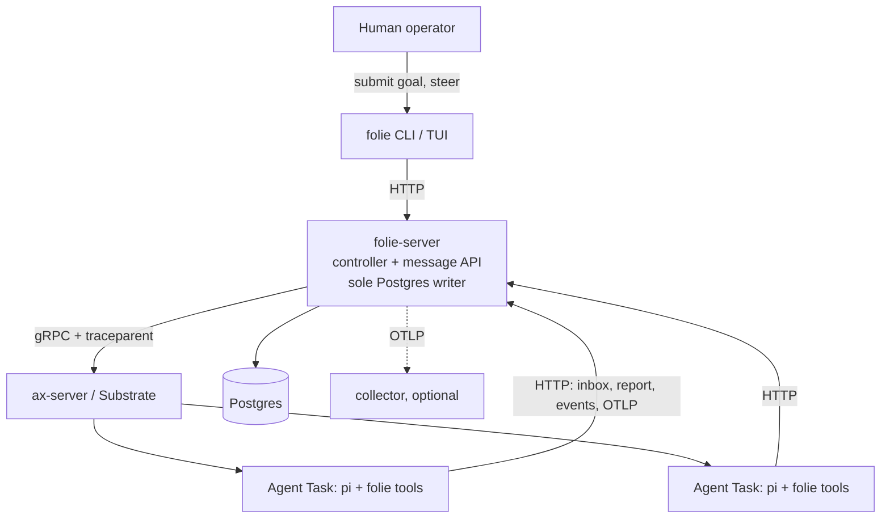

# Folie as built

Reference snapshot for what the code did at commit `0b826bc` (reviewed 2026-11-04; persisted sessions and ExecutionRegistry slices verified 2026-11-06). This is not a live verification of the current checkout. The current design proposal is in [`../docs/architecture/README.md`](../docs/architecture/README.md); prior target documents are retained for migration context. This file was the root `DESIGN.md` before the swarm evolution; where it disagreed with code, the disagreement was recorded in [Verified discrepancies](#verified-discrepancies).

Review method: read every file under `src/`, ran `bun run test` (383 passed, 11 skipped, 27 files), `bun run test:tui` (11 passed) and `bunx tsc -p .` (clean) on 2026-11-04. The "verified live" claims below were made by the earlier author and were **not** re-run in this review (no cluster was started).

## Read this first

### Invariants

Break one of these and the design no longer holds.

1. **ax is only consumed, never patched.** Everything above ax's gRPC API is Folie ([Decision 1](#decisions-at-a-glance)).
2. **folie-server is the only process with Postgres credentials.** A sandbox sends state, messages, reports, transcripts, logs and spans through folie-server's HTTP API, and nothing else.
3. **The only wake is a message in an inbox.** Goals, controller assignment, peer delegation and topic posts are all messages.
4. **A session is bounded.** One work item, an empty conversation, one report. Memory is files in `/workspace`, never chat history.
5. **Mail is acked only by a report**, and the report acks everything the session consumed, including mail steered in mid-run.
6. **Failure is one-shot.** A failed session reports `failed`, the work item parks in `blocked`, and nothing retries the work. Only delivery of a finished report is resent.
7. **Side effects are journaled before they run**, tagged `replay: "safe" | "never"`, and sent with deterministic idempotency keys.
8. **Traces are not the record.** Postgres is. Trace context is stored on rows so a trace survives suspend, resume and process boundaries.
9. **Full trust inside the sandbox**, by decision. Limits that matter (budgets, verification, external effects) belong outside it. _Today nothing outside it enforces them either; see [Verified discrepancies](#verified-discrepancies)._

### Life of a goal

```mermaid
sequenceDiagram
    participant H as Human / CLI / TUI
    participant S as folie-server
    participant X as ax + Substrate
    participant A as Agent (pi)
    H->>S: submit goal (span: work_item.submit)
    S->>S: queued -> dispatch to a pool agent -> message (inbox)
    S->>X: wake: create task, grant egress, resume (spans: wake, sandbox.init)
    A->>S: GET inbox
    A->>A: fresh pi session; poll inbox after every turn, steer new mail in
    A->>S: transcript events, logs, spans (HTTP only)
    A->>S: POST report (acks batch + steered mail)
    S->>S: work item -> done | blocked (span: report.settle)
```

### Decisions at a glance

Rationale of record. Mechanism and limits are in the linked section.

| #   | Decision                                                                                                                                                                                                                                     | Why                                                                                                                                                                                                                                                                                                                           | Detail                                                                            |
| --- | -------------------------------------------------------------------------------------------------------------------------------------------------------------------------------------------------------------------------------------------- | ----------------------------------------------------------------------------------------------------------------------------------------------------------------------------------------------------------------------------------------------------------------------------------------------------------------------------- | --------------------------------------------------------------------------------- |
| 1   | **On top of ax, never inside it.**                                                                                                                                                                                                           | ax is pre-stable with promised breaking changes; a pure API consumer survives them. Warts (immutable tasks, no TTL, no spend caps) are worked around in Folie.                                                                                                                                                                | [ax mapping](#mapping-to-ax-primitives)                                           |
| 2   | **Brokered messages, not peer sockets.**                                                                                                                                                                                                     | Direct serving needs a from-scratch PID 1 (ax's port-80 mux has no extension hook; its `internal/` packages are unimportable) and bypasses the audit trail. Brokering keeps every message durable and replayable; hub load is trivial at hundreds of agents. It is _not_ forge-proof today: the sender is self-asserted (D1). | [Messages](#messages-and-wake)                                                    |
| 3   | **pi is the first runtime, through the pi-agent-core SDK.**                                                                                                                                                                                  | Native programmatic integration, not CLI scraping. The seam for others is MCP over `Workspace.spec.mcp.servers`.                                                                                                                                                                                                              | [Runtime seam](#runtime-seam)                                                     |
| 4   | **TypeScript across server, agent and TUI.**                                                                                                                                                                                                 | One language and one contract at the seam the product lives on. (`pi-durable` server-side was part of this decision; **nothing uses it**.)                                                                                                                                                                                    | [Components](#components)                                                         |
| 5   | **Inbox-non-empty is the sole wake.**                                                                                                                                                                                                        | Uniform emergence: humans, controller and peers wake agents the same way, and every wake is a logged message.                                                                                                                                                                                                                 | [Messages](#messages-and-wake)                                                    |
| 6   | **Full-trust egress and tools.**                                                                                                                                                                                                             | Chosen over allowlists and tool scoping; the brakes are delete, suspend, rotate, quiesce. Realised as one Substrate `EgressPolicy` per agent, limited by Substrate to web ports.                                                                                                                                              | [Trust](#trust-and-credentials), [Egress](#sandbox-egress-a-substrate-dependency) |
| 7   | **One-shot failure, visible.**                                                                                                                                                                                                               | No retry loops; failures park and surface. Retry can be added per work item later without a schema change.                                                                                                                                                                                                                    | [Observability](#observability)                                                   |
| 8   | **`folie up` owns the whole bootstrap.**                                                                                                                                                                                                     | "Works on my laptop now" requires it.                                                                                                                                                                                                                                                                                         | [folie up](#folie-up)                                                             |
| 9   | **folie-server is the sole Postgres writer.**                                                                                                                                                                                                | One trust path, no database credentials in any sandbox.                                                                                                                                                                                                                                                                       | [Data model](#data-model)                                                         |
| 10  | **Opaque work-item schema.**                                                                                                                                                                                                                 | The goal is free text; Folie never interprets it, so nothing about the work is opinionated.                                                                                                                                                                                                                                   | [Messages](#messages-and-wake)                                                    |
| 11  | **A fresh session per work item; memory is files.**                                                                                                                                                                                          | Context rot over days or weeks is the failure to avoid.                                                                                                                                                                                                                                                                       | [Sessions](#sessions)                                                             |
| 12  | **Mid-session steering through pi's steering queue**, polled by the runtime (not the model) at turn boundaries, scoped to the work item.                                                                                                     | Deterministic, costs no context, keeps one report as the settlement.                                                                                                                                                                                                                                                          | [Sessions](#sessions)                                                             |
| 13  | **Replay safety through pi's `AgentTool.replay`**, a write-ahead journal and deterministic idempotency keys. No exactly-once claim for effects outside Postgres.                                                                             | An interrupted call is lost in a suspend as in a crash.                                                                                                                                                                                                                                                                       | [Replay safety](#replay-safety)                                                   |
| 14  | **W3C trace context stored on rows and sent over HTTP and gRPC.**                                                                                                                                                                            | A trace must outlive suspend, resume and process boundaries.                                                                                                                                                                                                                                                                  | [Observability](#observability)                                                   |
| 15  | **Telemetry leaves a sandbox only through folie-server** (OTLP pass-through gateway plus the HTTP API).                                                                                                                                      | No collector address or credentials in sandboxes; extends 9.                                                                                                                                                                                                                                                                  | [Observability](#observability)                                                   |
| 16  | **Transcript and artifact metadata in Postgres; artifact bytes stay in `/workspace`.**                                                                                                                                                       | Blob storage deferred. Cost: retiring an agent deletes its bytes and keeps the metadata.                                                                                                                                                                                                                                      | [Sessions](#sessions)                                                             |
| 17  | **Fail-fast covers work, not delivery.**                                                                                                                                                                                                     | A finished session's unaccepted report is kept and resent; redoing the work would be the wrong recovery.                                                                                                                                                                                                                      | [Observability](#observability)                                                   |
| 18  | **No coding-specific isolation in the core** (no git worktrees).                                                                                                                                                                             | Folie is a general swarm; a prototype per-agent worktree was removed.                                                                                                                                                                                                                                                         | [Lessons](#lessons-from-pi)                                                       |
| 19  | **Direction, not built (superseded by ADRs 0001, 0003, 0007):** server-push assignment with fencing leases; verification as a per-task contract (deterministic checks plus an optional reviewer agent); policy enforced outside the sandbox. | Smallest change that closes the stale-writer hole; neither check alone is enough; keeps Decision 6.                                                                                                                                                                                                                           | [Gap analysis](#reference-design-gap-analysis-history)                            |

### Built, unverified, not built

|                                                  |                                                                                                                                                                                                                                                                                                                                                                                                                                                                                                                                                                                                              |
| ------------------------------------------------ | ------------------------------------------------------------------------------------------------------------------------------------------------------------------------------------------------------------------------------------------------------------------------------------------------------------------------------------------------------------------------------------------------------------------------------------------------------------------------------------------------------------------------------------------------------------------------------------------------------------ |
| **Built and tested**                             | Queue, pool, wake, session, report; durable topics and peer delegation; elastic lifecycle (suspend, retire); bounded sessions; steering; transcript and artifact events; replay safety; tracing, metrics, structured logs and the OTLP gateway; operator TUI; `folie up`; **persisted sessions (`POST /v1/sessions`, message leases, terminal settle) and ExecutionRegistry (durable workspace binding, epoch, ghost → `lost`)**. 400 tests under `bun run test`, 11 under `bun run test:tui`, `bunx tsc -p .` clean.                                                                                        |
| **Verified live** (kind cluster, `echo` runtime) | Goal to `done`; transcript ingest; log lines carrying `trace_id`; gateway answering 202; pool growth 1 to 4; suspend, resume without recreation, retire; TUI driven in a pty.                                                                                                                                                                                                                                                                                                                                                                                                                                |
| **Verified only with pi's faux provider**        | Steering, replay, tool tracing, usage. pi has reached a real provider only to a `401` from `api.anthropic.com` with a bogus key. **pi completing real work against a valid key is unexercised.** Agent-initiated `topic_publish` is covered by tests, not run live.                                                                                                                                                                                                                                                                                                                                          |
| **Not built**                                    | Task graph, fencing leases, verification contracts, budgets, capability claiming, teams (target in the historical [`../spec/requirements.md`](../spec/requirements.md)). An OTel collector in `folie up` (spans are dropped unless `OTEL_EXPORTER_OTLP_ENDPOINT` is set). Durable artifact storage outside `/workspace`. `folie submit --intent` (API only). TUI transcript, cost and trace views (the data is in Postgres). Backlog-aware scaling beyond one goal per agent; deleting retired agent rows. TUI mouse selection, push instead of polling, reconnecting a dropped port-forward. |

### Verified discrepancies

Found by reading the code against the previous `DESIGN.md` (2026-11-04). Where the code and the old text disagreed, **the code is the current state**. Items marked _hole_ are behaviours the old text implied were safe and are not; each is covered by a requirement in [`../spec/requirements.md`](../spec/requirements.md).

| #   | Finding                                                                                                                                                                                                                                                                                                     | Evidence                                                                                                                                 | Status                                                                                                                                                                                                                                                                                                                                                                                                                                                                                                                                                                                                             |
| --- | ----------------------------------------------------------------------------------------------------------------------------------------------------------------------------------------------------------------------------------------------------------------------------------------------------------- | ---------------------------------------------------------------------------------------------------------------------------------------- | ------------------------------------------------------------------------------------------------------------------------------------------------------------------------------------------------------------------------------------------------------------------------------------------------------------------------------------------------------------------------------------------------------------------------------------------------------------------------------------------------------------------------------------------------------------------------------------------------------------------ |
| D1  | **Caller identity is not authenticated (hole).** `from`, `agent` and the path agent name are trusted. Any process that can reach `folie-server:8080` (any sandbox, any pod) can send as any agent, ack another agent's mail by reporting for it, submit reports, and `suspend`/`resume`/`delete` any agent. | `src/server/http.ts` has no auth; `src/shared/client.ts` sends none; `SwarmService.send/submitReport` take `from`/`agent` from the body. | Old text called messages "forge-proof". Target: R-1.1, R-1.3.                                                                                                                                                                                                                                                                                                                                                                                                                                                                                                                                                      |
| D2  | **Agent creation is unbounded (hole).** `send`, `subscribe` and `publish` create an agent row for any valid name; the controller then creates an ax task for every agent with unread mail. `FOLIE_MAX_AGENTS` bounds only pool dispatch (`agent-<n>`).                                                      | `AgentRepo.touch` upserts; `Controller.reconcileOnce` wakes all `wakeDemand()`; `choosePoolAgent` is the only cap.                       | Target: R-1.5 and R-9.6.                                                                                                                                                                                                                                                                                                                                                                                                                                                                                                                                                                                           |
| D3  | **`wake_epoch` is a counter, not a fence.** It increments on each transition into `running` and is shown by `folie agents`; nothing compares it. A stale process is rejected only because its message ids are no longer unacked.                                                                            | `pg-store.ts agents.setState`; no reader other than `list`.                                                                              | Target: R-1.2 and R-8.3.                                                                                                                                                                                                                                                                                                                                                                                                                                                                                                                                                                                           |
| D4  | **`work_items.state = 'failed'` is unreachable.** Only `queued`, `assigned`, `blocked`, `done` are ever set. A `blocked` item has no API to retry or release it.                                                                                                                                            | `service.ts submitReport` (`done` or `blocked`); no other `setState` caller.                                                             | Superseded by the task lifecycle ([`../spec/domain-model.md`](../spec/domain-model.md)).                                                                                                                                                                                                                                                                                                                                                                                                                                                                                                                           |
| D5  | **`done` is the agent's say-so.** Any `done` report settles every work item among the messages it acked.                                                                                                                                                                                                    | `submitReport` + `workItems.setState`.                                                                                                   | Target: R-11.1–11.5.                                                                                                                                                                                                                                                                                                                                                                                                                                                                                                                                                                                               |
| D6  | **No durable record of a session in flight.** `sessions` rows appear only at report time; a crashed session leaves transcript events but no row.                                                                                                                                                            | `pg-store.ts reports.record`.                                                                                                            | **CLOSED 2026-11-06 (persisted-sessions slice):** `POST /v1/sessions` writes a server-generated `running` row (state/outcome/work_item/client_request_id/public_id) and leases its messages (`messages.session_id/leased_at`) in one transaction before any transcript event; `submitReport` settles the named session (`running` → `settled` with outcome); numeric server-generated session ids are strictly validated, legacy free-form ids auto-provision. Target: R-3.2.                                                                                                                                      |
| D7  | **Docs named columns that do not exist** (`work_items` context refs and priority; a `sessions` report ref).                                                                                                                                                                                                 | `schema.ts`.                                                                                                                             | Corrected above.                                                                                                                                                                                                                                                                                                                                                                                                                                                                                                                                                                                                   |
| D8  | **ax `Workspace` and `ResourcesSpec` are not used; no resource limits on agent tasks.** `AxClient` wraps 5 of ax's RPCs (`GetTask`, `CreateTask`, `ResumeTask`, `SuspendTask`, `DeleteTask`); there is no `ListTasks`, so a task with no agent row (or an agent row lost) is never found.                   | `src/server/ax.ts`; `ax.proto:69-89`.                                                                                                    | **PARTIALLY CLOSED 2026-11-06 (ExecutionRegistry slice):** durable workspace `<key>-ws` is bound per agent at task create (survives `DeleteTask`), and the reconciler reads **actual** provider state via `list()` once per pass (R-6.2 reconciler half). Ghost detection (R-6.3): a recorded `running` execution the provider no longer reports is marked `lost`. Still open: `ResourcesSpec` per-task limits (setter path exists via `ControllerConfig.resources`, no per-agent policy yet), `spec.debug: false` guard with test, and pending execution of suspend/delete registry writes. Target: R-6.2, R-6.3. |
| D9  | **Single server process assumed.** The dispatch and reconcile loop is guarded by an in-process flag; the deployment pins `replicas: 1`; the advisory lock covers migrations only. Two pods would double-dispatch and double-wake.                                                                           | `main.ts` (`reconciling`), `deploy/server.yaml`, `schema.ts`.                                                                            | Target: R-6.6.                                                                                                                                                                                                                                                                                                                                                                                                                                                                                                                                                                                                     |
| D10 | **No cancellation reaches a running session.** `Runtime.run` takes no abort signal; `PiRuntime` never calls `Agent.abort()` (which pi-agent-core exposes); SIGTERM is checked only between ticks. A session in flight cannot be stopped except by ax killing the container.                                 | `runtime.ts`, `pi.ts`, `loop.ts run()`, `pi-agent-core/dist/agent.d.ts` (`abort()`).                                                     | Target: R-2.4, R-2.5 and R-5.1.                                                                                                                                                                                                                                                                                                                                                                                                                                                                                                                                                                                    |
| D11 | **Spend is recorded at session end only.** A crashed session's usage is not in `reports`; per-message usage survives inside `message` transcript events.                                                                                                                                                    | `loop.ts`, `reports.record`.                                                                                                             | Target: R-13.3.                                                                                                                                                                                                                                                                                                                                                                                                                                                                                                                                                                                                    |
| D12 | **Test shape.** No test exercises concurrent writers (no multi-connection race tests); the controller is only tested against `FakeAx`/`FakeEgress`; no test reaches a real ax, Substrate, collector or model. 383 tests, all PGlite or in-memory.                                                           | `test/support/fakes.ts`, `test/support/cluster.ts`.                                                                                      | Target: R-6.2, R-14.2 and the live requirements in [`../spec/requirements.md`](../spec/requirements.md).                                                                                                                                                                                                                                                                                                                                                                                                                                                                                                           |

Documented earlier and confirmed in code: topic publish to zero subscribers leaves no row; transcript delivery is best effort and can have gaps; steering lands at turn boundaries only; egress is `*` on web ports.

### Code map

| Path                                                | What it is                                                                           |
| --------------------------------------------------- | ------------------------------------------------------------------------------------ |
| `src/server/service.ts`                             | All business rules; every operation runs in a span.                                  |
| `src/server/controller.ts`                          | Wake, idle suspend, retire, operator ops (`AgentOps`).                               |
| `src/server/pool.ts`                                | `choosePoolAgent`: idle agent first, else grow to the ceiling.                       |
| `src/server/http.ts`                                | Routing only, plus request spans and the OTLP route.                                 |
| `src/server/store.ts`, `pg-store.ts`, `schema.ts`   | Ports, Postgres adapter, additive migrations.                                        |
| `src/server/ax.ts`, `substrate.ts`, `grpc.ts`       | gRPC clients; `callUnary` adds trace metadata.                                       |
| `src/server/otlp-gateway.ts`                        | OTLP pass-through to the collector.                                                  |
| `src/shared/`                                       | `types.ts`, `client.ts` (`FolieClient`), `trace.ts`, `telemetry.ts`, `logger.ts`.    |
| `src/agent/loop.ts`                                 | Wake loop: session scoping, spans, report.                                           |
| `src/agent/runtime.ts`                              | The `Runtime` and `Session` contract.                                                |
| `src/agent/runtimes/pi.ts`                          | pi runtime: tools, steering, usage. `echo.ts` is the LLM-free runtime.               |
| `src/agent/instrument.ts`, `replay.ts`, `events.ts` | Tool spans and journal; replay policy and idempotency keys; transcript sink.         |
| `src/tui/`, `src/cli.ts`, `src/cli/`                | OpenTUI app (pure view-models, one OpenTUI file), CLI.                               |
| `src/host/`                                         | `folie up/down`: cluster, images, manifests, Substrate authz, port-forward.          |
| `test/support/cluster.ts`                           | Harness: PGlite, service, HTTP, controller, agent loops. `test/e2e.test.ts` uses it. |

### Run it

`folie up` builds and deploys everything (idempotent); `folie down` removes it. `folie submit [--to agent] "goal"`, `status`, `agents`, `topics`, `subscribe`, `unsubscribe`, `publish`; bare `folie` for the TUI. Redeploy after changes with `bun src/cli.ts up`; unset a stale `FOLIE_SERVER_URL`. Without `kubectl` on PATH use `~/.folie/bin/kubectl --kubeconfig ~/.folie/kubeconfig --context kind-folie`. Tests: `bun run test` (Node, vitest, PGlite), `bun run test:tui` (Bun-only OpenTUI), `bunx tsc -p .`.

### Configuration

| Variable                                                                                                                                                           | Default                                          | Meaning                                                                                    |
| ------------------------------------------------------------------------------------------------------------------------------------------------------------------ | ------------------------------------------------ | ------------------------------------------------------------------------------------------ |
| `DATABASE_URL`, `FOLIE_AGENT_IMAGE`                                                                                                                                | required                                         | Server only.                                                                               |
| `FOLIE_MAX_AGENTS`                                                                                                                                                 | 8                                                | Pool ceiling; unaddressed goals queue beyond it.                                           |
| `FOLIE_SUSPEND_AFTER_S` / `FOLIE_DELETE_AFTER_S`                                                                                                                   | 60 / 3600                                        | Quiet period before suspend / retire; delete must exceed suspend.                          |
| `FOLIE_RECONCILE_MS`                                                                                                                                               | 2000                                             | Controller interval.                                                                       |
| `FOLIE_ATESPACE`, `AX_ADDR`, `PORT`                                                                                                                                | `folie`, `ax-server.ax-system.svc:8080`, 8080    | Server.                                                                                    |
| `SUBSTRATE_ADDR`, `SUBSTRATE_AUTHORITY`, `SUBSTRATE_CA_FILE`, `SUBSTRATE_TOKEN_FILE`                                                                               | in-cluster values                                | Substrate API access.                                                                      |
| `FOLIE_EGRESS_HTTP_PORTS` / `FOLIE_EGRESS_TLS_PORTS`                                                                                                               | `80,8080` / `443`                                | Ports of the full-trust egress rules.                                                      |
| `FOLIE_AGENT_ENV_<NAME>`                                                                                                                                           | none                                             | Forwarded into every agent task as `<NAME>` (the LLM key, `FOLIE_RUNTIME`, `FOLIE_MODEL`). |
| `FOLIE_AGENT_SERVER_URL`, `FOLIE_AGENT_COMMAND`                                                                                                                    | in-cluster URL, `["/usr/local/bin/folie-agent"]` | What agents are started with.                                                              |
| `OTEL_EXPORTER_OTLP_ENDPOINT`                                                                                                                                      | unset                                            | Collector base URL. Unset: spans propagate but nothing is exported.                        |
| Agent: `FOLIE_AGENT`, `FOLIE_SERVER_URL`, `FOLIE_RUNTIME` (`pi`\|`echo`), `FOLIE_MODEL` (`provider/model`), `FOLIE_WORKDIR` (`/workspace`), `FOLIE_POLL_MS` (2000) |                                                  | Set per task by the controller.                                                            |

### HTTP API

JSON. Every request may carry `traceparent`/`tracestate`. Validation errors are 400, unknown ids 404.

| Route                                                                                                        | Purpose                                                                                                                                                        |
| ------------------------------------------------------------------------------------------------------------ | -------------------------------------------------------------------------------------------------------------------------------------------------------------- |
| `POST /v1/work-items` `{goal, to?, intent?}`; `GET /v1/work-items/:id`                                       | Submit; read with its latest report.                                                                                                                           |
| `POST /v1/messages` `{from, to, body, requestId?}`; `GET /v1/messages?after&limit&topic&agent`               | Send (at-most-once per sender and recipient with `requestId`); audit log.                                                                                      |
| `GET /v1/agents/:n/inbox?workItem=<id>\|none`                                                                | Unread mail; with `workItem`, that work item's mail plus mail with none.                                                                                       |
| `POST /v1/reports` `{agent, startedAt, outcome, summary, messageIds, usage?}`; `GET /v1/reports?agent&limit` | Settle a session; list.                                                                                                                                        |
| `GET /v1/agents`; `POST /v1/agents/:n/{suspend,resume,delete}`                                               | Fleet; operator steering.                                                                                                                                      |
| `GET /v1/topics`; `POST /v1/topics/:t/{subscribe,unsubscribe,publish}`                                       | Topics; publish takes `requestId?`.                                                                                                                            |
| `POST /v1/sessions/events`; `GET /v1/sessions/events?agent&sessionId&scope&type&after&limit`                 | Transcript ingest (idempotent per session and seq); read.                                                                                                      |
| `POST /v1/sessions` `{agent, messageIds, clientRequestId?, workItemId?}`                                     | Start a server-owned running session and lease its messages (idempotent on `clientRequestId`); the session id is server-generated.                             |
| `POST /v1/sessions/events`; `GET /v1/sessions/events?agent&sessionId&scope&type&after&limit`                 | Transcript ingest (idempotent per session and seq); read. Server-generated ids must name a running session of the caller; legacy free-form ids auto-provision. |
| `GET /v1/sessions/attempts?agent&scope&exclude`                                                              | Earlier tool calls at a scope: `done`, `failed`, `interrupted`.                                                                                                |
| `POST /v1/otlp/v1/{traces,metrics,logs}`                                                                     | OTLP pass-through for sandboxes.                                                                                                                               |
| `GET /healthz`                                                                                               | Liveness; no database.                                                                                                                                         |

## Messages and wake

- **Inbox-non-empty is the only wake.** Any agent can wake any other by sending it a message. That is the emergence mechanism and the only one, so it is uniform and observable.
- **Topics are durable, not live.** `publish(topic)` copies the message into every current subscriber's inbox in one statement, excluding the publisher (so announcing to a followed topic does not wake yourself). Subscriptions live in Postgres, so a suspended agent wakes with its backlog and a retired one starts a fresh task. Nothing is replayed to late subscribers. A topic exists while it has subscribers; publishing to one with none delivers zero copies and leaves no trace (the one gap in the audit log). Anyone can publish; an agent can subscribe before it has ever run.
- **The message table is the audit trail.** Every goal, delegation and report passes through folie-server and is recorded server-side; agents cannot delete rows through the API. **Sender identity is not authenticated:** `from` in `POST /v1/messages` and `agent` in reports are caller-supplied (D1), so the trail proves what the server was told, not who told it. Log deletion is excluded; log forgery by impersonation is not, until agents authenticate. (The Hugging Face incident swarm forged its own logs.)
- **Delivery is at-least-once, with idempotent sends.** Mail is acked only by a report, so a session that dies is rerun. `message_send` and `topic_publish` carry a `requestId`, making them at-most-once per (sender, recipient) and per (sender, topic) ([Replay safety](#replay-safety)).
- **Opaque goals.** The work item stores and routes free text and never interprets it; verification, acceptance criteria and PRDs live inside the goal text (Decision 10).

### Domain model

**Swarm** (agents plus the substrate they talk through). **Agent**: long-lived, stable name, one inbox, works in sessions. **Work item**: an externally submitted goal with a state (`queued`, `assigned`, `blocked`, `done`, `failed`). **Message**: an inbox item from a human, the controller or a peer. **Topic**: a broadcast channel. **Session**: one bounded run over one work item's mail, scoped `wi:<id>` or `mail:<id>`. **Report**: a session's outcome with token and cost usage. **Transcript**: a session's append-only events. **Artifact**: a registered file (path, size, SHA-256, description). **Steering**: changing swarm behaviour, by message, suspend, resume or delete.

## Agent lifecycle and elasticity

- **Intake.** A goal that names an agent (`folie submit --to lead`) is a message to that agent. Otherwise it stays `queued`; each controller pass first dispatches queued goals, oldest first, to a _pool agent_ (`agent-<n>`): an idle one if any (running before suspended before retired), else a new one while fewer than `FOLIE_MAX_AGENTS` are alive, else it waits. Named agents are never drafted into the pool. Idle means no unread mail; an agent mid-session always has unread mail because only its report acks.
- **Wake.** Mail for an agent without a running task creates the task (egress policy, then resume) or resumes the suspended one.
- **Suspend.** A running agent quiet for `FOLIE_SUSPEND_AFTER_S` is suspended. Activity is mail in or a report out (`agents.last_active_at`), not controller state changes.
- **Retire.** A suspended agent quiet for `FOLIE_DELETE_AFTER_S` (measured from the same activity) has its task deleted and its state set to `retired`. A task found `Failed` while quiet is deleted the same way. Delete is issued only for a `Suspended` or `Failed` task, never a running one. New mail for a retired agent starts a fresh task.
- **Identity and memory.** An agent's _files_ survive suspend and resume (`/workspace`, which ax checkpoints); its conversation does not exist beyond a session. `DeleteTask` destroys `/workspace` and therefore the agent's memory and artifact bytes: retirement is forgetting, not parking. The name, the audit history and transcript in Postgres, and the `<atespace>/<agent>` address are stable across all of it.
- **Operator ops** (`suspend`, `resume`, `delete`) leave the recorded state matching ax so the sweep does not fight them; `resume` restarts the quiet period first.
- Verified in the cluster with short thresholds: four unaddressed goals grew the pool 1 to 4 and all completed; agents suspended when quiet, resumed on new mail without being recreated, and retired after the longer horizon. A pre-existing `Failed` task was garbage-collected by the same sweep.
- **Scale.** Designed for hundreds of concurrent agents with no hard cap in schema, protocol or TUI. A laptop (kind) runs dozens. Nothing binds to localhost; all service addresses are configurable. Multi-VPC operation is later.

## Sessions

**A session serves one work item and starts empty.** The oldest unread message picks the work item. The first batch is that work item's mail plus mail that belongs to no work item; mail for other work items waits for its own session. Scope is `wi:<id>`, or `mail:<first message id>` when the batch has no work item. No conversation is saved or resumed. A long job is a chain of sessions whose memory is files in `/workspace`: when a goal is bigger than one session, the agent writes down where it stopped and what is next, then `message_send`s that to itself, and the next phase starts fresh from the files. The system prompt says so.

**Mid-session steering.** The runtime, not the model, polls `GET /v1/agents/<n>/inbox?workItem=<id>` between turns. Anything not yet consumed is pushed with `agent.steer()` from pi's `finishTurn` hook, so pi delivers it before the next model call.

- _Runtime-side, not a model tool._ Deterministic and costs no context; an `inbox_peek` tool was rejected.
- _`finishTurn`, not `prepareNextTurn`._ It runs before pi's own post-turn drain of the steering queue, so the mail lands in the same turn boundary. The drain also continues the run when mail arrives after the model tried to stop.
- _Scoped by work item._ A session never absorbs another goal's mail, so the one report settles the right work items. Mail with no work item (a peer's note, a topic post, an operator correction) is absorbed by whichever session is running, because it carries no scope to respect.
- _A report already recorded is void when mail arrives after it;_ the model gets another turn rather than finishing on stale instructions.
- _A failing poll is logged and ignored;_ a server hiccup must not kill a session that is making progress.
- _One report acks the initial batch and every steered message,_ so the audit trail never holds an unacked message a session read.

Limit: steering lands at turn boundaries and cannot interrupt a single tool call that runs for hours. The operator's `suspend` or `delete` is the interrupt for that.

**Transcript.** The agent batches events to `POST /v1/sessions/events`, idempotent per `(session id, seq)`. Events over 48 KiB become a truncated preview, because the server rejects more than 64 KiB per event and a rejected batch would block the log. Delivery is best effort: a failed batch is retried at the next flush and dropped after three failures, so the transcript can have gaps; it never fails a session.

**Artifacts.** `artifact_register(path, description)` stats and hashes a file under the workspace (refusing paths outside it) and emits an `artifact` event with the relative path, size, SHA-256 and description. Re-registering is harmless, which is why the tool is replayable. The bytes stay in `/workspace` (Decision 16).

## Replay safety

Agents act on live external systems, so a tool that ran, was interrupted and ran again can duplicate a charge or a message. ax resumes a suspended task into a fresh container with a new process tree ([ax facts](#ax-and-pi-facts)), so an interrupted call is lost in a suspend exactly as in a crash.

- **Every tool carries pi's `replay` policy**: `"safe"` (twice is harmless) or `"never"`. Folie's tools declare it; pi's coding tools get theirs from a table (`read`, `grep`, `find`, `ls` safe; `bash`, `edit`, `write` never); an unknown tool is `"never"`. The flag appears as `replayable` on every `tool_start`/`tool_end` event and as `tool.replayable` on tool spans.

  | Tool                                                                         | Policy | Why                               |
  | ---------------------------------------------------------------------------- | ------ | --------------------------------- |
  | `topic_subscribe`, `topic_unsubscribe`, `artifact_register`, `report_submit` | safe   | Idempotent setters or local-only. |
  | `message_send`, `topic_publish`                                              | never  | Create mail.                      |

- **Write-ahead journal.** For a `"never"` tool, `tool_start` reaches Postgres _before_ the tool runs and `tool_end` after. A start with no end means the outcome is unknown.
- **Idempotency keys.** `message_send` and `topic_publish` send a key derived from scope, tool, canonical arguments and the call's ordinal among identical calls. A restarted session at the same scope that repeats the call gets the same key, and a unique index drops the duplicate. Two identical calls in one session get different keys, so deliberate repetition is not swallowed.
- **After a restart** the session reads `GET /v1/sessions/attempts`, which pairs starts with ends into `done`, `failed` or `interrupted`. It re-runs interrupted idempotent state-setters (`topic_subscribe`, `topic_unsubscribe`, `artifact_register`) to restore intended state and never re-runs a side effect. Its first prompt lists the earlier state-changing calls, flagging interrupted ones as unknown-outcome so the model checks before repeating them.
- **Not claimed:** exactly-once for effects outside Postgres. A tool that calls an external API must declare `replay: "never"` and use that API's own idempotency mechanism where it has one. An uncertain irreversible action is never retried blindly.

## Observability

Tracing is first-class, but spans can be sampled or dropped; the Postgres tables are authoritative (Invariant 8).

**Propagation.** W3C `traceparent` and `tracestate` ride on every HTTP call between the CLI, agents and folie-server (added in `FolieClient`, read by the server's request span) and on every gRPC call to ax and Substrate (metadata, added in `callUnary`). The context is also stored on `work_items` and `messages`, so the controller and an agent in another process, possibly after a suspend, rejoin the same trace.

| Span                                                                                                            | Made by    | Parent                                               |
| --------------------------------------------------------------------------------------------------------------- | ---------- | ---------------------------------------------------- |
| `folie.http.request`                                                                                            | server     | the caller's span                                    |
| `folie.work_item.submit` (`work_item_id`, `folie.intent`)                                                       | server     | the submitting request; the work item's trace root   |
| `folie.dispatch`                                                                                                | server     | the submit span (queued goals only)                  |
| `folie.controller.wake`                                                                                         | controller | the span stored on the agent's oldest unread message |
| `folie.sandbox.init`                                                                                            | controller | wake; wraps task create, egress grant, resume        |
| `folie.agent.session`                                                                                           | agent      | `sandbox.init`, else the stored trace                |
| `folie.turn` (`llm.usage.prompt_tokens`, `llm.usage.completion_tokens`, `llm.usage.cost_usd`, `llm.latency_ms`) | agent      | session                                              |
| `folie.tool.<name>` (`tool.name`, `tool.replayable`, `tool.exit_code`, `tool.call_id`)                          | agent      | the turn that requested it                           |
| `folie.report.settle` (`work_item_id`, `outcome`, usage)                                                        | server     | the report's HTTP request, inside the session span   |
| `folie.message.send`, `folie.topic.publish`                                                                     | server     | the caller's span (usually an agent's tool call)     |

- _The session is the child of `sandbox.init`._ Before resuming a task the controller rewrites the trace on the agent's unread mail to the `sandbox.init` span, so the hierarchy reads submission, dispatch, wake, init, session, turn, tool, with settlement under the session. Otherwise the session would be the wake's sibling.
- _The wake span opens only when there is something to bring up._ An agent with unread mail is in the wake demand on every pass while its session runs; tracing each would write a span every two seconds per busy agent.
- _`tool.exit_code`_ is the tool's reported exit code when its result has one (pi's `bash`), else 0, or 1 on error.

**Metrics** are derived by folie-server from reports and events; agents export none. `folie.llm.tokens` (`type` prompt or completion) and `folie.llm.cost` come from report usage; `folie.tool.calls` and `folie.tool.failures` (`tool.name`, `tool.replayable`) from `tool_end` events, counted once per event actually stored so a resent batch does not double count; `folie.session.outcome`; `folie.inbox.depth` (gauge read from the store at each collection); `folie.inbox.latency`, the time from a message's creation to the report that acks it, so it includes the session's own runtime, not only the queue wait. All carry `agent_name`.

**Logs** are one JSON object per line: `ts`, `level`, `msg`, `agent_name`, `work_item_id`, `session_id`, and `trace_id` and `span_id` while a span is active. In the sandbox each line goes to stdout and into the transcript as a `log` event, which is how a log leaves the sandbox over HTTP.

**Getting spans out.** Sandboxes send OTLP/HTTP to `POST /v1/otlp/v1/{traces,metrics,logs}`, which forwards the bytes unchanged to `OTEL_EXPORTER_OTLP_ENDPOINT`. Unset, it answers 202 and drops them so agents do not retry a disabled feature; a collector failure answers 502 so the exporter's own retry applies. The route is not itself traced. This keeps collector addresses and credentials out of sandboxes (Decision 15). The agent flushes spans at the end of each session because the task can be suspended right after. Sampling is the SDK default (always on); policy is deferred.

**Fail-fast.** A thrown error or a `failed` outcome puts the error on the session span (status and exception event); the report carries `outcome=failed`; the work item parks in `blocked`; the settlement span is marked failed with `folie.work_item.parked`; `folie.session.outcome{outcome=failed}` counts it. Nothing retries the work. `blocked` shows in the TUI today; the trace and cost do not.

## Data model

Postgres; all writes through folie-server; migrations are additive `ALTER`s.

- `agents` — name (identity), state (`pending`, `running`, `suspended`, `retired`), wake epoch (advances on each transition into running), last activity.
- `messages` — the audit log: id, sender, recipient (always an agent), body, work item, topic (set when it came from a publish), created, acked, optional idempotency `request_id` (unique per sender and recipient), and the W3C trace context of the sending span. A publish is one row per subscriber.
- `topic_subscriptions` — (topic, agent); no separate topic registry.
- `work_items` — id, goal (opaque text), state, created, and the trace context of the submission that created it. (No priority or context-reference columns exist.)
- `sessions` — **server-owned since 2026-11-06**: `id` (server-generated sequence = the session id), agent, `state` (`running`/`settled`), `outcome` on settle, `work_item_id`, `client_request_id` (idempotency), `public_id` (legacy free-form ids), started, `ended_at` (set on settle), message ids consumed. A `running` row is written at session start; `reports` references it (`session_id`).
- `executions` — **ExecutionRegistry**: `id` (execution id), agent, `state` (`provisioning`/`running`/`suspended`/`failed`/`terminated`/`lost`), `epoch` (increments on re-entry to `running`), `provider_ref`, `started_at`, `generation`, `ended_at`.
- `reports` — outcome, summary, usage (prompt and completion tokens, cost in USD, tool calls, tool failures; null when the runtime reports none). Artifacts are `artifact` events, not a column.
- `session_events` — the transcript: agent, session id (the server session id, validated against the row), scope, per-session `seq` (unique with the session id, so a resent batch cannot duplicate), type, JSON data, trace id. Types: `session_start`, `message`, `turn_start`, `turn_end`, `tool_start`, `tool_end`, `steer`, `log`, `artifact`, `session_end`.
- `messages` — plus `session_id` + `leased_at`: a delivery bound to a leased session. Unleased mail (`acked_at IS NULL AND session_id IS NULL`) is what a new session may take.

## Trust and credentials

**Full trust, by decision.** Agents run as root in their sandbox with unrestricted internet egress, unrestricted tools and no NetworkPolicy. Chosen with eyes open: it is the configuration that produced the Hugging Face incident, minus the unobservability; here every action that crosses the substrate is logged where agents cannot write.

The free brakes, all surviving the full-trust choice: `DeleteTask` (remove any agent), `SuspendTask` (freeze any agent), key rotation (the LLM key is injected per task at `CreateTask`; rotate and recreate to cut model access), and stopping folie-server (no wakes, no message flow; the swarm goes quiescent).

Credential delivery is the simplest thing that works: the controller holds the LLM key and injects it through `spec.env` (the ax-native flow). Spend enforcement exists nowhere in this stack. When cost matters, insert an in-cluster LLM gateway that holds the key and enforces per-agent budgets, and remove the key from `spec.env`. Spend is visible meanwhile: every report carries usage. `spec.config` is plaintext (shown by `ax get task`) and never carries credentials.

### Sandbox egress (a Substrate dependency)

**Found 2026-11-03 by running the slice.** Substrate sandboxes deny egress by default: an actor with no `EgressPolicy` gets `NXDOMAIN` for every hostname and all TCP is blocked (`substrate/docs/egress-traffic.md`). ax creates no policy and exposes no way to set one. Before the fix the agent task was `Running`/`Ready` and logged `getaddrinfo ENOTFOUND folie-server.folie.svc` every poll (visible in the `ax-workers` pod logs).

**Resolution (2026-11-04).** The controller calls Substrate's `CreateActorEgressPolicy` for each agent's actor between ax `CreateTask` and `ResumeTask`, and again before resuming any suspended agent (idempotent, so a crash between steps heals). The policy is the full-trust one: hostname `*` on cleartext HTTP ports `80,8080` and TLS-passthrough port `443`. The two rules use disjoint ports because Substrate rejects ties on the same pattern and port at admission. Verified in-cluster: an agent reaches `folie-server.folie.svc:8080`, and a pi session got a genuine `401 invalid x-api-key` from `api.anthropic.com`.

What it costs:

- Folie depends on Substrate's API, not only ax's. folie-server holds a projected service-account token (audience `api.ate-system.svc`) and the Substrate trust bundle, as ax-server does, and its namespace carries `ate.dev/api-access=true`.
- `folie up` adds `system:serviceaccount:folie:folie-server` to `ate-api-server`'s `--authz-bootstrap-owners` (a Substrate install setting; ax untouched). That makes folie-server a _global_ Substrate owner, broader than needed. Upgrade path: an atespace-editor access policy for the `folie` atespace. Re-running ax's setup script resets the owners; the next `folie up` re-applies the grant.
- Substrate egress is HTTP(S) only: other TCP (ssh, arbitrary ports) is blocked whatever the policy. "Unrestricted egress" is "all hosts, web ports"; git over ssh, databases and dev servers on other ports do not work from a sandbox.
- **Forward risk: in-cluster destinations.** Agents reach `folie-server.folie.svc` today because `*` matches and Substrate does not yet filter private destinations. Substrate [#2086](https://github.com/agent-substrate/substrate/issues/2086) (open) proposes denying private IPs by default with an explicit operator exception. When it lands, agent to folie-server traffic breaks unless that exception exists or Substrate gains named in-cluster Service rules (reported as #3243, not checked). Re-test after every Substrate bump.
- **Upstream tracking.** ax [#449](https://github.com/google/ax/issues/449) (no egress field on `TaskSpec`; open, maintainers want it) is the issue to watch. Folie drops its policy grant, the Substrate API dependency and the bootstrap-owner patch once ax exposes egress that can name folie-server and web hosts.
- Unresolved: `ax ssh` from this host fails ("error reading server preface"); `ip route get` shows the host routes `10.244.0.0/16` through the LAN gateway rather than kind. Logs via worker pods work and show agent stdout.

## Components



Everything above ax is Folie. Everything at ax and below is fleet plumbing Folie reuses but never patches.

### Mapping to ax primitives

ax provides one sandboxed, resource-limited, digest-pinned container per agent (`Task`), shared prepared environments (`Workspace`), a credential record (`Model`), checkpointed suspend and resume, in-cluster addressing through the atenet router, and a paginated `ListTasks` built for millions of tasks.

| Swarm need                  | ax primitive                                             | Folie consequence                                                                                                                                                                                                                  |
| --------------------------- | -------------------------------------------------------- | ---------------------------------------------------------------------------------------------------------------------------------------------------------------------------------------------------------------------------------- |
| One sandboxed agent each    | `Task`                                                   | Agent == Task; name == actor name                                                                                                                                                                                                  |
| Shared prepared environment | `Workspace` (git, files, MCP, skills)                    | **Not used.** `AxClient.createTask` sends image, command and env only: no `workspace`, no `resources`. Tasks get ax's empty `/workspace` and no CPU or memory limits. Workspace remains the intended MCP seam for non-pi runtimes. |
| Mid-run goal change         | Tasks are immutable                                      | Goals are **messages**, never task mutations                                                                                                                                                                                       |
| Cheap idle agents           | `SuspendTask` / `ResumeTask` (checkpoint `/workspace`)   | Controller suspends idle agents; `/workspace` files ride the snapshot                                                                                                                                                              |
| Kill switch                 | `DeleteTask`                                             | Steering hard-stop                                                                                                                                                                                                                 |
| Address / probe any agent   | atenet router, `ate-target-actor: <atespace>/<task>`     | Health checks; emergency `ax ssh` needs `spec.debug: true`                                                                                                                                                                         |
| Task TTL / GC               | None                                                     | Controller owns GC (delete parked or dead agents)                                                                                                                                                                                  |
| Completion detection        | Control plane never reads command exit                   | Agent program is a non-exiting loop; completion is a report                                                                                                                                                                        |
| Spend caps                  | None                                                     | None in v1; a gateway is the upgrade path                                                                                                                                                                                          |
| LLM credential delivery     | `spec.env` (`Model.secretKey` never reaches the sandbox) | Controller injects the key per task at `CreateTask`                                                                                                                                                                                |

### folie-server

One TypeScript deployment: (1) the **controller loop** maintains the elastic pool (`CreateTask` to grow, `SuspendTask` to free CPU and memory, `ResumeTask` on wake, `DeleteTask` to shrink) and injects the LLM key at creation; (2) the **HTTP API** above, every write landing in Postgres; (3) the **operator backend**, the same API. It depends on `pg` and a generated ax gRPC client (from `ax.proto`, 298 lines; ax is pre-stable, so regenerating on upstream changes is expected maintenance either way). Telemetry is shared with the agent: `src/shared/telemetry.ts`.

### Agent image

Extends ax's default `ax-task-runner` image (Python 3.12 base; ax documents this as the shallowest customization level, add tools and keep the entrypoint) with Node.js ≥ 22.19, a pinned `@earendil-works/pi-coding-agent` toolchain and the **folie agent program**, a TypeScript loop on `@earendil-works/pi-agent-core`. `spec.command` runs it under the stock runner, which handles workspace prep, probes and SIGTERM. **No runner fork is needed**: the program never exits, which also neutralizes ax's control plane never reading the exit code.

```
tick:
    resend an undelivered report if there is one, else
    unread  = fetch inbox
    first   = oldest unread message  ->  scope wi:<work item> | mail:<message id>
    batch   = unread mail for that work item, plus mail with no work item
    session = a fresh pi Agent with an empty conversation
              prompt = batch (+ a notice of earlier attempts at this scope, if any)
    tools   = pi coding tools + folie tools, each tagged replay "safe" | "never",
              each traced (span) and journaled (tool_start / tool_end events):
                message_send(to, body)                 # wake another agent
                topic_subscribe / topic_unsubscribe / topic_publish
                artifact_register(path, description)   # a file worth keeping
                report_submit(outcome, summary)
    after every turn: poll the inbox scoped to this work item -> agent.steer(new mail)
    run the session, streaming transcript events; one report acks the batch and all steered mail
on failure: report outcome=failed; work item parks in blocked; NO retry
```

### Runtime seam

pi is the first runtime, not the only forever-runtime. In code the seam is `Runtime.run(messages, session)` with `pi` and `echo` (an LLM-free runtime that proves wake, session and report wiring). For other runtimes (e.g. Claude Code via ax's own runner), ax `Workspace.spec.mcp.servers` with an HTTP endpoint wires tools into any MCP-speaking agent, and pi speaks MCP too; the message API would be exposed as an MCP server for them.

### folie CLI and TUI

TypeScript on [OpenTUI](https://github.com/anomalyco/opentui) (`@opentui/core`: Zig-native renderer, flexbox, scroll boxes, selects, inputs; the library behind OpenCode). Chosen over `pi-tui` because the operator surface is a dense grid plus a scrolling feed, and OpenTUI offers `@opentui/ssh` for serving the TUI to remote operators. Cost: it needs Bun and a native core (the `folie` CLI is Bun-only) and is pre-1.0 (0.8.x here). State and transitions are pure view-models (`src/tui/model.ts`, commands, poller) tested under Node; `src/tui/app.ts` is the only OpenTUI code, tested with OpenTUI's in-memory renderer under Bun.

Bare `folie` opens the TUI, polling about once a second (cursor-based, so only new messages; no push yet):

- **Fleet grid** — every agent: state (`working`, `idle`, `waking`, `suspended`, `retired`), unread mail, time since activity.
- **Views** — message stream (`1`), selected agent's unread inbox (`2`), topics and subscribers (`3`), the agent's session reports (`4`).
- **Command line** — `:` opens `submit [@agent] <goal>`, `send [@agent] <text>`, `publish`, `subscribe`, `unsubscribe`, `suspend|resume|delete [agent]`. Shortcuts: `tab`/`1-4`, `s` suspend, `r` resume, `q` quit. Delete, the kill switch, is command-only so it cannot be pressed by accident.

### folie up

One command creates the world on a laptop: kind cluster, Agent Substrate, ax-server, Postgres, folie-server. Versions are pinned; Folie lives in its own `folie` namespace beside `ax-system` and `ate-system`; `folie down` tears it down. ax's own `hack/setup-e2e-kind.sh` installs Substrate and ax, and `folie up` skips it when ax is healthy (the script wipes ax's database). The same manifests deploy to a real VPC; only the cluster provider differs. kubectl and kind are downloaded, sha256-verified, into `~/.folie/bin`.

## Reference design gap analysis (history)

Source: the author's design conversation (2026-11-04) for a general-purpose autonomous swarm. Kept as the record of what was missing then; the resulting target at that time is preserved in the historical architecture and spec files. Folie at that snapshot was its **runtime layer** (persistent agents, durable messaging, isolation, recovery, observability). Missing was its **work layer**: structured tasks and independent proof they were done.

| Reference concept                                             | Folie today                                                                                                                                                                                                                                    |
| ------------------------------------------------------------- | ---------------------------------------------------------------------------------------------------------------------------------------------------------------------------------------------------------------------------------------------- |
| Agent identity is not a process or a session                  | Partly. The name is the identity, the ax task is suspended, resumed and retired beneath it, and sessions are fresh. But `agents.state` records _execution_ state, so identity and execution are one row, and the name is unauthenticated (D1). |
| Durable authoritative store; traces never authoritative       | Built.                                                                                                                                                                                                                                         |
| Recover from durable state, not conversation replay           | Built: bounded sessions, write-ahead journal, idempotency keys.                                                                                                                                                                                |
| Harness behind an interface                                   | Built as `Runtime`: run-to-completion only. No cancel, no capability flags (D10).                                                                                                                                                              |
| Peer messaging, TUI as a client                               | Built.                                                                                                                                                                                                                                         |
| OpenTelemetry with GenAI-style attributes                     | Built, using `llm.usage.*`; the span set is ours.                                                                                                                                                                                              |
| Task graph: parents, dependency edges, supersession proposals | **Not built.** Work items are flat.                                                                                                                                                                                                            |
| Claiming, leases, fencing tokens                              | **Not built.** The server pushes work.                                                                                                                                                                                                         |
| Verification contracts, independent verifier                  | **Not built.** `done` means the agent reported done. The largest gap.                                                                                                                                                                          |
| Hierarchical budgets with reservations                        | **Not built.** Usage is recorded, not enforced.                                                                                                                                                                                                |
| Capability manifests, teams, scheduler scoring                | **Not built.** Pool agents are interchangeable.                                                                                                                                                                                                |
| Policy engine, risk tiers, approvals                          | **Not built, by decision** (Decision 6).                                                                                                                                                                                                       |
| Event-sourced ledger                                          | **Not adopted.** `messages`, `session_events` and `reports` are append-only audit tables. The target adds a transactional event ledger, not full event sourcing ([ADR 0004](../decisions/0004-event-ledger-scope.md)).                         |

**Directions recorded 2026-11-04, and what became of them.**

- _"Assignment stays server-push; leases add fencing only; agents do not pull or negotiate."_ **Revised.** Fencing leases are kept exactly as decided. Pull and negotiation are added, because the stated goal is agent-driven discovery and team formation. Server push survives as one of three claim sources (`assignment`) so the existing dispatch path migrates unchanged ([ADR 0001](../decisions/0001-hybrid-discovery-runtime-claims.md)).
- _"Verification is declared per task contract: deterministic checks by folie-server plus an optional reviewer."_ **Adopted and extended** ([ADR 0003](../decisions/0003-completion-states-and-verification.md)).
- _"Policy without breaking full trust: full trust stays inside the sandbox; limits live in folie-server or a gateway."_ **Adopted as the default for the first swarm and narrowed for production**: full-trust egress is a named trust profile rather than the only one ([ADR 0007](../decisions/0007-gateway-credentials-budgets.md)).

Not taken from the earlier proposal: SQLite and in-process events for an initial implementation (Folie uses Postgres and Kubernetes already), NATS (the HTTP broker suffices), federation.

## Lessons from pi

Source: Mario Zechner, [What I learned building an opinionated and minimal coding agent](https://mariozechner.at/posts/2025-11-30-pi-coding-agent/) (2025-11-30), by the author of the harness Folie's agents run.

**Already aligned.** Observability over magic (message log, inbox, reports, transcripts and TUI hide nothing an agent does to the swarm). YOLO inside a sandbox (permission prompts are theater once an agent can run code; Decision 6). Minimal prompt and tools (a short system prompt, six swarm tools beside pi's coding tools). No built-in todos or plan mode (durable plans are files in `/workspace`). Alternative UIs over a small documented API (HTTP and `FolieClient`).

**Where it pushed, and what was decided (2026-11-04).**

1. **Parallel agents on one codebase** — _dropped as a core concern._ He is writing about coding agents; Folie is a general swarm, so a repo model does not belong in the core. A swarm working on a repository does it through goals and files in `/workspace`. A per-agent worktree was prototyped and removed (Decision 18).
2. **Transcripts are invisible** — _adopted_ (events in Postgres). The TUI transcript view is not built.
3. **No mid-session steering** — _adopted_ ([Sessions](#sessions)).
4. **Unbounded conversations** — _adopted:_ a fresh session per work item, memory in files.
5. **Cost is unseen** — _adopted:_ reports carry usage; no enforcement.
6. **Hop-in** — _proposal._ He runs long work in tmux so a human can attach. `spec.debug: true` on agent tasks would allow `ax ssh` (blocked on this machine by pod-network routing).
7. **Tool surface** — _proposal._ Every tool description costs context every session. Swarm operations could be the `folie` CLI called through bash, with a short README read on demand.

**TUI style.** pi-tui chose scrollback-native rendering because a coding agent is a linear chat; a full-screen TUI gives that up. Folie's TUI is a full-screen dashboard because its primary object is a fleet. If the harness feel matters more than the grid, a main-screen mode with a pinned fleet footer is the alternative; OpenTUI's test renderer exposes `screenMode` and `footerHeight`, which suggests support (not verified). The post called OpenTUI not production-ready in late 2025; its docs now cite OpenCode in production, and it is still 0.x.

## ax and pi facts

Against the ax checkout at `~/Projects/FOSS/ax`:

- `TaskSpec` = image, command, env, resources, workspace, debug, config; no TTL, timeout or restart policy: `pkg/apis/v1alpha1/ax.proto:69-89`.
- `ModelSpec` = provider, model, secretKey, parameters; no budget or quota: `ax.proto:196-203`.
- Tasks are immutable once created: ax `DESIGN.md:44`.
- The runner stays up after the command exits; the control plane does not read the exit status: `docs/runner.md:49`.
- Suspend and resume snapshot `/workspace` into a fresh container (new process tree): `docs/runner.md:27`.
- Port 80 serves `/healthz`, `/readyz` and, with `spec.debug: true`, guest gRPC; the mux has no extension hook: `internal/metadata/server.go:98-108`.
- Tasks are addressed in-cluster through the atenet router with `ate-target-actor: <atespace>/<task>`: `docs/networking.md:3-14`.
- ax-server is a ClusterIP Service at `ax-server.ax-system.svc:8080`: `deploy/ax-server.yaml:154-168`.
- The ax-native credential flow is a key in `spec.env` substituted at apply time; `Model.secretKey` never reaches the sandbox: `examples/claude-code/README.md:104-108`, `docs/sandbox.md:42-46`.
- Extending the default runner image is documented customization level 1; the default image is Python 3.12 plus git, curl, ssh: `docs/runner.md:57-85`.
- `runner.Run` exposes an `OnCommandExit` hook, unused by Folie (the agent loops): `runner/runner.go:159-166`.

pi (`earendil-works/pi` monorepo): `pi-agent-core` (agent runtime SDK), `pi-durable` (durable conversation/task/document runtime; unused), Node ≥ 22.19, no built-in permission system (containerization is the boundary). Read from the installed `pi-agent-core` types and loop (`dist/agent-loop.js`): `Agent.steer()` queues a message the loop drains after a turn's tool calls, and the loop continues if any were queued, even after a terminating tool; `finishTurn` runs before that drain; `steeringMode: "all"` drains the whole queue; `AgentTool.replay` is `"never" | "safe"`; `AssistantMessage.usage` carries tokens and `cost.total`; a `StreamFn` receives a branded `TranscriptContext` with no tool list. OpenTelemetry JS 3.x differs from 1.x: the provider is `TracerProvider` from `@opentelemetry/sdk-trace`, span processors take `{ exporter }`, and under Bun an `AsyncLocalStorage` context manager must be installed by hand (`installContextManager`).
