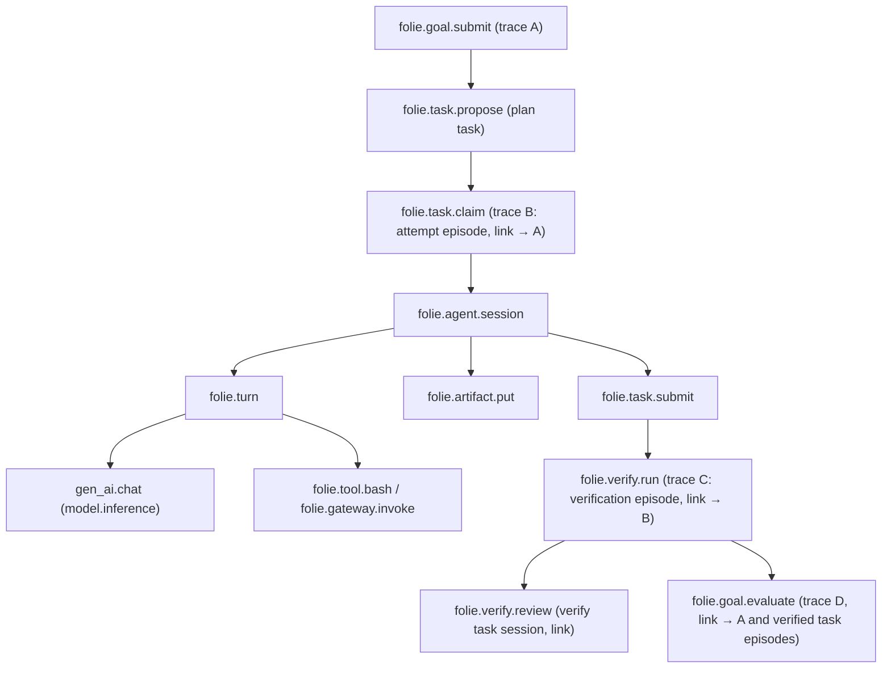

# OpenTelemetry and clients

Status: **target architecture**; today's tracing, metrics, logs, OTLP gateway and TUI are in [`current-system.md`](current-system.md#observability) and are the base this builds on. Authority: [`../DESIGN.md`](../DESIGN.md) §17, §18. Names are normative for new work; existing names are listed where they change.

## OpenTelemetry

**Role.** OTel is the _observability layer_: it explains and correlates. Postgres, the event ledger and `session_events` are the record (Invariant 8). A dropped span loses a picture, never a fact. Consequences that are rules: no state is derived from telemetry; every id a trace needs is stored on rows (trace context columns exist on messages and work items today and extend to tasks, claims, invocations, verification jobs, ledger events); sampling and export failures never affect behaviour.

### Correlation identifiers

Attributes on spans, and on log lines where applicable. Metrics use a restricted subset ([cardinality](#metrics)).

| Concept                      | Attribute                                                                                                                                                                                                     | Notes                                                                                                                                                                          |
| ---------------------------- | ------------------------------------------------------------------------------------------------------------------------------------------------------------------------------------------------------------- | ------------------------------------------------------------------------------------------------------------------------------------------------------------------------------ |
| Swarm                        | `folie.swarm.id`                                                                                                                                                                                              |                                                                                                                                                                                |
| Goal                         | `folie.goal.id`, `folie.goal.revision`                                                                                                                                                                        |                                                                                                                                                                                |
| Task                         | `folie.task.id`, `folie.task.attempt`, `folie.task.fence`, `folie.task.kind`                                                                                                                                  | fence on claim-scoped spans: a stale writer is visible in the trace                                                                                                            |
| Agent                        | `folie.agent.name`                                                                                                                                                                                            | today `agent_name`; dual-written for one release                                                                                                                               |
| Session                      | `folie.session.id`, `folie.session.scope`, `folie.session.kind` (`work` `plan` `verify` `triage` `team` `consolidation`)                                                                                      | `session.id` exists as `session.id` today                                                                                                                                      |
| Execution                    | `folie.execution.id`, `folie.execution.epoch`, `folie.provider`                                                                                                                                               |                                                                                                                                                                                |
| Harness                      | `folie.harness.id`, `folie.harness.version`                                                                                                                                                                   |                                                                                                                                                                                |
| Model request                | `gen_ai.*` per the OTel GenAI semantic conventions (operation, provider, request/response model, `gen_ai.usage.input_tokens`, `gen_ai.usage.output_tokens`) plus `folie.llm.cost_usd`, `folie.llm.cost_basis` | Today `llm.usage.*`; migrate when the conventions are stable enough ([OQ8](../decisions/README.md#open-architectural-questions)); both names are written during the transition |
| Tool invocation              | `folie.tool.name`, `folie.tool.version`, `folie.tool.risk`, `folie.invocation.id`, `folie.tool.replayable`                                                                                                    |                                                                                                                                                                                |
| Artifact                     | `folie.artifact.id`, `folie.artifact.sha256`                                                                                                                                                                  |                                                                                                                                                                                |
| Team, verification, approval | `folie.team.id`, `folie.verification.id`, `folie.approval.id`                                                                                                                                                 |                                                                                                                                                                                |
| Work item (today)            | `work_item_id`                                                                                                                                                                                                | maps to task; dual-written until the migration completes                                                                                                                       |

### Trace structure: episodes linked, not one trace per goal

A goal runs for hours to weeks, across suspends and process boundaries. A single trace for that is unbounded, unreadable and unexportable. Rule: **no span stays open across a suspend or longer than one bounded piece of work; the long causal chain is carried by links and by trace context stored on rows.** The existing design already does this (a trace root on the work item, context on messages); it generalises:

Episode roots: goal submission, goal revision, each task attempt (claim to settlement), each verification run, each wake, each goal evaluation, each approval decision, each team formation. Each stores its context on the rows it creates and **links** to the episode that caused it. The vision's example chain `goal.submit → goal.plan → task.propose → task.claim → agent.invoke → model.inference → tool.execute → artifact.create → task.verify → goal.evaluate` appears as that chain of linked episodes; in a UI that follows links it reads as one story, in the backend it is bounded traces.

### Span catalogue

Existing spans ([observability today](current-system.md#observability)) are kept: `folie.http.request`, `folie.dispatch`, `folie.controller.wake`, `folie.sandbox.init`, `folie.agent.session`, `folie.turn`, `folie.tool.<name>`, `folie.report.settle`, `folie.message.send`, `folie.topic.publish`; `folie.work_item.submit` is renamed `folie.goal.submit` when goals land. New:

| Span                                                                                             | Made by           | Parent / link                                                       | Key attributes                                             |
| ------------------------------------------------------------------------------------------------ | ----------------- | ------------------------------------------------------------------- | ---------------------------------------------------------- |
| `folie.goal.submit`, `.revise`, `.evaluate`, `.pause`                                            | server            | caller; link to prior episode                                       | goal, revision, verdict                                    |
| `folie.task.propose`, `.accept`, `.claim`, `.submit`, `.release`, `.revoke`                      | server            | caller span (an agent's tool call); `claim` links to the nomination | task, fence, attempt, source, `folie.conflict` (lost race) |
| `folie.task.nominate`                                                                            | server            | the `available` transition                                          | round, K, candidates                                       |
| `folie.lease.sweep`                                                                              | leader            | root                                                                | expired count                                              |
| `folie.negotiate.offer`, `.bid`, `.handoff`                                                      | server            | caller                                                              | offer id, ttl, outcome                                     |
| `folie.team.form`, `.join`, `.dissolve`                                                          | server            | caller                                                              | team, members                                              |
| `folie.verify.run`, `folie.verify.check`, `folie.verify.review`                                  | server / verifier | task submit; verify task session                                    | kind, adapter, result, confidence, independence            |
| `folie.gateway.invoke`, `folie.policy.evaluate`, `folie.budget.reserve`, `folie.approval.decide` | server            | caller                                                              | risk, effect, rule, policy version, headroom               |
| `folie.execution.ensure`, `.start`, `.suspend`, `.terminate`, `folie.reconcile.pass`             | server            | wake or reconciler                                                  | provider, phase                                            |
| `folie.context.assemble`                                                                         | server/shim       | session                                                             | items, tokens, dropped                                     |
| `folie.memory.query`, `.write`                                                                   | server            | session                                                             | scope, hits                                                |

Rule for waits that outlast a span: **record a span event at request time and open a new linked span at the decision** (an approval requested Monday and decided Tuesday is two spans and a link, never one span open for a day).

### Propagation across boundaries

| Boundary                                                          | Carrier                                                                                                   | Status                           |
| ----------------------------------------------------------------- | --------------------------------------------------------------------------------------------------------- | -------------------------------- |
| client → server, agent → server                                   | `traceparent`/`tracestate` HTTP headers                                                                   | today                            |
| server → ax, Substrate                                            | gRPC metadata                                                                                             | today                            |
| message / delivery                                                | `traceparent`, `tracestate` columns                                                                       | today; extends to `publications` |
| task, claim, verification job, invocation, approval, ledger event | the same two columns, written in the creating transaction                                                 | new                              |
| wake → session                                                    | unread deliveries re-traced to `sandbox.init`; the session is its child                                   | today                            |
| server → agent shim                                               | the `control` response and `task_assigned` delivery carry the context                                     | new                              |
| shim → harness                                                    | in-process: active context; out-of-process harness: `traceparent` in the JSON-RPC `start` request and env | new                              |
| gateway → tool provider                                           | `InvocationContext.trace` → HTTP header / JSON-RPC field                                                  | new                              |
| ledger → SSE → clients and extensions                             | `traceparent` on every event frame                                                                        | new                              |

Sandboxes still send telemetry only through folie-server's OTLP gateway (Decision 15); that does not change.

### Metrics

Low-cardinality by rule. **Allowed labels**: `agent_name` (bounded by fleet size), `capability`, `tool.name`, `outcome`, `risk_class`, `verification.kind`, `session.kind`, `reason`, `provider`, `dim`. **Forbidden as labels**: `task_id`, `goal_id`, `session_id`, message ids (use traces and exemplars to jump from a metric to an episode). Each metric method is added to the `Metrics` port deliberately.

| Metric                                                                                          | Type             | Answers                                                                                                                                                 |
| ----------------------------------------------------------------------------------------------- | ---------------- | ------------------------------------------------------------------------------------------------------------------------------------------------------- |
| `folie.goal.outcome{outcome}`                                                                   | counter          | goal completion rate: `achieved / (achieved + failed + cancelled)`                                                                                      |
| `folie.task.transition{from,to}`                                                                | counter          | flow, retry and failure rates                                                                                                                           |
| `folie.task.verified` / `folie.task.failed{reason}`                                             | counter          | **verified task completion rate**, the primary success metric (not reported completion)                                                                 |
| `folie.task.claim.latency`                                                                      | histogram        | time `available → claimed` (discovery effectiveness)                                                                                                    |
| `folie.task.time_to_verified`                                                                   | histogram        | time `accepted → verified`                                                                                                                              |
| `folie.agent.utilization`                                                                       | gauge            | fraction of alive time in a running session                                                                                                             |
| `folie.message.delivery.latency`, `folie.inbox.latency` (today), `folie.inbox.depth` (today)    | histogram, gauge | message delivery latency (create → leased); latency to ack                                                                                              |
| `folie.coordination.overhead`                                                                   | derived          | cost and tokens in sessions of kind `plan`, `triage`, `team`, `verify` over total, from `folie.llm.cost{session.kind}`; plus messages per verified task |
| `folie.llm.tokens`, `folie.llm.cost{cost_basis}` (today, `type` and `agent_name`)               | counter          | model cost, by basis                                                                                                                                    |
| `folie.tool.calls`, `folie.tool.failures` (today); `folie.gateway.invocation{risk_class,state}` | counter          | tool cost and failure; external effects                                                                                                                 |
| `folie.task.retry{reason}`                                                                      | counter          | retry rate by cause (lease expiry, environment, verification)                                                                                           |
| `folie.verification.result{verification.kind,result}`                                           | counter          | **verification rejection rate**; `errored` separately                                                                                                   |
| `folie.verification.false_accept{verification.kind}`                                            | counter          | canary and audit-sample misses ([protocols §8](../spec/protocols.md#8-verification))                                                                    |
| `folie.recovery.time{kind}` (`lease`, `execution`, `session`)                                   | histogram        | **time to recover**: detection of loss to the work resuming under a new holder                                                                          |
| `folie.budget.utilization{dim}`, `folie.budget.exhausted{dim}`, `folie.budget.overrun{dim}`     | gauge, counters  | consumption and enforcement quality                                                                                                                     |
| `folie.policy.decision{effect,risk_class}`, `folie.policy.attempt_denied{action}`               | counter          | policy violations and unauthorized attempts                                                                                                             |
| `folie.proposal{outcome}` (`accepted`, `duplicate`, `rejected`, `quota`)                        | counter          | duplicate-work and runaway pressure                                                                                                                     |
| `folie.stall.detected{kind}`                                                                    | counter          | no-progress detections                                                                                                                                  |
| `folie.execution.state{state}`, `folie.execution.lost`, `folie.publication.undelivered`         | gauge, counters  | infrastructure health                                                                                                                                   |
| `folie.session.outcome` (today)                                                                 | counter          | session settlement by outcome                                                                                                                           |

Metrics remain **derived by folie-server** from state transitions and reports/events (agents export none), counted once per stored row so resends do not double-count (today's rule).

### Logs

One JSON object per line, as today (`ts`, `level`, `msg`, `agent_name`, `session_id`, `trace_id`, `span_id`), plus `goal_id`, `task_id`, `execution_id` where known. Logs correlate by `trace_id` and the ids above; in the sandbox each line also becomes a transcript `log` event so it leaves over HTTP.

### Sampling, export, and the collector

Development: always on. Production: tail-based sampling in the collector that always keeps traces containing errors, policy denials, verification failures, `lost` executions, stale-fence conflicts and slow episodes, and samples the rest. `folie up` deploys an OpenTelemetry Collector (today spans are dropped unless `OTEL_EXPORTER_OTLP_ENDPOINT` is set) with a local exporter by default and a configurable OTLP upstream; this is required (R-15.5 applies to spans; the collector is part of the deployment).

### Using telemetry to analyse coordination

Span events and the attributes above support questions the evaluation asks without extra instrumentation: time from `available` to first claim by nomination round; wasted work (attempts ending `lease_expired` or `stale_fence`); negotiation duration; verify tasks per verified task; how often a lost race (`folie.conflict`) occurs. **These are diagnostics; the evaluation's numbers come from the ledger and the database**, so a sampling gap cannot change a result ([`../DESIGN.md` §23](../DESIGN.md#23-testing-and-evaluation)).

## Clients: TUI first, API always

**Principles.** The TUI is a client of the same HTTP API and SSE stream that the CLI and a future web client use. It holds no business logic: state and transitions are pure view-models under Node tests, one file touches OpenTUI (today's structure: `src/tui/model.ts`, `commands.ts`, `poller.ts`, `app.ts`), and it does not depend on any harness (it renders neutral session events and the harness descriptor as metadata).

**Live updates.** The TUI loads a snapshot by query, then applies `GET /v1/stream` frames (resumable by `Last-Event-ID`, [interfaces §9](../spec/interfaces.md#9-http-api-additions-v1)); on `resync` it re-queries. Polling (today's 1 s poller) remains as the fallback and for clients that cannot hold a stream. Views subscribe to filtered streams (a goal, an agent), so the dashboard's cost does not grow with the whole swarm.

**Authentication.** An operator API key from `~/.folie/credentials` ([protocols §1](../spec/protocols.md#1-authentication-and-the-request-envelope)); roles gate destructive commands, and the TUI keeps today's rule that delete is command-only.

**Views** (all backed by documented API routes; all are required by R-15.6):

| View                                        | Shows                                                                                                                                                                        | Actions                                                                                         | State                              |
| ------------------------------------------- | ---------------------------------------------------------------------------------------------------------------------------------------------------------------------------- | ----------------------------------------------------------------------------------------------- | ---------------------------------- |
| ● **Fleet** (today's grid, extended)        | agents: status, execution state, harness and model, current goal and task, session state, spend, last activity, alerts                                                       | suspend, resume, pause, retire, credentials rotate, message                                     | exists; needs extension            |
| ● **Goals**                                 | goals with status, progress (verified / total tasks), spend vs budget, blockers, stall flags, acceptance criteria and their verification status, artifacts, revision history | submit, revise, pause, resume, cancel, request evaluation, approve                              | new                                |
| ● **Tasks**                                 | the goal's graph (list and dependency view), status, owner and fence, lease remaining, attempts, participants, verification checks, history                                  | propose, accept, reject, offer, revoke, take over, cancel, supersede, edit plan (`plan.change`) | new                                |
| ● **Comms** (today's stream, inbox, topics) | direct, topic, goal, task and team channels; per-agent inbox with delivery state and priority                                                                                | send, urgent, publish, subscribe                                                                | exists; needs extension            |
| ● **Execution inspector**                   | selected agent's executions, sessions and transcript (turns, tool calls, steers, logs), harness details, usage, checkpoints, trace id (copyable)                             | cancel session, steer, open trace                                                               | new (transcript view absent today) |
| ● **Approvals**                             | pending approvals (goal activation, final acceptance, human checks; tool approvals), what exactly is being approved (args, diff, risk class), requester, deadline            | approve, reject, delegate                                                                       | new                                |
| ○ **Policy**                                | policies, grants, budgets, revocations, audit history, trust profiles                                                                                                        | edit (admin), revoke                                                                            | new                                |
| ○ **Teams and capabilities**                | teams, members, notes; agent capability levels and evidence                                                                                                                  | dissolve, assess, revoke                                                                        | new                                |
| ○ **Coordination analysis**                 | claim latency, negotiation, overhead, mechanism switches                                                                                                                     | toggle experiments                                                                              | new                                |

**Human interaction flows** (required, R-15.6): submit a goal with acceptance criteria and a budget → watch the graph form → read a session transcript when something looks wrong → intervene (message, pause, revoke a claim, take a task over) → approve the final acceptance. Every flow is also a `folie …` CLI command and an API call, so scripts and future clients get parity without a second implementation.

**Constraints carried over from today.** OpenTUI is 0.x and Bun-only ([`current-system.md`](current-system.md#folie-cli-and-tui)); the pure-model structure is what keeps a renderer swap cheap. `@opentui/ssh` for remote operators and mouse selection stay deferred.

## Requirements

Required: R-15.1–15.7 (correlation attributes, bounded episodes and links, propagation, the metric set, telemetry not authoritative, the TUI as a client with the intervention flows, evaluation from the ledger), R-12.9 (measured stop latencies in the TUI).

Not required: the GenAI semantic-convention migration beyond dual-writing, tail-sampling configuration beyond a default, a web client, a remote TUI.

## Tests

Trace tests extend `test/e2e.test.ts` (in-memory exporter): one goal produces linked episodes with the expected parent/link edges; a stale-fence rejection carries the fence attribute; context survives suspend (stored on rows, read back); no span outlives its bounded work. Metrics tests count once per stored row. TUI view-models stay Node-tested; one Bun test per new view drives OpenTUI's in-memory renderer; an SSE test checks resume by `Last-Event-ID` and `resync`.
