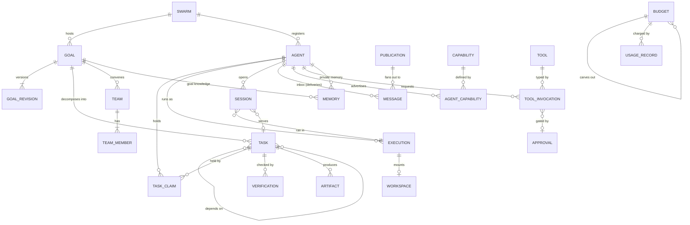
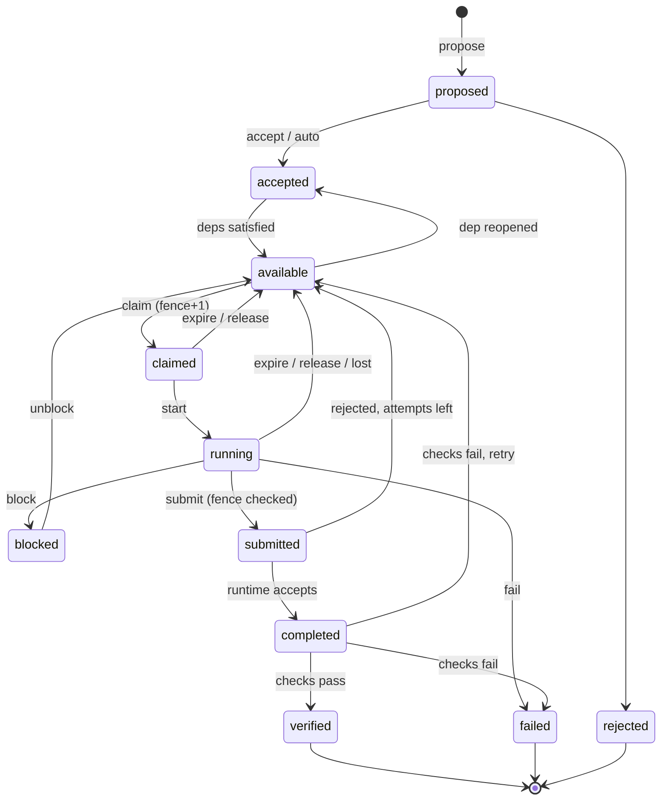

# Domain model and durable state

> **Historical target specification:** This page records the previous design and is retained for migration context. Its state model and references are not current mandates. See the [architecture reset proposal](../docs/architecture/README.md) and [as-built snapshot](../architecture/current-system.md).

Historical status: target specification for the previous design.

## 1. Conventions

- **Postgres, one authoritative writer** (folie-server), unchanged. Current state lives in relational tables. History and decisions live in an append-only **event ledger** written in the same transaction as the state change ([ADR 0004](../decisions/0004-event-ledger-scope.md)). The ledger is not an event-sourcing store: no table is rebuilt from it on a normal read.
- **Time**: every comparison against `now()` runs in the database. No lease, expiry or budget decision uses a client or server-process clock.
- **Ids**: integer identity columns, as today. Agents keep their DNS-1123 `name` as key (it is the address `<atespace>/<name>`). Every aggregate root carries `swarm_id` (`1`; multi-swarm is excluded); this costs a column now and avoids rewriting every table later. No isolation between swarms is claimed (multi-swarm is excluded).
- **Principals** are written `kind:id` in `actor` columns and the ledger: `agent:lead`, `human:saury`, `system:scheduler`, `ext:github`. The server derives the principal from the credential, never from the request body ([`protocols.md` §1](protocols.md#1-authentication-and-the-request-envelope)).
- **JSONB vs columns**: a field is a column if the runtime filters, joins, constrains or indexes it. It is JSONB if the runtime only stores and returns it (domain-specific goal metadata, task instructions, tool arguments, verifier evidence). The runtime interprets _structure_ (status, deps, budgets, contracts) and never the _meaning_ of a goal ([Decision 10](../architecture/current-system.md#decisions-at-a-glance) is kept).
- **Immutability**: ledger rows, `session_events`, `messages` bodies, `artifacts` content and `goal_revisions` are never updated. Corrections are new rows.
- **Migrations** stay additive `ALTER`s under the advisory lock, as today. Renames and splits are done as add, backfill, switch readers, drop in later releases.

## 2. Entity overview



## 3. Aggregates, ownership and consistency

An aggregate is the set of rows one transaction may change together. Cross-aggregate effects go through the ledger and the inbox (an inbox row written in the transaction is the outbox).

| Aggregate (root)                | Contains                                                                                                 | Owner module | Invariants the transaction enforces                                                                                                                                                 |
| ------------------------------- | -------------------------------------------------------------------------------------------------------- | ------------ | ----------------------------------------------------------------------------------------------------------------------------------------------------------------------------------- |
| **Agent**                       | agent row, credential generation, capability assignments, grants                                         | agents       | Name unique and immutable; `credential_generation` only increases; a retired agent holds no active claim and no live execution.                                                     |
| **Execution**                   | execution row, workspace row                                                                             | execution    | At most one non-terminal execution per agent. `epoch` increases monotonically per agent.                                                                                            |
| **Session**                     | session row (`session_events` are append-only children, delivered in batches)                            | runtime      | One `running` session per agent. A session belongs to exactly one execution and at most one task scope.                                                                             |
| **Goal**                        | goal, revisions, evaluations                                                                             | goals        | Exactly one current revision. Terminal goals are immutable except by `supersede`. Status moves only along the table in §4.1.                                                        |
| **Task**                        | task row, dependency edges _into_ it, claims (owner, contributor, reviewer, verifier), verification rows | tasks        | At most one active owner claim (unique partial index). `fence` only increases. Status moves only along §4.2. `open_deps` equals the count of unsatisfied hard edges. Acyclic edges. |
| **Team**                        | team, members                                                                                            | coordination | Scope is one goal or one task; dissolved teams hold no active member.                                                                                                               |
| **Budget tree** (per dimension) | budget rows, reservations                                                                                | resources    | A child's limit is carved from its parent's unreserved headroom in one statement; `limit >= 0`; reservation holds never exceed headroom at reserve time.                            |
| **Message flow**                | publication, deliveries, subscriptions                                                                   | messaging    | A delivery has exactly one recipient. A publication row exists even with zero subscribers.                                                                                          |
| **Memory entry**                | memory row, links                                                                                        | memory       | Entries are immutable; status changes are new link rows or a `superseded_by` update on a single column.                                                                             |
| **Tool invocation**             | invocation, approval, reconciliation record                                                              | gateway      | Journal row written before dispatch. At most one dispatch per `(idempotency_key)`.                                                                                                  |
| **Policy set**                  | policies, grants (versioned, read-mostly)                                                                | policy       | Evaluated against a single committed version; cached by version number.                                                                                                             |
| **Event ledger**                | events                                                                                                   | ledger       | Append-only; written only in the transaction that changed the subject.                                                                                                              |

**Does not need a table of its own.** Topics are names with a retention rule, not entities, until a reason appears; the `publications` table records them. Reputation is a _view_ over verification results, not a stored score. A "plan" is the task graph of a goal, not an entity. Roles inside a team are labels on `team_members`, not a hierarchy.

**Eventually consistent, by design** (never in a correctness path): OTel export, TUI/SSE projections, extension subscribers, memory indexing, verification jobs (their _result_ is committed transactionally), digest messages.

## 4. State machines

Actors: **holder** (the agent with the active owner claim), **agent** (any authenticated agent permitted by grant), **owner** (goal owner: a human or an agent the human named), **runtime** (folie-server code, deterministic, including policy), **verifier** (a principal assigned a verification check), **human** (operator). A transition not listed is rejected with `409 invalid_transition`; every accepted transition writes one ledger event.

### 4.1 Goal

| From → To                             | Trigger                                                           | Actor                                             | Guard                                                                    | Effect                                                                                                                                                       |
| ------------------------------------- | ----------------------------------------------------------------- | ------------------------------------------------- | ------------------------------------------------------------------------ | ------------------------------------------------------------------------------------------------------------------------------------------------------------ |
| ∅ → `draft`                           | `goal.create`                                                     | human, or agent with `goal.create` grant          | valid revision 1; budget carve-out succeeds                              | `goal.created`                                                                                                                                               |
| `draft` → `pending_approval`          | `goal.submit`                                                     | creator                                           | policy says approval required                                            | approval row                                                                                                                                                 |
| `draft`/`pending_approval` → `active` | submit / approve                                                  | creator (if no approval required) / human         | acceptance criteria present _or_ `acceptance: "owner_judgment"` declared | scheduler starts considering the goal's tasks                                                                                                                |
| `active` → `paused`                   | `goal.pause`                                                      | human, owner, runtime (budget or stall policy)    | none                                                                     | claim of new tasks blocked (hold flag); holders get a `control: pause` message; leases keep renewing only while they stop cooperatively within `pause_grace` |
| `paused` → `active`                   | `goal.resume`                                                     | human, owner                                      | budget available                                                         | hold cleared; discovery re-notifies                                                                                                                          |
| `active` → `evaluating`               | `goal.request_evaluation`                                         | owner, agent with grant, runtime (frontier empty) | no `claimed`/`running` task blocks evaluation unless `force`             | creates goal-scope verification rows                                                                                                                         |
| `evaluating` → `achieved`             | all required checks pass (and human approval if `approval.final`) | runtime                                           | independence satisfied                                                   | `goal.achieved`; remaining open tasks cancelled; budget closed, unspent returns to parent                                                                    |
| `evaluating` → `active`               | checks failed or `inconclusive` with remaining budget             | runtime                                           | evaluation recorded                                                      | findings become input to new task proposals                                                                                                                  |
| `evaluating` → `failed`               | checks failed, budget or deadline exhausted                       | runtime, human                                    | —                                                                        | `goal.failed` with reason                                                                                                                                    |
| non-terminal → `cancelled`            | `goal.cancel`                                                     | human, owner (if grant)                           | —                                                                        | all non-terminal tasks cancelled, claims revoked                                                                                                             |
| non-terminal → `superseded`           | `goal.supersede`                                                  | human, owner                                      | new goal named                                                           | like cancel; links `superseded_by`                                                                                                                           |

`achieved`, `failed`, `cancelled`, `superseded` are terminal. **`achieved` is set only by the runtime after goal-level verification**, never by an agent's report ([§7](#7-completion-is-four-different-claims)).

**Revisions.** `goal.revise` appends a `goal_revisions` row (full replacement text and criteria, plus `reason`, `supersedes_revision`) and moves `current_revision`. A _material_ revision (acceptance criteria, constraints, exclusions, budget reduction, approval requirements) needs human approval if `goal.revision_policy = "material_needs_human"` (the default). On commit the runtime marks every non-terminal task created under an older revision `stale_revision = true` and messages its owner or proposer. The task is not cancelled automatically. Marked tasks cannot pass verification until the owner calls `task.confirm_revision` or the task is superseded ([`protocols.md` §9](protocols.md#9-revision-dependency-change-and-supersession)).

### 4.2 Task

Statuses: `proposed`, `rejected`, `accepted`, `available`, `claimed`, `running`, `blocked`, `submitted`, `completed`, `verified`, `failed`, `cancelled`, `superseded`.

| #   | From → To                            | Trigger                                                     | Actor                                                                         | Guard                                                                                                     | Effect                                                                                                                                                              |
| --- | ------------------------------------ | ----------------------------------------------------------- | ----------------------------------------------------------------------------- | --------------------------------------------------------------------------------------------------------- | ------------------------------------------------------------------------------------------------------------------------------------------------------------------- |
| T1  | ∅ → `proposed`                       | `task.propose`                                              | agent with `task.propose` on the goal; human                                  | goal `active`; proposer within quotas (rate, fan-out, depth, frontier WIP); dedup check; contract present | row, edges, `task.proposed`. If the goal's `acceptance_mode` admits it, T2 runs in the same transaction.                                                            |
| T2  | `proposed` → `accepted`              | `task.accept` or auto                                       | runtime (mode `auto` and within caps), owner, human                           | budget carve-out for the task succeeds                                                                    | `task.accepted`; `open_deps` computed                                                                                                                               |
| T3  | `proposed` → `rejected`              | reject, TTL, dedup collision                                | runtime, owner, human                                                         | reason required                                                                                           | terminal; proposer messaged                                                                                                                                         |
| T4  | `accepted` → `available`             | promotion                                                   | runtime only                                                                  | `open_deps = 0`, goal not on hold, budget reserved                                                        | `task.available`; discovery runs (targeted notification)                                                                                                            |
| T5  | `available` → `accepted`             | a hard dependency was reopened or superseded                | runtime                                                                       | `open_deps > 0` again                                                                                     | claims none (none can exist in `available`)                                                                                                                         |
| T6  | `available` → `claimed`              | `task.claim` / offer accepted / assignment                  | runtime, on request of the claimant                                           | eligibility (capability level, grants, budget, concurrency limit); single conditional `UPDATE` wins       | `fence + 1`, lease set, owner set, claim row, `task.claimed`                                                                                                        |
| T7  | `claimed` → `running`                | `task.start`                                                | holder (sent by the agent shim, not the model)                                | fence matches; within `start_grace`                                                                       | `task.started`                                                                                                                                                      |
| T8  | `claimed`/`running` → `available`    | `task.release`, lease expiry, `task.revoke`, execution lost | holder (release), runtime (sweeper, loss), human (revoke)                     | —                                                                                                         | claim ended with reason; `attempt + 1` if it had started; owner cleared (**`fence` unchanged until the next claim bumps it**); non-owner claims become `superseded` |
| T9  | `running` → `blocked`                | `task.block`                                                | holder                                                                        | `blocked_on` kind given: `dependency`, `human_input`, `external`, `resource`, `approval`                  | owner cleared, lease released; `blocked_on` recorded                                                                                                                |
| T10 | `blocked` → `available`              | blocker resolved                                            | runtime, owner, human                                                         | per `blocked_on` kind                                                                                     | `task.unblocked`; former owner gets an affinity hint                                                                                                                |
| T11 | `running` → `submitted`              | `task.submit`                                               | holder                                                                        | **fence matches**, result envelope present                                                                | claim `completed`; lease ends; `task.submitted`                                                                                                                     |
| T12 | `submitted` → `completed`            | acceptance                                                  | runtime                                                                       | structural checks (§7) pass                                                                               | `task.completed`; if the contract requires no verification, this is terminal                                                                                        |
| T13 | `submitted` → `available` / `failed` | acceptance fails                                            | runtime                                                                       | attempts remain / exhausted                                                                               | rejection reasons attached to the next attempt                                                                                                                      |
| T14 | `completed` → `verified`             | verification passed                                         | runtime                                                                       | every required check `passed`, independence satisfied                                                     | `task.verified`; dependents with `needs: verified` promoted                                                                                                         |
| T15 | `completed` → `available`            | verification failed, retry allowed                          | runtime                                                                       | `verification_rounds < max_verification_rounds`                                                           | findings attached; `attempt + 1`                                                                                                                                    |
| T16 | `completed` → `failed`               | verification failed, no retry                               | runtime                                                                       | policy `on_fail: fail` or rounds exhausted                                                                | `task.failed`                                                                                                                                                       |
| T17 | `running` → `failed`                 | `task.fail`                                                 | holder (classification given), runtime (attempts exhausted, budget exhausted) | classification in `retryable \| non_retryable \| policy \| budget \| environment`                         | retryable and attempts remain → T8 instead                                                                                                                          |
| T18 | non-terminal → `cancelled`           | `task.cancel`, goal cancel, budget exhausted                | human, owner, runtime                                                         | —                                                                                                         | claims revoked with fence bump; participants and holder get `control: cancel`                                                                                       |
| T19 | non-terminal → `superseded`          | `task.supersede`                                            | owner, human, runtime (on goal revision)                                      | `superseded_by` list (may be empty: "obsolete")                                                           | like T18; dependents re-evaluated                                                                                                                                   |
| T20 | `failed` → `available`               | `task.reopen`                                               | human only                                                                    | attempts reset                                                                                            | `task.reopened`                                                                                                                                                     |

Terminal: `rejected`, `verified`, `failed`, `cancelled`, `superseded`, and `completed` **when the contract declares `verification.level = "none"`**. Dependency satisfaction is per edge: `needs: completed` is satisfied by `completed` or `verified`; `needs: verified` only by `verified`. The default for an edge is `verified` if the upstream contract requires verification, else `completed`.



`cancelled` and `superseded` (reachable from every non-terminal state) are omitted from the diagram for legibility.

### 4.3 Claim, participation

A **claim** row records one agent's hold on a task. `role` is `owner` (at most one active; the only role that can `submit`), `contributor`, `reviewer` (a participant in the work) or `verifier` (assigned to a verification check, never an owner or contributor of the same task).

`state`: `active` → `completed` (task submitted) | `released` (voluntary) | `expired` (lease lapsed) | `revoked` (human, policy, cancellation) | `superseded` (ownership transferred by `handoff` or `offer`). Every non-`active` end carries `end_reason`. A claim's `fence` is the task fence at grant. Non-owner claims record the _owner's_ fence at admission; when the owner changes, those claims become `superseded` and must be re-admitted by the new owner.

### 4.4 Agent, execution, workspace, session

| Entity              | States                                                                    | Notes                                                                                                                                                                                                                                                                                                     |
| ------------------- | ------------------------------------------------------------------------- | --------------------------------------------------------------------------------------------------------------------------------------------------------------------------------------------------------------------------------------------------------------------------------------------------------- |
| **Agent** (logical) | `active`, `paused`, `retired`                                             | `paused`: no claims, no wakes (operator or policy). `retired`: identity ended; name kept as a tombstone, never reused. Today's `agents.state` values (`pending`, `running`, `suspended`, `retired`) are **execution** states and move to `executions` ([§8](#8-migration-from-the-current-schema)).       |
| **Execution**       | `provisioning` → `running` ⇄ `suspended` → `terminated`; `failed`, `lost` | `lost`: the provider no longer reports the execution and Folie did not end it. `epoch` increments on each entry to `running`.                                                                                                                                                                             |
| **Workspace**       | `active` → `archived` → `destroyed`                                       | `archived` means bytes were copied to the artifact store. Destroy requires `archived` only when the agent's `workspace_policy` is `archive`; `scratch` (default) and `discard: true` destroy freely ([agents-and-execution](../architecture/agents-and-execution.md#workspace-and-checkpoint-lifecycle)). |
| **Session**         | `running` → `settled` \| `abandoned`                                      | `abandoned`: set by the runtime when the execution ended or a newer session began without a report. Written at session _start_ (today: only at report, D6).                                                                                                                                               |

### 4.5 Message delivery

A `messages` row is one **delivery** to one recipient. `publications` is the sender-side event (one per publish, including zero-subscriber publishes).

`pending` → `leased` (consumed into a session; `session_id` set) → `acked` (settled by that session's report). From `leased`, a dead session returns it to `pending` when the session is marked `abandoned`. `expired` (past `expires_at`, never consumed) and `dead_lettered` (consumed by more than `max_deliveries` abandoned sessions) are terminal and visible to operators. Today a delivery is just `acked_at IS NULL` or not; `leased` makes "consumed but unsettled" explicit.

### 4.6 Tool invocation and approval

Invocation: `requested` → `denied` | `pending_approval` | `authorized` → `dispatched` → `succeeded` | `failed` | `unknown`; `unknown` → `reconciled_succeeded` | `reconciled_absent` | `needs_human`. The journal row exists from `requested`. Approval: `pending` → `approved` \| `rejected` \| `expired` \| `cancelled`; `approved` → `consumed` (single use, bound to the task, tool and args hash).

### 4.7 Team

`forming` → `active` → `dissolving` → `dissolved`; `forming` → `dissolved` (not enough members before `form_by`). Details: [`protocols.md` §7](protocols.md#7-team-formation).

## 5. Logical schema (illustrative DDL)

Written to fix the shape and the constraints that carry the invariants. Column lists are not exhaustive. All tables carry `swarm_id`, omitted below.

```sql
-- Identity, separated from execution (replaces agents.state/wake_epoch semantics)
agents(name PK, status, profile jsonb, config jsonb,      -- config: harness, model, trust_profile, workspace_policy, limits
       credential_generation int NOT NULL DEFAULT 0,
       created_by, created_at, retired_at, last_active_at)
executions(id PK, agent REFERENCES agents, provider, provider_ref jsonb, state, epoch int,
           started_at, ended_at, end_reason, workspace_id)
CREATE UNIQUE INDEX one_live_execution ON executions(agent) WHERE state NOT IN ('terminated','failed','lost');

sessions(id PK text, agent, execution_id, epoch, harness_id, harness_version, model,
         scope text,                 -- 'task:<id>' | 'mail:<id>'  (today 'wi:<id>' | 'mail:<id>')
         task_id, state, started_at, ended_at, outcome, summary, usage jsonb,
         context_ref, traceparent, tracestate)
CREATE UNIQUE INDEX one_running_session ON sessions(agent) WHERE state = 'running';

-- Work
goals(id PK, title, status, priority, deadline, owner text, current_revision int,
      budget_id, hold bool NOT NULL DEFAULT false, acceptance_mode text, revision_policy text,
      metadata jsonb, created_by, traceparent, tracestate)
goal_revisions(goal_id, rev, description text, acceptance jsonb, constraints jsonb, exclusions jsonb,
               approval jsonb, refs jsonb, reason, supersedes_rev, created_by, created_at, PRIMARY KEY(goal_id, rev))

tasks(id PK, goal_id, goal_revision, parent_id, depth, kind,           -- work | verify | reconcile
      title, spec jsonb, contract jsonb,                                -- contract = verification (§7)
      status, status_reason, priority, required_capabilities jsonb, claim_mode,
      open_deps int NOT NULL DEFAULT 0, stale_revision bool NOT NULL DEFAULT false,
      owner text, fence bigint NOT NULL DEFAULT 0, lease_expires_at,
      attempt int NOT NULL DEFAULT 0, max_attempts int NOT NULL DEFAULT 3, verification_rounds int NOT NULL DEFAULT 0,
      blocked_on jsonb, budget_id, dedup_key, superseded_by bigint[],
      proposed_by, accepted_by, traceparent, tracestate)
CREATE UNIQUE INDEX tasks_dedup ON tasks(goal_id, dedup_key)
  WHERE dedup_key IS NOT NULL AND status NOT IN ('rejected','cancelled','superseded','failed');
CREATE INDEX tasks_available ON tasks(goal_id, priority DESC, id) WHERE status = 'available';
CREATE INDEX tasks_leases    ON tasks(lease_expires_at) WHERE status IN ('claimed','running');

task_dependencies(task_id, depends_on, kind,         -- hard | soft | informs
                  needs,                              -- completed | verified
                  satisfied bool NOT NULL DEFAULT false, PRIMARY KEY(task_id, depends_on))

task_claims(id PK, task_id, agent, role, source,     -- self | offer | assignment
            fence bigint, state, granted_at, lease_expires_at, last_heartbeat_at,
            progress jsonb, ended_at, end_reason)
CREATE UNIQUE INDEX one_active_owner ON task_claims(task_id) WHERE role = 'owner' AND state = 'active';

verifications(id PK, subject_kind,                   -- task | goal
              subject_id, attempt int, check_id, kind, required bool, state,
              verifier text,                          -- principal or adapter id
              independence jsonb, evidence jsonb, confidence numeric, started_at, finished_at)
goal_evaluations(id PK, goal_id, revision int, verdict, caveats jsonb, decided_by, created_at)

-- Coordination
publications(id PK, sender, channel text, kind, body, priority, expires_at, correlation_id, causation_id, delivered int, traceparent, tracestate)
messages(...existing columns...,                      -- one row per recipient (delivery)
         publication_id, kind text NOT NULL DEFAULT 'mail', priority smallint NOT NULL DEFAULT 1,
         expires_at, correlation_id, causation_id, channel, state, session_id, deliveries int NOT NULL DEFAULT 0)
teams(id PK, scope_kind, scope_id, purpose, convener, status, form_by, min_members, budget_id, channel, charter jsonb)
team_members(team_id, agent, label, responsibilities text, state, PRIMARY KEY(team_id, agent))

-- Capability, tools, policy
capabilities(id, version, description, requires jsonb, probe jsonb)
agent_capabilities(agent, capability, version, level,  -- declared | assessed | verified
                   evidence jsonb, assigned_by, revoked_at)
tools(id, version, kind,                              -- local | gateway
      input_schema jsonb, output_schema jsonb, risk_class, idempotency, replay, timeout_ms, provider, auth jsonb)
grants(id PK, principal text, action text, resource text, effect text, limits jsonb,
       delegated_from bigint, created_by, expires_at, revoked_at)
policies(id, version, scope, rules jsonb, status)
tool_invocations(id PK, tool, tool_version, agent, task_id, session_id, fence, idempotency_key UNIQUE,
                 args_hash, args jsonb, risk_class, state, decision jsonb, approval_id, result_ref, error,
                 reconcile jsonb, started_at, finished_at, traceparent, tracestate)
approvals(id PK, kind, subject jsonb, subject_hash, requested_by, approvers jsonb, state,
          decided_by, decided_at, expires_at)

-- Resources
budgets(id PK, parent_id, scope_kind, scope_id, dim,   -- usd | tokens | tool_calls | compute_s | storage_b | tasks | executions
        limit_amount numeric NOT NULL, reserved numeric NOT NULL DEFAULT 0, spent numeric NOT NULL DEFAULT 0,
        status, enforcement)                           -- E0 | E1 | E2
budget_reservations(id PK, budget_id, amount, state, ref)
usage_records(id PK, budget_id, agent, task_id, session_id, dim, amount, basis, -- estimated | measured | external_charge
              source, at)

-- Content
artifacts(id PK, goal_id, task_id, producer, session_id, name, media_type, sha256, bytes, store_ref,
          state, supersedes bigint, provenance jsonb, description, created_at)
memories(id PK, scope,                                  -- agent | team | goal | swarm
         scope_id, kind,                                -- semantic | episodic | procedural | claim | handoff
         content text, data jsonb, provenance jsonb, origin_goal_id, portable bool,
         status, confidence numeric, superseded_by, valid_from, valid_to, created_by, created_at)
memory_links(from_id, to_id, kind)                      -- contradicts | corroborates | supersedes | derived_from

-- One committed response per mutating API request; expired rows are deleted before key reuse.
idempotency_records(principal text, request_id text, response_status int, response_body jsonb,
                    created_at timestamptz DEFAULT now(), expires_at timestamptz,
                    PRIMARY KEY(principal, request_id))

-- Ledger
events(id bigint identity PK, at timestamptz DEFAULT now(), type text, aggregate text, aggregate_id text,
       actor text, payload jsonb, correlation_id text, causation_id bigint, traceparent text, tracestate text)
CREATE INDEX events_aggregate ON events(aggregate, aggregate_id, id);
```

**What the constraints carry.** The unique partial indexes are the concurrency guarantees: `one_active_owner` (two claimants cannot both win), `one_running_session`, `one_live_execution`, `tasks_dedup` (duplicate proposals collide at the database). `open_deps` and `satisfied` are maintained transactionally by the transition that changes the upstream task, and a periodic reconciler recomputes and alerts on drift.

## 6. Transactions and conflict handling

Each row is one transaction. "Conditional update" means a single `UPDATE ... WHERE <guard> RETURNING`; zero rows returned is the conflict result, never an exception to catch and retry blindly.

| Operation               | Writes in the transaction                                                                                                                       | Concurrency primitive                                                                                         | On conflict                                                                                  |
| ----------------------- | ----------------------------------------------------------------------------------------------------------------------------------------------- | ------------------------------------------------------------------------------------------------------------- | -------------------------------------------------------------------------------------------- |
| `task.claim`            | task (`status, owner, fence, lease`), `task_claims`, ledger, budget reservation (if per-claim), `task.claimed` notification to the goal channel | conditional update on `status = 'available' AND stale_revision = false`; partial unique index                 | `409 already_claimed` with the current owner; claimant must re-discover                      |
| `task.heartbeat`        | claim and task `lease_expires_at`, `progress`                                                                                                   | conditional update on `fence` and `owner`                                                                     | `409 stale_fence`; the shim stops the harness (`control: lease_lost`)                        |
| `task.submit`           | task status, claim state, artifacts rows, ledger, acceptance job row                                                                            | conditional update on `fence`, `owner`, `status IN ('claimed','running')`                                     | `409 stale_fence`; artifacts uploaded by the stale holder stay quarantined, never attached   |
| Accept result (T12)     | task status, ledger, verification rows (one per required check), dependent promotion (T4)                                                       | row lock on the task, then conditional updates on dependents                                                  | idempotent: already accepted → no-op                                                         |
| Verification pass (T14) | verification rows, task status, dependent promotion, ledger                                                                                     | same                                                                                                          | idempotent                                                                                   |
| Lease sweep             | tasks and claims where `lease_expires_at < now()`                                                                                               | `FOR UPDATE SKIP LOCKED` batches; leader-only ([deployment](../DESIGN.md#24-deployment-architecture))         | a concurrent heartbeat wins if it commits first (conditional on `lease_expires_at >= now()`) |
| `task.propose`          | task, edges (cycle-checked), budget carve-out, dedup index, ledger                                                                              | unique index on `dedup_key`; ancestor path locked `FOR UPDATE` in id order for the fan-out and depth counters | `409 duplicate` returning the existing task id; `422 quota_exceeded`                         |
| Budget carve-out        | child budget row, parent `reserved`                                                                                                             | `UPDATE parent SET reserved = reserved + $n WHERE limit_amount - reserved - spent >= $n`                      | `402 insufficient_budget`                                                                    |
| Usage commit            | `usage_records`, leaf budget `spent`, reservation state                                                                                         | one statement; overrun recorded, never rejected after the fact                                                | budget `exhausted`, `control: stop` queued                                                   |
| Publish                 | publication, deliveries (one insert-select), recipients' `last_active_at`                                                                       | unique `(sender, request_id, recipient)`                                                                      | duplicate request returns original copies                                                    |
| Approval decision       | approval, invocation `authorized`, ledger                                                                                                       | conditional update `state = 'pending'`                                                                        | `409 already_decided`                                                                        |
| `goal.revise`           | revision, goal pointer, task `stale_revision` flags, ledger, messages                                                                           | goal row lock                                                                                                 | `409` if `expected_revision` mismatches                                                      |

**Idempotency of the API itself.** Every mutating call accepts `request_id` (client-generated). The server claims `(principal, request_id)` and commits the state change, ledger event and response record in the same transaction. A concurrent duplicate blocks on the unique key; after the winner commits, it returns the stored status and body. A crash before commit leaves neither mutation nor key. Expired records are deleted before the key can be reused; retention is 24 h. Long-running tool effects use `tool_invocations.idempotency_key` and reconciliation instead of holding this transaction open.

**Isolation level.** `READ COMMITTED` plus conditional updates and unique indexes (as today). `SERIALIZABLE` is not required by any operation above and is avoided because it moves conflict handling into retry loops.

## 7. Completion is four different claims

| Claim                  | Where it lives                                         | Established by                                                 | Means                                                                                                                                                                                                                       |
| ---------------------- | ------------------------------------------------------ | -------------------------------------------------------------- | --------------------------------------------------------------------------------------------------------------------------------------------------------------------------------------------------------------------------- |
| **Agent-reported**     | `task.status = submitted`; `reports` row               | The holder, via `task.submit` with a valid fence               | "I believe this is done." Nothing more.                                                                                                                                                                                     |
| **Runtime-accepted**   | `task.status = completed`                              | The runtime, deterministically                                 | Fence was valid at commit; the result envelope is well-formed; declared outputs exist, are hashed, and are stored; no approval-gated effect is still pending; no input artifact is stale; the task is not `stale_revision`. |
| **Verified**           | `task.status = verified`; `verifications` all `passed` | The verification orchestrator with independent checks          | The contract's required checks passed with the required independence. Confidence is recorded per check.                                                                                                                     |
| **Goal-level success** | `goal.status = achieved`; `goal_evaluations`           | Goal-scope verification against the goal's acceptance criteria | The objective, not the task list, was met. All tasks verified does not imply this.                                                                                                                                          |

**Task contract** (`tasks.contract`; goals use the same shape in `goal_revisions.acceptance`):

```json
{
  "level": "composite", // none | deterministic | review | human | composite
  "outputs": [
    { "name": "report.md", "media_type": "text/markdown", "required": true },
    { "name": "claims.json", "schema_ref": "schemas/claims-v1" }
  ],
  "checks": [
    {
      "id": "c1",
      "kind": "deterministic",
      "adapter": "artifact.schema",
      "args": { "output": "claims.json" },
      "required": true
    },
    {
      "id": "c2",
      "kind": "deterministic",
      "adapter": "citations.resolve",
      "args": { "output": "report.md", "min_resolving": 0.95 },
      "required": true
    },
    {
      "id": "c3",
      "kind": "agent_review",
      "rubric": "Does each claim in claims.json follow from its cited source?",
      "independence": {
        "exclude_agents": ["$producer", "$participants"],
        "distinct_harness_from_producer": false
      },
      "quorum": { "n": 2, "pass": 2 },
      "required": true
    },
    {
      "id": "c4",
      "kind": "human",
      "when": "c3.confidence < 0.8",
      "required": false
    }
  ],
  "on_fail": "retry",
  "max_verification_rounds": 2,
  "needs_default": "verified"
}
```

A task whose goal policy sets a _floor_ (`verification_floor: "deterministic"`) cannot be accepted with a weaker contract. `level: none` is legal only if the floor allows it, and the task then terminates at `completed`, recorded and displayed as **unverified**, never as success.

## 8. Migration from the current schema

Each step is additive and independently shippable. "Today" is [`schema.ts`](../src/server/schema.ts).

| Today                                             | Target                                                             | Step                                                                                                                                                                                                                                                                                                                                                                                                            |
| ------------------------------------------------- | ------------------------------------------------------------------ | --------------------------------------------------------------------------------------------------------------------------------------------------------------------------------------------------------------------------------------------------------------------------------------------------------------------------------------------------------------------------------------------------------------- |
| `agents(name, state, wake_epoch, last_active_at)` | `agents(status, ...)` + `executions`                               | Add `executions`; backfill one row per agent from `state`/`wake_epoch`; controller writes both; readers switch; drop `state`/`wake_epoch` after one release. Existing agents become `status = 'active'` (`retired` execution state does not retire the identity).                                                                                                                                               |
| `work_items(id, goal, state, trace)`              | `goals` + root `tasks`                                             | Add tables. Each work item backfills one `goal` (status mapped: `queued`/`assigned` → `active`, `blocked` → `paused`, `done` → `achieved` _with `verification: none` recorded as unverified_, `failed` unreachable) and one root `task` (`done` → `completed`, `blocked` → `blocked`, `assigned` → `claimed`, `queued` → `available`). `messages.work_item_id` is kept and joined; `messages.task_id` is added. |
| scope `wi:<id>` / `mail:<id>`                     | `task:<id>` / `mail:<id>`                                          | `SCOPE` regex accepts both for one release; backfill is not needed (scope is a label on `session_events`).                                                                                                                                                                                                                                                                                                      |
| `sessions` + `reports` (written at report)        | `sessions` (written at start) + report folded into the session row | Add session columns; agent shim opens the session via API; `reports` rows stay as the historical record and `GET /v1/reports` is served from `sessions`.                                                                                                                                                                                                                                                        |
| `messages` (acked via report)                     | deliveries with `state`                                            | Add `state`, `kind`, `priority`, `expires_at`, `publication_id`, `session_id`; backfill `state` from `acked_at`.                                                                                                                                                                                                                                                                                                |
| `topic_subscriptions(topic, agent)`               | unchanged, plus `publications`                                     | New table only.                                                                                                                                                                                                                                                                                                                                                                                                 |
| `session_events`                                  | unchanged                                                          | Remains the high-volume transcript; the ledger references it, never copies it.                                                                                                                                                                                                                                                                                                                                  |
| (none)                                            | `events` ledger                                                    | New; every new transition writes it. Existing tables are not backfilled into it.                                                                                                                                                                                                                                                                                                                                |
