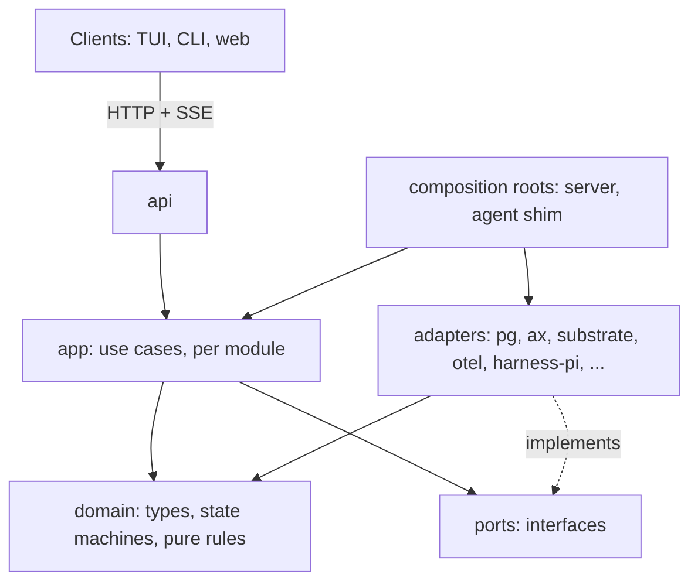

# Interfaces and contracts

Status: **target specification**; TypeScript is the notation because the code is TypeScript. Signatures show shape and responsibilities, not final spellings. Where an interface evolves something that exists, the existing file is named. State: [`domain-model.md`](domain-model.md). Behaviour: [`protocols.md`](protocols.md).

## 1. Layering and the dependency rule



| Layer                                                 | May import                                                                               | Must not import                                               |
| ----------------------------------------------------- | ---------------------------------------------------------------------------------------- | ------------------------------------------------------------- |
| `domain`                                              | itself                                                                                   | everything else: no Pi, AX, OpenTelemetry, Postgres, Node I/O |
| `ports`                                               | `domain`                                                                                 | adapters                                                      |
| `app`                                                 | `domain`, `ports`, the **`@opentelemetry/api`** package through the `Observability` port | adapters, SDKs                                                |
| `adapters`                                            | `domain`, `ports`, their vendor SDK                                                      | other adapters, `app`                                         |
| composition roots (`server/main.ts`, `agent/main.ts`) | all                                                                                      | —                                                             |

The OpenTelemetry **API** package is a vendor-neutral facade that is a no-op without an SDK; it is allowed in `app` (as today in `service.ts`) behind `Observability`, and forbidden in `domain`. The OTel **SDK** and exporters live in the `otel` adapter only. The rule is enforced by one test that fails on a forbidden import (a few lines over the `src/` tree; no new dependency).

**Mapping from today** (migration is file moves behind unchanged behaviour, one module at a time, never a big bang):

| Today                                          | Target layer                                                                                              |
| ---------------------------------------------- | --------------------------------------------------------------------------------------------------------- |
| `src/shared/types.ts`                          | `domain` (types), request DTOs to `api`                                                                   |
| `src/server/service.ts` (one 343-line class)   | `app`, split by module: `messaging`, `tasks`, `goals`, `sessions`, `verification`, `gateway`, `resources` |
| `src/server/store.ts`                          | `ports`                                                                                                   |
| `src/server/pg-store.ts`, `schema.ts`, `db.ts` | `adapters/pg`                                                                                             |
| `src/server/ax.ts`, `substrate.ts`, `grpc.ts`  | `adapters/ax` (one `ExecutionProvider`)                                                                   |
| `src/server/controller.ts`                     | `app/execution` (reconciler) using the provider port                                                      |
| `src/server/pool.ts`                           | `domain` (scoring)                                                                                        |
| `src/shared/telemetry.ts`, `trace.ts`          | port in `ports`, SDK in `adapters/otel`                                                                   |
| `src/agent/runtime.ts`                         | `ports/harness`                                                                                           |
| `src/agent/runtimes/pi.ts`                     | `adapters/harness-pi`                                                                                     |
| `src/agent/loop.ts`                            | agent shim (composition root + `app/shim`)                                                                |

## 2. Principals

```ts
type PrincipalKind = "agent" | "human" | "system" | "ext";
interface Principal {
  kind: PrincipalKind;
  id: string;
  swarmId: number;
  roles?: string[];
  executionId?: number;
  generation?: number;
}
```

Resolved from the bearer token only ([`protocols.md` §1](protocols.md#1-authentication-and-the-request-envelope)). Every `app` function takes a `Principal` as its first argument, never a name from a request body.

## 3. Persistence ports

`Store`/`Repos` ([`src/server/store.ts`](../src/server/store.ts)) is kept: ports are interfaces over repos, and `transaction(fn)` hands out repos bound to one unit of work. The target adds repos; each lists the operations whose atomicity matters.

```ts
interface Repos {
  messages: MessageRepo; // + publications, leases, expiry, channels
  agents: AgentRepo; // identity, credentials, capabilities, grants
  executions: ExecutionRepo; // one live per agent; epoch
  sessions: SessionRepo; // open at start; abandon; settle
  events: EventRepo; // session_events (transcript), unchanged
  goals: GoalRepo; // revisions, evaluations
  tasks: TaskRepo; // claim/heartbeat/submit are single conditional updates
  verifications: VerificationRepo;
  budgets: BudgetRepo; // carveOut, reserve, commit, close
  invocations: InvocationRepo; // write-ahead journal, approvals
  artifacts: ArtifactRepo;
  memories: MemoryRepo;
  ledger: LedgerRepo; // append only
  policy: PolicyRepo; // versioned snapshots
}
interface TaskRepo {
  claim(
    taskId: number,
    agent: string,
    leaseSec: number,
    source: ClaimSource,
  ): Promise<{ fence: number; leaseExpiresAt: string } | null>; // null: lost
  heartbeat(
    taskId: number,
    agent: string,
    fence: number,
    leaseSec: number,
    progress: Progress,
  ): Promise<string | null>;
  submit(taskId: number, agent: string, fence: number): Promise<boolean>;
  expireLeases(limit: number): Promise<ExpiredClaim[]>; // FOR UPDATE SKIP LOCKED
  promoteDependents(taskId: number): Promise<number[]>; // maintains open_deps
}
interface LedgerRepo {
  append(
    e: LedgerEntry,
  ): Promise<number>; /* only called inside the subject's transaction */
}
```

`null`/`false` are the conflict results; repos do not throw for expected conflicts. Repos never call each other: `app` composes them inside `store.transaction`.

## 4. Harness

The harness runs **inside the agent shim**, in the sandbox. It is the one interface that must not leak Pi: `Session`, `AgentTool`, `steer()` and `finishTurn` appear only in `adapters/harness-pi`. Evolves `Runtime.run(messages, session)` ([`src/agent/runtime.ts`](../src/agent/runtime.ts)), which is run-to-completion with no cancel (D10).

```ts
interface Harness {
  readonly descriptor: {
    id: string;
    version: string;
    capabilities: HarnessCapabilities;
  };
  start(input: SessionStart, host: HarnessHost): RunHandle; // returns at once
}

interface HarnessCapabilities {
  deliver: "none" | "turn_boundary" | "immediate"; // mid-run message delivery (Pi: turn_boundary via finishTurn)
  cancel: "none" | "cooperative" | "abortable"; // "none": the shim must kill the process
  usage: "session" | "turn"; // granularity of UsageDelta
  nativeTools: { name: string; replay: "safe" | "never" }[]; // tools the harness brings itself (Pi's coding tools)
  snapshot: boolean; // can export resumable in-process state (optional feature)
  mcpClient: boolean;
}

interface SessionStart {
  sessionId: string;
  agent: { name: string; profile: unknown };
  scope: string; // "task:<id>" | "mail:<id>"
  task?: TaskBrief;
  goal?: GoalBrief; // runtime-neutral, from the domain
  context: ContextPack; // assembled by the runtime ([agents-and-execution])
  inbox: InboundMessage[];
  attempts: ToolAttempt[]; // today's replay notice input
  model: { provider: string; id: string };
  limits: { deadline?: string; maxTurns?: number };
}

interface RunHandle {
  readonly result: Promise<SessionResult>; // { outcome: "done"|"failed"|"cancelled"|"yielded"; summary; usage }  (yielded: out of room, handoff note written, claim kept)
  deliver?(msgs: InboundMessage[], mode: "steer" | "followup"): void; // present iff capabilities.deliver != "none"
  cancel(reason: CancelReason, graceMs: number): void; // must not throw; best effort
  snapshot?(): Promise<Uint8Array>; // optional
}

interface HarnessHost {
  // what the platform gives the harness; implemented once, in the shim
  readonly signal: AbortSignal; // aborted on cancel; harnesses SHOULD honour it
  tools: {
    list(): ToolSpec[]; // JSON Schema specs (hosted tools: swarm ops, gateway tools)
    call(
      name: string,
      args: unknown,
      o: { callId: string; signal: AbortSignal },
    ): Promise<ToolResult>;
    observe(e: NativeToolEvent): void; // native tools report start/end here
  };
  emit(e: SessionEventInput): void; // structured transcript events
  usage(u: UsageDelta): void; // tokens, cost basis, model
  takeMail(): Promise<InboundMessage[]>; // pull-style, for harnesses without `deliver`
  log: StructuredLogger;
  tracer: Tracer;
}
```

**Universal** (every harness must provide): `start`, `result`, `cancel` (a harness with `cancel: "none"` is killed by the shim, which is acceptable but loses graceful settlement), events for session start and end and every tool call, usage at session granularity. **Conditional capability:** `usage: "turn"` is required for any session whose model-spend budget uses E1; a session-only harness may run only with E0 or E2 model-spend enforcement. `deliver` is optional; absent, the shim cancels the active session and starts another with urgent mail before continuing work. `snapshot` and native-tool replay declarations are optional; without replay declarations, native tools are treated `never`.

**Tool dispatch is hosted, not harness-specific.** The shim wraps every tool call (hosted _and_ native) in one pipeline: write-ahead journal (`tool_start`), span, replay policy, `task_id`/fence attachment, result redaction, `tool_end`. Today that is `instrument()` around Pi's `AgentTool`; moving it into `HarnessHost` means a new harness gets journaling, tracing and idempotency keys without reimplementing them. A harness adapts `host.tools.list()` to its own tool format.

**Out-of-process harnesses** (R-10.5) speak the same contract as JSON-RPC 2.0 over stdio (`start`, `cancel`, `deliver`, and server-to-harness requests for `tools.call`, `emit`, `usage`). The TypeScript interface is the contract's reference binding; there is no second semantics.

**Pi mapping.** `PiRuntime` becomes `PiHarness`: `start` builds an `Agent` (as now); `deliver` = `agent.steer` through `finishTurn` (`turn_boundary`); `cancel` = `agent.abort()` plus `host.signal` forwarded to tool `execute` signals (pi exposes `abort()` and per-run `signal`); usage from `message_end` (`turn`); `nativeTools` = pi's coding tools with the existing replay table. `echo` becomes the conformance harness: deterministic, no LLM, used by the harness contract tests (§12).

## 5. Execution provider

```ts
interface ExecutionProvider {
  readonly id: string; // "ax"
  readonly capabilities: {
    suspend: boolean;
    checkpoint: boolean;
    list: boolean;
    resourceLimits: boolean;
    network: "none" | "allowlist" | "full-trust-only";
    logs: boolean;
    inFlightCancel: boolean; // ax: inFlightCancel=false
  };
  ensure(spec: ExecutionSpec): Promise<ExecutionState>; // create if absent; idempotent by spec.key
  start(ref: ProviderRef): Promise<ExecutionState>; // first start or resume
  suspend(ref: ProviderRef): Promise<ExecutionState>; // checkpoints the workspace when supported
  terminate(ref: ProviderRef, o: { destroyWorkspace: boolean }): Promise<void>;
  inspect(ref: ProviderRef): Promise<ExecutionState | null>; // null: absent
  list(namespace: string): AsyncIterable<ExecutionState>; // for orphan/ghost detection
  setNetworkPolicy(ref: ProviderRef, p: NetworkPolicy): Promise<void>;
  logs?(ref: ProviderRef, o: LogOptions): AsyncIterable<LogLine>;
}
interface ExecutionSpec {
  key: string;
  namespace: string;
  image: string;
  command: string[];
  env: Record<string, string>;
  resources?: { cpu?: string; memoryMiB?: number; ephemeralMiB?: number };
  workspace?: { ref?: string; path?: string };
  network: NetworkPolicy;
  labels?: Record<string, string>;
}
type NetworkPolicy =
  | { profile: "full-trust" }
  | { profile: "allowlist"; allow: { hosts: string[]; ports: number[] }[] }
  | { profile: "deny-all" };
interface ExecutionState {
  ref: ProviderRef;
  phase:
    "provisioning" | "running" | "suspended" | "failed" | "absent" | "unknown";
  since: string;
  detail?: string;
}
```

**AX adapter mapping** (what the adapter owns, what Folie owns):

| Contract                  | AX/Substrate call                                        | Notes                                                                                                                                                                                |
| ------------------------- | -------------------------------------------------------- | ------------------------------------------------------------------------------------------------------------------------------------------------------------------------------------ |
| `ensure`                  | `CreateTask` (+ `CreateActorEgressPolicy` per `network`) | Sets `spec.resources` and `spec.workspace` (today unset, D8). Egress grant stays before `start` ([egress](../architecture/current-system.md#sandbox-egress-a-substrate-dependency)). |
| `start`                   | `ResumeTask`                                             |                                                                                                                                                                                      |
| `suspend`                 | `SuspendTask`                                            | Checkpoint of `/workspace` is the only checkpoint ax offers.                                                                                                                         |
| `terminate`               | `DeleteTask`                                             | Destroys `/workspace`; the reconciler gates it on `workspace.archived`.                                                                                                              |
| `inspect`                 | `GetTask`                                                | `NOT_FOUND` → `null`.                                                                                                                                                                |
| `list`                    | `ListTasks`                                              | **New use**; enables orphan and ghost detection.                                                                                                                                     |
| `setNetworkPolicy`        | Substrate `CreateActorEgressPolicy` / delete             | HTTP(S) only, hostname rules; `allowlist` is expressible, other TCP is not.                                                                                                          |
| TTL, timeouts, spend caps | none in ax                                               | **Folie's**: idle suspend, `max_execution_age`, session deadline and budgets are enforced by the reconciler and shim.                                                                |

The domain never sees `atespace`, `Task` or `actor`; they live in `ProviderRef` (opaque JSON). A second provider (local containers, another cluster, a VM) implements the same interface; `capabilities` tells the scheduler what it cannot promise (for example no suspend means the reconciler never plans around suspension).

## 6. Tools, verifiers, capabilities

```ts
type RiskClass =
  | "R0_read"
  | "R1_local_reversible"
  | "R2_external_read"
  | "R3_external_write_reversible"
  | "R4_commitment"
  | "R5_destructive"
  | "R6_production"
  | "R7_physical";

interface ToolDefinition {
  id: string;
  version: string; // semver; tasks and capabilities pin "id@^1"
  kind: "local" | "gateway"; // local: runs in the sandbox, not mediated; gateway: effect outside it
  description: string;
  inputSchema: JsonSchema;
  outputSchema: JsonSchema;
  risk: RiskClass;
  idempotency: "natural" | "key" | "none";
  replay: "safe" | "never"; // today's replay policy, unchanged
  timeoutMs: number;
  costModel?: { dim: string; estimate: string }; // estimate expression over args
  requiresAccount?: string; // account type; credential never leaves the gateway
  redact?: string[]; // JSON paths removed from results and transcripts
  sensitiveData?: boolean;
}

interface ToolProvider {
  readonly manifest: ExtensionManifest;
  list(): Promise<ToolDefinition[]>;
  invoke(
    call: { tool: string; args: unknown },
    ctx: InvocationContext,
  ): Promise<ToolOutcome>;
  reconcile?(
    inv: InvocationRecord,
    ctx: InvocationContext,
  ): Promise<"succeeded" | "absent" | "indeterminate">;
  cancel?(inv: InvocationRecord, ctx: InvocationContext): Promise<void>;
  compensate?(
    inv: InvocationRecord,
    ctx: InvocationContext,
  ): Promise<ToolOutcome>;
}
interface InvocationContext {
  invocationId: number;
  idempotencyKey: string;
  deadline: string;
  signal: AbortSignal;
  principal: Principal;
  taskId?: number;
  credential?: ScopedCredential;
  trace: { traceparent: string; tracestate?: string };
}
type ToolOutcome =
  | { ok: true; result: unknown; usage?: UsageDelta[] }
  | { ok: false; error: { code: string; message: string; retryable: boolean } };

interface VerifierAdapter {
  // deterministic checks: artifact.schema, citations.resolve, tests.run, proof.check, state.reconcile
  readonly id: string;
  readonly version: string;
  run(
    check: CheckSpec,
    subject: SubjectSnapshot,
    ctx: VerifierContext,
  ): Promise<{
    state: "passed" | "failed" | "errored";
    evidence: EvidenceRef[];
    confidence?: number;
  }>;
}
interface CapabilityDefinition {
  id: string;
  version: string;
  description: string;
  requires?: { tools?: string[]; grants?: string[] };
  probe?: ProbeSpec;
}
interface CapabilityProvider {
  definitions(): CapabilityDefinition[];
  probe?(
    agent: string,
    capabilityId: string,
  ): Promise<{ level: "assessed" | "failed"; evidence: EvidenceRef[] }>;
}
```

`VerifierAdapter` and `ToolProvider` are deliberately the same _shape of extension_ (a manifest plus a few typed methods); the registry treats them uniformly. Out-of-process providers use JSON-RPC 2.0 over HTTP: `provider.describe`, `tool.list`, `tool.invoke`, `tool.reconcile`, `tool.cancel`, `verifier.run`, `health`.

## 7. Policy, artifacts, memory

```ts
interface PolicyEngine {
  // pure over an immutable snapshot: trivially testable, in `domain`
  evaluate(req: AuthzRequest, snapshot: PolicySnapshot): Decision;
}
interface AuthzRequest {
  principal: Principal;
  chain: Principal[]; // delegation chain: who asked whom
  action: string;
  resource: { kind: string; id: string; goalId?: number; taskId?: number };
  risk?: RiskClass;
  sensitive?: boolean;
  context: {
    now: string;
    fenceValid?: boolean;
    budgetHeadroom?: number;
    trustProfile: string;
  };
}
type Decision =
  | { effect: "allow"; limits?: Limits }
  | { effect: "deny"; rule: string; reason: string }
  | {
      effect: "require_approval";
      rule: string;
      approvers: ApproverSpec;
      ttlSec: number;
    };
```

Evaluation order: **explicit deny > require_approval > allow**; the default is `deny` for gateway actions and `allow` for actions inside the sandbox under the `dev-full-trust` profile. Grants (positive, delegable downward, expiring, revocable) say who _may_; policies (constraints and obligations that apply regardless of grants) say what always holds. The snapshot has a monotonic `version`; every decision records it.

```ts
interface ArtifactStore {
  // Required adapter: content-addressed files on a PVC; S3-compatible is optional
  put(
    content: ReadableStream,
    meta: { sha256?: string; mediaType?: string },
  ): Promise<{ sha256: string; bytes: number; ref: string }>;
  get(ref: string): Promise<ReadableStream>;
  delete(ref: string): Promise<void>;
}
interface MemoryStore {
  // Required adapter: Postgres tables with full-text search; embeddings excluded
  write(e: NewMemory): Promise<number>; // immutable; links express contradicts/supersedes/corroborates
  query(
    q: {
      scope: MemoryScope;
      scopeId: string;
      text?: string;
      kinds?: MemoryKind[];
      portableOnly?: boolean;
      limit: number;
      tokenBudget?: number;
    },
    as: Principal,
  ): Promise<Memory[]>;
  link(from: number, to: number, kind: LinkKind): Promise<void>;
}
```

`MemoryStore.query` enforces access control itself (the `as` principal); there is no unfiltered read.

## 8. Extension manifest and lifecycle

The smallest stable contract for composability: **a manifest, a typed invocation protocol, a lifecycle, and isolation**. Nothing else is promised stable.

```json
{
  "id": "github",
  "version": "0.3.1",
  "folie_api": "^1.0",
  "kinds": ["tool", "verifier", "capability", "event_subscriber"],
  "endpoint": { "type": "http", "url": "http://github-ext.folie.svc:9000/rpc" },
  "permissions_requested": [
    { "action": "credential.use", "resource": "account:github/*" },
    { "action": "event.read", "resource": "goal:*" }
  ],
  "config_schema": {
    "type": "object",
    "properties": { "org": { "type": "string" } },
    "required": ["org"]
  },
  "provides": {
    "tools": ["github.pr.read@1", "github.pr.merge@1"],
    "capabilities": ["software.dev@1"],
    "verifiers": ["ci.status@1"]
  }
}
```

| Aspect                | Rule                                                                                                                                                                                                                                                                                    |
| --------------------- | --------------------------------------------------------------------------------------------------------------------------------------------------------------------------------------------------------------------------------------------------------------------------------------- |
| **Lifecycle**         | `registered` → `approved` (an admin reviews `permissions_requested`; the grants issued are recorded and are the extension's only authority) → `enabled` ⇄ `disabled` → `removed`. Upgrades re-enter `registered` if `permissions_requested` grew.                                       |
| **Compatibility**     | `folie_api` is a semver range against the API version; a mismatch refuses `enabled`. Tool and capability ids carry versions; breaking changes bump major and old versions keep working while pinned tasks exist.                                                                        |
| **Isolation**         | Third-party extensions are **out of process only**: no in-process loading, no database access, no sandbox access. First-party built-ins may be in-process in the server (trusted, tested with the server).                                                                              |
| **Failure isolation** | Per-extension timeout, concurrency limit, result size cap; circuit breaker (5 consecutive failures → open for 30 s; calls fail fast with `provider_unavailable`); an unhealthy provider's tools disappear from discovery and tasks needing them become unclaimable rather than failing. |
| **Event subscribers** | Consume the ledger by durable cursor (`event_subscriptions(name, filter, cursor)`), at-least-once, dedup by event id. They cannot veto or mutate; blocking behaviour belongs to the gateway or a verifier.                                                                              |
| **Configuration**     | Validated against `config_schema` at `enabled`; secrets go to the vault, not to config.                                                                                                                                                                                                 |
| **Not specified yet** | TUI/UI extensions, in-process third-party plugins, a marketplace ([`../DESIGN.md` §19](../DESIGN.md#19-extension-architecture)).                                                                                                                                                        |

## 9. HTTP API additions (v1)

JSON. Existing routes ([`current-system.md`](../architecture/current-system.md#http-api)) are unchanged except that identity comes from the token. `P` = principal kinds allowed (`A` agent, `H` human operator, `S` system). Mutations take `request_id`.

| Resource                | Routes                                                                                                                                                                                                                                                                                                                          | P                  |
| ----------------------- | ------------------------------------------------------------------------------------------------------------------------------------------------------------------------------------------------------------------------------------------------------------------------------------------------------------------------------- | ------------------ |
| Goals                   | `POST /v1/goals`; `GET /v1/goals[/:id]`; `POST /v1/goals/:id/{revise,pause,resume,cancel,supersede,request-evaluation}`; `GET /v1/goals/:id/{tasks,graph,evaluations,history}`                                                                                                                                                  | H, A (grant)       |
| Tasks                   | `POST /v1/tasks`; `GET /v1/tasks?goal&status&capability&claimable&age_gt`; `GET /v1/tasks/:id[/history]`; `POST /v1/tasks/:id/{accept,reject,claim,start,heartbeat,submit,block,release,fail,offer,request-help,bid,cancel,supersede,reopen,revoke,confirm-revision,add-dependency,remove-dependency}`; `POST /v1/plan-changes` | A, H               |
| Offers                  | `POST /v1/offers/:id/{accept,decline}`                                                                                                                                                                                                                                                                                          | A                  |
| Teams                   | `POST /v1/teams`; `POST /v1/teams/:id/{join,decline,activate,assign,digest,convene,dissolve}`; `GET /v1/teams[/:id]`                                                                                                                                                                                                            | A, H               |
| Messaging               | `POST /v1/messages`; `GET /v1/agents/me/control`; `GET /v1/channels/:c/history`; topics as today                                                                                                                                                                                                                                | A, H               |
| Sessions                | `POST /v1/sessions`; `POST /v1/sessions/:id/{settle,rescope}`; events as today                                                                                                                                                                                                                                                  | A                  |
| Executions              | `GET /v1/executions[/:id]`; `POST /v1/agents/:n/{suspend,resume,delete}` (operator)                                                                                                                                                                                                                                             | H, S               |
| Agents and capabilities | `POST /v1/agents`; `GET /v1/agents?capability&available`; `POST /v1/agents/:n/{pause,retire,rotate-credentials}`; `GET/POST /v1/capabilities`; `POST /v1/agents/:n/capabilities`                                                                                                                                                | H                  |
| Capacity                | `POST /v1/capacity-requests`                                                                                                                                                                                                                                                                                                    | A                  |
| Artifacts               | `POST /v1/artifacts` (streamed upload, `task` and `fence`); `GET /v1/artifacts/:id[/content]`                                                                                                                                                                                                                                   | A, H               |
| Memory                  | `POST /v1/memories`; `GET /v1/memories?scope&scopeId&text`; `POST /v1/memories/:id/links`                                                                                                                                                                                                                                       | A, H               |
| Gateway                 | `POST /v1/gateway/invoke`; `GET /v1/invocations[/:id]`                                                                                                                                                                                                                                                                          | A, H               |
| Approvals               | `GET /v1/approvals?state`; `POST /v1/approvals/:id/{approve,reject}`                                                                                                                                                                                                                                                            | H                  |
| Policy and grants       | `GET/PUT /v1/policies`; `GET/POST/DELETE /v1/grants`                                                                                                                                                                                                                                                                            | H                  |
| Budgets                 | `GET /v1/budgets?scope`; `POST /v1/budgets/:id/{raise,close}`; `POST /v1/usage` (shim usage events)                                                                                                                                                                                                                             | H, A               |
| Extensions and tools    | `GET /v1/tools`; `POST /v1/extensions`; `POST /v1/extensions/:id/{approve,enable,disable}`                                                                                                                                                                                                                                      | A (read), H        |
| Stream                  | `GET /v1/stream` (SSE, below); `GET /v1/events?after&type&aggregate` (cursor read)                                                                                                                                                                                                                                              | H, A (filtered), S |
| Ops                     | `POST /v1/swarm/{freeze,unfreeze}`; `GET /healthz`; `GET /v1/otlp/...`                                                                                                                                                                                                                                                          | H                  |

**SSE stream.** `GET /v1/stream?after=<event id>&types=task.*,goal.*&goal=<id>&agent=<name>`. Each frame is `id: <ledger id>`, `event: <type>`, `data: <json>`; comment frames every 15 s keep proxies open. `Last-Event-ID` resumes; delivery is at-least-once in ledger order per subject, clients dedup by id. If `after` precedes retention the server sends `event: resync` and the client re-reads state by query. Agent principals receive only events for subjects they may read. This is the same feed the TUI, extensions and a future web client consume; **no client has a private channel**.

## 10. The agent's tool surface

Every tool description costs context in every session ([Lessons from pi](../architecture/current-system.md#lessons-from-pi), item 7). The model-visible set is deliberately small, grouped by when it is needed; rare operations are reachable through the `folie` CLI in `bash` (its `--help` is read on demand), which is the same API.

| Group                                   | Tools                                                                                                                                                        | Replay                                           |
| --------------------------------------- | ------------------------------------------------------------------------------------------------------------------------------------------------------------ | ------------------------------------------------ |
| Messaging (today)                       | `message_send`, `topic_publish` (never); `topic_subscribe`, `topic_unsubscribe` (safe)                                                                       | as today                                         |
| Work                                    | `task_list`, `task_get` (safe); `task_claim`, `task_propose`, `task_submit`, `task_block`, `task_fail`, `task_offer` (never; idempotency key = `request_id`) | never                                            |
| Artifacts (evolves `artifact_register`) | `artifact_put(path, description)` uploads bytes to the artifact store and registers (safe: content-addressed)                                                | safe                                             |
| Memory                                  | `memory_write`, `memory_query`                                                                                                                               | write: safe (dedup by content hash); query: safe |
| Coordination (rare, CLI-first)          | team, help request, capacity request, `agent_find`, `goal_get`                                                                                               | never                                            |
| Session                                 | `report_submit` for `mail:` sessions (as today); in `task:` sessions `task_submit` is the settlement                                                         | safe                                             |
| Gateway tools                           | typed per tool, from `host.tools.list()`                                                                                                                     | per `ToolDefinition`                             |

Heartbeat, start, rescope and usage are **not tools**: the shim does them, because lease renewal and accounting must not depend on the model.

## 11. Observability port

```ts
interface Observability {
  tracer: Tracer;
  metrics: Metrics;
} // today's shape, kept
interface Metrics {
  // grows by named methods, never by arbitrary labels (cardinality is reviewed)
  sessionSettled(r: SessionMetric): void;
  toolEnded(e: ToolMetric): void;
  observeInboxDepth(read: () => Promise<DepthRow[]>): void;
  taskTransition(from: string, to: string, goalKind?: string): void;
  claimLatency(ms: number): void;
  verification(r: { kind: string; result: string }): void;
  budgetEvent(r: { dim: string; kind: string }): void;
  policyDecision(r: { effect: string; risk: string }): void;
}
```

Span and metric names: [`../architecture/observability-and-clients.md`](../architecture/observability-and-clients.md).

## 12. Conformance and contract tests

Each external-facing interface ships a shared test suite that every adapter must pass; this is how "replaceable infrastructure" is checked rather than asserted.

| Interface           | Suite                                                                                                   | Reference implementation                                                                       |
| ------------------- | ------------------------------------------------------------------------------------------------------- | ---------------------------------------------------------------------------------------------- |
| `Harness`           | start/cancel/deliver/usage/event ordering; cancel mid-tool; usage totals; replay notice                 | `echo` (conformance), `pi`                                                                     |
| `ExecutionProvider` | ensure idempotency; suspend/resume keeps workspace; terminate gating; list finds orphans; phase mapping | an in-memory fake (also used by every other test, replacing today's `FakeAx`), `ax` live smoke |
| `ToolProvider`      | schema validation, timeout, idempotency key honoured, reconcile on `unknown`                            | a fake HTTP provider                                                                           |
| `VerifierAdapter`   | deterministic result for fixed snapshot; `errored` vs `failed`                                          | built-ins                                                                                      |
| `Store` (`Repos`)   | the claim/fence/lease/budget race tests, run with multiple connections                                  | PGlite and real Postgres                                                                       |
